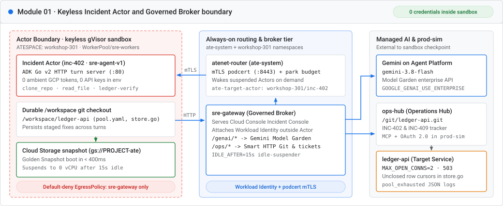

# Actor boundary and first triage turn (12 min)

In Module 00, you installed **Agent Substrate (`v1.0.0`)** and deployed the live degraded `prod-sim` incident environment (`ledger-api` + `ops-hub`). Now you cross the **Actor Boundary**: deploying the always-on **Governed Broker** (`sre-gateway`), warming a keyless **Incident Actor** (`sre-agent-v1`) backed by a **Golden Snapshot**, completing your first guided **ADK Go v2** code edit, and diagnosing `INC-402` inside `/workspace` before the actor auto-suspends to `0 vCPU` in Cloud Storage.



## Why the Actor Boundary matters

Production SRE agents need two things that appear to conflict:

1. **Stateful sandbox execution**: Investigating an incident requires cloning source repositories into `/workspace`, inspecting configs and ASTs, running diagnostic scripts, and staging git commits that survive across turns.
2. **Zero-credential governance**: Multiplexed gVisor sandboxes checkpoint their full memory and `/workspace` filesystem to Cloud Storage (`SNAPSHOT_FIDELITY_MEMORY`). Any bearer token, API key, or OAuth secret fetched inside the sandbox would be written into shared snapshot storage.

As documented in [ADR-0001](../../docs/adr/0001-keyless-actor-and-governed-broker-boundary.md), **Agent Substrate 301** separates those two concerns across the **Actor Boundary**:

- **Inside the Actor Boundary (`WorkerPool/sre-workers` + `sre-agent-v1`)**: Each incident (`inc-402`, `inc-409`) runs in its own isolated `ateworker-gvisor` sandbox listening on port `80` with **zero ambient credentials** and a default-deny `EgressPolicy` allowing outbound HTTP strictly to `sre-gateway.${NAMESPACE}.svc.cluster.local`.
- **Outside the Actor Boundary (`Deployment/sre-gateway`)**: The always-on **Governed Broker** (`100m` CPU / `128Mi` RAM) serves the Google Cloud Console-modeled **Incident Console**, dials `atenet-router` over mTLS (`podidentity.podcert.ate.dev/identity`), attaches Workload Identity on `/genai/` requests to **Gemini on Agent Platform** (`gemini-3.8-flash`), streams Smart HTTP git clones via `/ops/`, and suspends idle Incident Actors after `15s` (`IDLE_AFTER=15s`).

## Steps

1. **Load `workshop.env` and deploy `WorkerPool/sre-workers`.** Apply [`manifests/workerpool.yaml.tmpl`](manifests/workerpool.yaml.tmpl) to start two warm `ateworker-gvisor` pods (`250m` CPU / `1Gi` RAM request each) in `workshop-301` and create the `workshop-301` atespace:
   ```bash
   source scripts/env.sh
   scripts/render.sh modules/01-actor-boundary/manifests/workerpool.yaml.tmpl | kubectl apply -f -
   kubectl -n "$NAMESPACE" get pods -l workload=sre-agent -w
   ```
   Once both pods report `Running` (press `Ctrl+C` to stop watching), create the atespace (`make gateway` in Step 2 binds the `AccessPolicy` granting `sre-gateway` control-plane access):
   ```bash
   kubectl ate create atespace "$ATESPACE" || true
   ```

2. **Build and deploy the Governed Broker (`sre-gateway`).** Inspect [`manifests/sre-gateway.yaml.tmpl`](manifests/sre-gateway.yaml.tmpl): it mounts Substrate's `ate-token`, `ate-trust` (`ClusterTrustBundle`), and `ate-identity` (`podCertificate` mTLS client credential) volumes alongside auto-resolved GKE SPIFFE identity annotations, sets `GOOGLE_GENAI_USE_ENTERPRISE=true`, and enables a `15s` background idle-suspender:
   ```bash
   make build-gateway
   make gateway
   make forward-gateway
   ```
   Open the **Incident Console** at `http://localhost:8081` (or Cloud Shell **Web Preview > port 8081**):
   - Toggle between **Cloud Console Light Mode** and **Dark Mode** using the Moon/Sun icon control in the top-right `48px` Platform Bar.
   - Open `/about` (**Architecture** in the left navigation) to explore the interactive animated SVG diagram of the **Actor Boundary** and click through the five signal flows.

3. **Inspect the starter Incident Actor and complete `WORKSHOP(module-1)`.** Open [`app/cmd/agent/main.go`](../../app/cmd/agent/main.go) and find `// WORKSHOP(module-1):`:
   ```go
   func buildRunner(ctx context.Context, cfg agentruntime.Config, workspaceTools []tool.Tool) (*runner.Runner, error) {
       // WORKSHOP(module-1): Wire brokerclient.NewModel, llmagent.New, and runner.New with workspaceTools.
   ```
   Notice that [`app/.ko.yaml`](../../app/.ko.yaml) packages `./cmd/agent` onto `alpine/git:latest` (`< 5s` rebuilds) with `ledger-verify` built directly into `/ko-app/agent`, and [`app/internal/agentruntime/workspace.go`](../../app/internal/agentruntime/workspace.go) defines four confined `/workspace` tools (`clone_repo`, `read_workspace_file`, `run_workspace_command`, and `stage_git_patch`).

   Update `buildRunner` in `app/cmd/agent/main.go` (importing `brokerclient`, `adk/v2/agent`, `adk/v2/agent/llmagent`, and `adk/v2/session`, or compare against [`solution/main.go`](solution/main.go)) while **keeping the three downstream `// WORKSHOP(module-2..4):` comment lines intact**:
   ```go
   func buildRunner(ctx context.Context, cfg agentruntime.Config, workspaceTools []tool.Tool) (*runner.Runner, error) {
   	llm, err := brokerclient.NewModel(ctx, cfg.BrokerURL, cfg.ModelName, nil)
   	if err != nil {
   		return nil, err
   	}

   	sessionSvc := session.InMemoryService()
   	// WORKSHOP(module-2): Replace session.InMemoryService() with brokerclient.NewSessionService and wire brokerclient.NewMemoryService.

   	tools := append([]tool.Tool(nil), workspaceTools...)
   	// WORKSHOP(module-3): Attach SkillToolset backed by RegistrySkillSource so procedural runbooks load without rebuilding the Actor.

   	// WORKSHOP(module-4): Discover MCP toolsets from Agent Registry and enable RequireConfirmation on apply_remediation_pr.

   	triageAgent, err := llmagent.New(llmagent.Config{
   		Name:        "sre_triage_agent",
   		Description: "Platform SRE Triage Agent running inside a keyless Agent Substrate gVisor Incident Actor.",
   		Model:       llm,
   		InstructionProvider: func(agent.ReadonlyContext) (string, error) {
   			return agentruntime.DefaultInstruction, nil
   		},
   		Tools: tools,
   	})
   	if err != nil {
   		return nil, err
   	}

   	return runner.New(runner.Config{
   		AppName:           agentruntime.AppName,
   		Agent:             triageAgent,
   		SessionService:    sessionSvc,
   		AutoCreateSession: true,
   	})
   }
   ```

4. **Build `sre-agent-v1` via `ko` and warm its Golden Snapshot.** Inspect [`manifests/template-v1.yaml.tmpl`](manifests/template-v1.yaml.tmpl) (`port: 80` wakeup probe, `NET_BIND_SERVICE`, `768Mi` sandbox memory limit leaving `256Mi` headroom inside the `1Gi` worker pod, `SNAPSHOT_FIDELITY_MEMORY`, `/workspace` `durableDir`, and **zero** credentials):
   ```bash
   make build-agent
   scripts/render.sh modules/01-actor-boundary/manifests/template-v1.yaml.tmpl | kubectl ate create actor-template -f -
   kubectl ate get actor-template sre-agent-v1 -a "$ATESPACE" -o yaml
   ```
   Wait ~15–25 seconds until `status.goldenSnapshotStatus.goldenTag.name` is populated:
   ```bash
   until kubectl ate get actor-template sre-agent-v1 -a "$ATESPACE" -o json | jq -e '.status.goldenSnapshotStatus.goldenTag.name' >/dev/null; do sleep 2; done
   ```

5. **Dispatch Turn 1 on `INC-402` (via Incident Console or `curl`).** Either click the first starter prompt in the right-docked **SRE triage agent** pane at `http://localhost:8081` and press **Send**, or run:
   ```bash
   curl -s -X POST http://localhost:8081/api/chat \
     -H 'Content-Type: application/json' \
     -d '{
       "incident_id": "INC-402",
       "prompt": "Investigate INC-402 by cloning ledger-api into /workspace, inspecting config/pool.yaml and pool/store.go, and running ledger-verify."
     }' | jq .
   ```
   Observe what happened across the Actor Boundary:
   - `sre-gateway` called `EnsureActor` on `ateapi` to instantiate `inc-402` from `sre-agent-v1`'s Golden Snapshot and attached the default-deny [`egress-policy.yaml.tmpl`](manifests/egress-policy.yaml.tmpl) allowing traffic strictly to `sre-gateway.${NAMESPACE}.svc.cluster.local`:
     ```bash
     kubectl ate get egress-policy inc-402 -a "$ATESPACE" -o yaml
     ```
   - `atenet-router` restored `inc-402` on a warm worker pod and routed `POST /turn` over mTLS.
   - Inside `/workspace`, the keyless ADK Go v2 `Runner` executed `clone_repo` (`/ops/git/ledger-api.git`), `read_workspace_file` (`config/pool.yaml` and `pool/store.go`), and `run_workspace_command` (`ledger-verify`), identifying both the `max_open_conns: 2` / `idle_timeout_seconds: 0` cap and the missing `defer rows.Close()` before `rows.ValidateChecksum()` in `ReconcileTransfer`.

6. **Watch `inc-402` auto-suspend to `0 vCPU` after `15s` idle.** Wait ~15 seconds and inspect the actor fleet:
   ```bash
   kubectl ate get actors -a "$ATESPACE"
   curl -s http://localhost:8081/api/actors | jq .
   ```
   `inc-402` transitions from `RUNNING` to `SUSPENDED` in Cloud Storage (`0 vCPU`, freeing its `WorkerPool` slot), while the **Incident Console** continues displaying the cached `/workspace` checkout status and governance log without waking the actor!

## Checkpoint

Verify your Module 01 state:

```bash
make verify MODULE=1
```

**Need to catch up or reset a broken template?** Run `make catch-up MODULE=2` (add `RESET=1` if you created `sre-agent-v1` before saving your `WORKSHOP(module-1)` edit).

Next: [Session ledger and consolidated memory](../02-sessions-and-memory/README.md)
