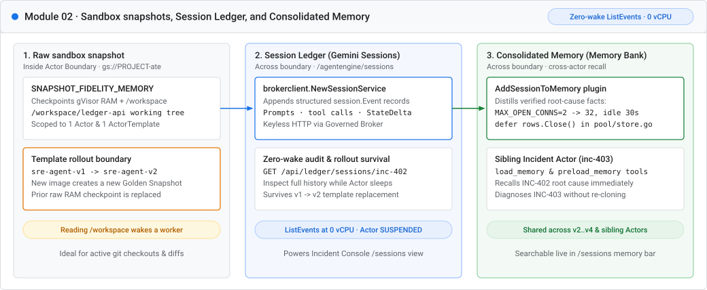

# Session ledger and consolidated memory (15 min)

In Module 01, your keyless **Incident Actor** (`sre-agent-v1`) cloned `ledger-api.git` into `/workspace`, diagnosed `INC-402`, and suspended to `0 vCPU` in Cloud Storage (`SNAPSHOT_FIDELITY_MEMORY`). Now you solve what happens outside a single sandbox checkpoint: persisting structured turn events to a managed **Session Ledger** (**Gemini Sessions**) for zero-wake (`0 vCPU`) inspection and extracting **Consolidated Memory** (**Gemini Memory Bank**) that survives `ActorTemplate` (`v1` -> `v2`) rollouts and transfers across sibling Incident Actors (`inc-403`).



## Snapshots vs. Session Ledger vs. Consolidated Memory

Agent Substrate's Cloud Storage checkpoints and **Gemini Enterprise Agent Platform**'s state services solve distinct layers of stateful agent operations:

| Layer | Where it lives | What it preserves | Lifecycle & visibility |
|---|---|---|---|
| **GCS RAM + `/workspace` snapshot** (`SNAPSHOT_FIDELITY_MEMORY`) | Inside the **Actor Boundary** (`gs://${BUCKET_NAME}`) | Cloned git working tree, unpacked diagnostic scripts, staged commits, and in-process memory | Scoped to one `Actor` and one immutable `ActorTemplate`; reading inside `/workspace` wakes a worker slot |
| **Session Ledger** (**Gemini Sessions**) | Outside the **Actor Boundary** via `sre-gateway/agentengine` | Ordered `session.Event` log: operator prompts, ADK tool calls/results, and scoped `StateDelta` updates | Queryable at `0 vCPU` while the Actor is `SUSPENDED`; survives `v1` -> `v2` template replacement |
| **Consolidated Memory** (**Gemini Memory Bank**) | Outside the **Actor Boundary** via `sre-gateway/agentengine` | Distilled root-cause and operational runbook facts extracted after completed turns (`AddSessionToMemory`) | Shared across upgraded templates (`sre-agent-v2`) and sibling Incident Actors (`inc-402` -> `inc-403`) |

Because `app/cmd/agent` remains **100% keyless**, `brokerclient.NewSessionService` and `brokerclient.NewMemoryService` speak over HTTP exclusively to `sre-gateway/agentengine/*`. Outside the sandbox, `sre-gateway` attaches Workload Identity / Pod **Agent Identity** credentials when delegating to a provisioned `ReasoningEngine` runtime (from `.workshop/reasoning-engine-id`) and maintains a synchronized durable broker ledger when running without one.

## Steps

1. **Complete `WORKSHOP(module-2)` in `app/cmd/agent/main.go`.** Open [`app/cmd/agent/main.go`](../../app/cmd/agent/main.go) and locate `// WORKSHOP(module-2):`. Replace `session.InMemoryService()` with `brokerclient.NewSessionService`, wire `brokerclient.NewMemoryService` plus `brokerclient.NewMemoryConsolidationPlugin` (which invokes `AddSessionToMemory` after each completed turn), and attach ADK Go v2's `loadmemorytool.New()` and `preloadmemorytool.New()` (compare against [`solution/main.go`](solution/main.go)) while **keeping `// WORKSHOP(module-3):` and `// WORKSHOP(module-4):` unchanged**:

   Update your imports in `app/cmd/agent/main.go` (replacing `"google.golang.org/adk/v2/session"` with `plugin`, `loadmemorytool`, and `preloadmemorytool`):
   ```go
   	"google.golang.org/adk/v2/agent"
   	"google.golang.org/adk/v2/agent/llmagent"
   	"google.golang.org/adk/v2/plugin"
   	"google.golang.org/adk/v2/runner"
   	"google.golang.org/adk/v2/tool"
   	"google.golang.org/adk/v2/tool/loadmemorytool"
   	"google.golang.org/adk/v2/tool/preloadmemorytool"
   ```

   Then update `buildRunner` (and optionally change the default `ACTOR_TEMPLATE` fallback in `main()` to `"sre-agent-v2"`):
   ```go
   func buildRunner(ctx context.Context, cfg agentruntime.Config, workspaceTools []tool.Tool) (*runner.Runner, error) {
   	llm, err := brokerclient.NewModel(ctx, cfg.BrokerURL, cfg.ModelName, nil)
   	if err != nil {
   		return nil, err
   	}

   	sessionSvc, err := brokerclient.NewSessionService(cfg.BrokerURL, nil)
   	if err != nil {
   		return nil, err
   	}
   	memorySvc, err := brokerclient.NewMemoryService(cfg.BrokerURL, nil)
   	if err != nil {
   		return nil, err
   	}
   	memoryPlugin, err := brokerclient.NewMemoryConsolidationPlugin(sessionSvc, memorySvc)
   	if err != nil {
   		return nil, err
   	}

   	tools := append([]tool.Tool(nil), workspaceTools...)
   	tools = append(tools, loadmemorytool.New(), preloadmemorytool.New())
   	// WORKSHOP(module-3): Attach SkillToolset backed by RegistrySkillSource so procedural runbooks load without rebuilding the Actor.

   	// WORKSHOP(module-4): Discover MCP toolsets from Agent Registry and enable RequireConfirmation on apply_remediation_pr.

   	triageAgent, err := llmagent.New(llmagent.Config{
   		Name:        "sre_triage_agent",
   		Description: "Platform SRE Triage Agent running inside a keyless Agent Substrate gVisor Incident Actor.",
   		Model:       llm,
   		InstructionProvider: func(agent.ReadonlyContext) (string, error) {
   			return agentruntime.DefaultInstruction, nil
   		},
   		Tools: tools,
   	})
   	if err != nil {
   		return nil, err
   	}

   	return runner.New(runner.Config{
   		AppName:           agentruntime.AppName,
   		Agent:             triageAgent,
   		SessionService:    sessionSvc,
   		MemoryService:     memorySvc,
   		PluginConfig:      runner.PluginConfig{Plugins: []*plugin.Plugin{memoryPlugin}},
   		AutoCreateSession: true,
   	})
   }
   ```

2. **Build `sre-agent-v2`, warm its Golden Snapshot, and roll out the `v2` template on `sre-gateway`.** Inspect [`manifests/template-v2.yaml.tmpl`](manifests/template-v2.yaml.tmpl), build the updated agent image with `ko`, and create `ActorTemplate/sre-agent-v2`:
   ```bash
   source scripts/env.sh
   make build-agent
   scripts/render.sh modules/02-sessions-and-memory/manifests/template-v2.yaml.tmpl | kubectl ate create actor-template -f -
   until kubectl ate get actor-template sre-agent-v2 -a "$ATESPACE" -o json | jq -e '.status.goldenSnapshotStatus.goldenTag.name' >/dev/null; do sleep 2; done
   ```
   Point `sre-gateway` at `sre-agent-v2` (which also picks up `.workshop/reasoning-engine-id` automatically when your background runtime bootstrap finished) and reconnect the local port-forward:
   ```bash
   DEFAULT_ACTOR_TEMPLATE=sre-agent-v2 make gateway
   make forward-gateway
   ```

3. **Notice how `v1` -> `v2` invalidates raw memory snapshots, then record `INC-402` into the Session Ledger.** In Agent Substrate, an `Actor`'s `actorTemplate` reference is immutable because RAM checkpoints bind to the exact container image and kernel state of that template. When `sre-gateway` dispatches `INC-402` onto `sre-agent-v2`, it replaces the `sre-agent-v1` actor with a fresh `sre-agent-v2` sandbox restored from `sre-agent-v2`'s Golden Snapshot:
   ```bash
   curl -s -X POST http://localhost:8081/api/chat \
     -H 'Content-Type: application/json' \
     -d '{
       "incident_id": "INC-402",
       "template": "sre-agent-v2",
       "prompt": "Investigate INC-402 by cloning ledger-api into /workspace, inspecting config/pool.yaml and pool/store.go, and running ledger-verify."
     }' | jq '{actor_name, template, workspace_cloned: .workspace.cloned, tool_steps: [(.tool_steps // [])[].name]}'
   ```
   During this turn:
   - `Runner.Run` persists every prompt, tool call (`load_memory`, `clone_repo`, `read_workspace_file`, `run_workspace_command`), and model reply through `sre-gateway/agentengine/sessions:appendEvent`.
   - When the turn completes, `NewMemoryConsolidationPlugin` calls `AddSessionToMemory`, distilling `INC-402`'s verified root cause (`MAX_OPEN_CONNS=2`, `IDLE_TIMEOUT_SECONDS=0` in `config/pool.yaml` and the missing `defer rows.Close()` before `rows.ValidateChecksum()` in `pool/store.go`) into **Consolidated Memory**.

4. **Audit the Session Ledger at `0 vCPU` (zero-wake inspection).** Suspend `inc-402` (or wait `15s` for the idle-suspender) and confirm it consumes zero worker slots:
   ```bash
   kubectl ate suspend actor inc-402 -a "$ATESPACE"
   kubectl ate get actors -a "$ATESPACE"
   ```
   Now query `inc-402`'s structured turn history through `sre-gateway` and verify the Actor remains `SUSPENDED`:
   ```bash
   curl -s http://localhost:8081/api/ledger/sessions/inc-402 | jq '{session_id, actor_state, compute_badge, event_count, events: [.events[] | {kind, author, summary}]}'
   kubectl ate get actor inc-402 -a "$ATESPACE" -o json | jq -r '.status.state'
   ```
   Open `http://localhost:8081/sessions` (**Session ledger & memory** in the left navigation of the **Incident Console**):
   - Click **Inspect events** on `inc-402` to expand each structured prompt, tool call, and tool response while the **Actor compute** badge stays `Suspended · 0 vCPU · < 400ms wake`.
   - Use the **Consolidated memory** search bar at the bottom of `/sessions` (for example, search `MAX_OPEN_CONNS` or `rows.Close`) to test live `SearchMemory` recall.

5. **Prove cross-rollout survival and sibling Incident Actor (`INC-403`) recall.** First, delete `inc-402` to discard its sandbox `/workspace` and raw checkpoint completely, wait for deletion to finish, and ask a newly instantiated `inc-402` (`sre-agent-v2`) to summarize `INC-402` from memory without re-cloning:
   ```bash
   kubectl ate delete actor inc-402 -a "$ATESPACE"
   while kubectl ate get actor inc-402 -a "$ATESPACE" >/dev/null 2>&1; do sleep 1; done
   curl -s -X POST http://localhost:8081/api/chat \
     -H 'Content-Type: application/json' \
     -d '{
       "incident_id": "INC-402",
       "template": "sre-agent-v2",
       "prompt": "Summarize the previously verified INC-402 connection pool root cause and tuning values from memory without re-cloning."
     }' | jq '{actor_name, template, workspace_cloned: .workspace.cloned, reply}'
   ```
   Notice `workspace_cloned` is `false` (the raw snapshot was deleted), yet the fresh `sre-agent-v2` instance recovers both its **Session Ledger** history and its distilled **Consolidated Memory** facts (`MAX_OPEN_CONNS=2`, `IDLE_TIMEOUT_SECONDS=0`, `max_open_conns: 32`, `idle_timeout_seconds: 30`)!

   Next, dispatch a brand-new sibling Incident Actor for `INC-403` (`inc-403`, either by selecting `INC-403 · ledger-api` in the **Incident Console** dropdown or via `curl`):
   ```bash
   curl -s -X POST http://localhost:8081/api/chat \
     -H 'Content-Type: application/json' \
     -d '{
       "incident_id": "INC-403",
       "template": "sre-agent-v2",
       "prompt": "Triage sibling incident INC-403 using Consolidated Memory from prior ledger-api incidents."
     }' | jq '{actor_name, template, tool_steps: [(.tool_steps // [])[].name], reply}'
   ```
   `inc-403` recalls the consolidated `INC-402` pool-sizing and cursor-leak facts across the **Actor Boundary** via `preload_memory` (which injects distilled memories into the prompt with zero runtime tool calls) and/or `load_memory`, diagnosing `INC-403` immediately without repeating a repository clone.

## Checkpoint

Verify your Module 02 state:

```bash
make verify MODULE=2
```

**Need to catch up or reset `sre-agent-v2`?** Run `make catch-up MODULE=3` (add `RESET=1` to rebuild `sre-agent-v2` from `modules/02-sessions-and-memory/solution/main.go`).

Next: [Dynamic procedural skills with Skill Registry](../03-skill-registry/README.md)
