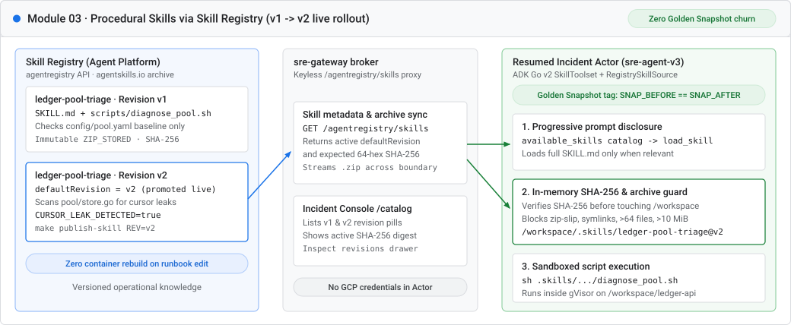

# Dynamic procedural skills with Skill Registry (12 min)

In Module 02, rolling out `sre-agent-v1` -> `sre-agent-v2` demonstrated a fundamental operational rule of **Agent Substrate**: every container image edit creates a new `ActorTemplate`, warms a new **Golden Snapshot**, and replaces existing per-incident RAM checkpoints. If your team bakes SRE runbooks (`SKILL.md`) or diagnostic scripts (`*.sh`) directly into the agent container image, every runbook tweak triggers an image rebuild and **Golden Snapshot** churn across the fleet.

In Module 03, you decouple operational procedures from the container image by packaging `ledger-pool-triage` as a versioned **Procedural Skill** (`agentskills.io` archive format) in **Skill Registry** (`agentregistry.googleapis.com`) on **Gemini Enterprise Agent Platform**, wiring ADK Go v2's `SkillToolset` (`google.golang.org/adk/v2/tool/skilltoolset`) into `sre-agent-v3` **once**, and rolling out `v1` -> `v2` at runtime with **zero container rebuilds** and **zero Golden Snapshot churn**.



## How `SkillToolset` and `RegistrySkillSource` work across the Actor Boundary

| Step | Component | Security & lifecycle contract |
|---|---|---|
| **1. Package & publish (`make publish-skill REV=v1\|v2`)** | [`scripts/publish-skill.sh`](../../scripts/publish-skill.sh) -> **Skill Registry** & `sre-gateway` | Builds a deterministic `ZIP_STORED` archive from `SKILL.md` + `scripts/diagnose_pool.sh`, computes its `SHA-256` digest, publishes the immutable `SkillRevision` (`gcloud alpha agent-registry skills --location=global`), and updates `defaultRevision`. |
| **2. Progressive disclosure (`available_skills` -> `load_skill`)** | ADK Go v2 `skilltoolset.New` + `brokerclient.NewSkillSource` | On each turn, `RegistrySkillSource` queries keyless `http://sre-gateway.${NAMESPACE}.svc.cluster.local:8080/agentregistry/skills` for the active `defaultRevision` and injects the lightweight `available_skills` XML catalog into the model prompt before loading full `SKILL.md` instructions via `load_skill`. |
| **3. Integrity & archive hardening** | [`app/internal/brokerclient/skills.go`](../../app/internal/brokerclient/skills.go) | When `SKILL@REVISION` is not yet unpacked in `/workspace/.skills/`, the Actor downloads the `.zip` over `sre-gateway`, verifies its `SHA-256` digest in memory before touching disk, enforces zip-slip (`filepath.Clean` + separator prefix), symlink, file-count (`<= 64`), and uncompressed size (`<= 10 MiB`) bounds, and atomically activates `/workspace/.skills/ledger-pool-triage/` (`0755` on `scripts/*.sh`). |
| **4. Sandboxed execution (`run_workspace_command`)** | gVisor **Incident Actor** (`/workspace/ledger-api`) | Executes `sh .skills/ledger-pool-triage/scripts/diagnose_pool.sh` inside the isolated `/workspace/ledger-api` git checkout with zero ambient cloud credentials. |

## Steps

1. **Inspect the `v1` and `v2` Procedural Skill bundles and publish `v1`.** Compare the two revisions under [`skills/ledger-pool-triage/`](skills/ledger-pool-triage/):
   - [`v1/SKILL.md`](skills/ledger-pool-triage/v1/SKILL.md) + [`v1/scripts/diagnose_pool.sh`](skills/ledger-pool-triage/v1/scripts/diagnose_pool.sh): inspects `config/pool.yaml` (`max_open_conns`, `idle_timeout_seconds`, `acquire_timeout_ms`) and outputs baseline saturation diagnostics stamped with `SKILL_REVISION=v1`.
   - [`v2/SKILL.md`](skills/ledger-pool-triage/v2/SKILL.md) + [`v2/scripts/diagnose_pool.sh`](skills/ledger-pool-triage/v2/scripts/diagnose_pool.sh): inspects **both** `config/pool.yaml` and Go source files (`pool/store.go`) to pinpoint unclosed row cursors (`rows.ValidateChecksum()` returning before `defer rows.Close()` in `ReconcileTransfer`), stamped with `SKILL_REVISION=v2`.

   Publish `v1` as the active `defaultRevision`:
   ```bash
   source scripts/env.sh
   make publish-skill REV=v1
   ```

2. **Complete `WORKSHOP(module-3)` in `app/cmd/agent/main.go`.** Open [`app/cmd/agent/main.go`](../../app/cmd/agent/main.go) and locate `// WORKSHOP(module-3):`. Construct `brokerclient.NewSkillSource` + `skilltoolset.New` and pass `Toolsets: toolsets` into `llmagent.Config` (compare against [`solution/main.go`](solution/main.go)) while **keeping `// WORKSHOP(module-4):` unchanged**:

   Add `"google.golang.org/adk/v2/tool/skilltoolset"` to your imports:
   ```go
   	"google.golang.org/adk/v2/tool"
   	"google.golang.org/adk/v2/tool/loadmemorytool"
   	"google.golang.org/adk/v2/tool/preloadmemorytool"
   	"google.golang.org/adk/v2/tool/skilltoolset"
   ```

   Wire `skillSource` and `skillsTS` in `buildRunner` (and optionally update the default `ACTOR_TEMPLATE` fallback in `main()` to `"sre-agent-v3"`):
   ```go
   	tools := append([]tool.Tool(nil), workspaceTools...)
   	tools = append(tools, loadmemorytool.New(), preloadmemorytool.New())

   	skillSource, err := brokerclient.NewSkillSource(cfg.BrokerURL, cfg.WorkspaceDir, nil)
   	if err != nil {
   		return nil, err
   	}
   	skillsTS, err := skilltoolset.New(ctx, skilltoolset.Config{
   		Source: skillSource,
   	})
   	if err != nil {
   		return nil, err
   	}
   	toolsets := []tool.Toolset{skillsTS}

   	// WORKSHOP(module-4): Discover MCP toolsets from Agent Registry and enable RequireConfirmation on apply_remediation_pr.

   	triageAgent, err := llmagent.New(llmagent.Config{
   		Name:        "sre_triage_agent",
   		Description: "Platform SRE Triage Agent running inside a keyless Agent Substrate gVisor Incident Actor.",
   		Model:       llm,
   		InstructionProvider: func(agent.ReadonlyContext) (string, error) {
   			return agentruntime.DefaultInstruction, nil
   		},
   		Tools:    tools,
   		Toolsets: toolsets,
   	})
   ```

3. **Build `sre-agent-v3` once, warm its Golden Snapshot, and run `v1` on `INC-402`.** Build the agent image, create [`manifests/template-v3.yaml.tmpl`](manifests/template-v3.yaml.tmpl), and point `sre-gateway` at `sre-agent-v3`:
   ```bash
   make build-agent
   scripts/render.sh modules/03-skill-registry/manifests/template-v3.yaml.tmpl | kubectl ate create actor-template -f -
   until kubectl ate get actor-template sre-agent-v3 -a "$ATESPACE" -o json | jq -e '.status.goldenSnapshotStatus.goldenTag.name' >/dev/null; do sleep 2; done
   DEFAULT_ACTOR_TEMPLATE=sre-agent-v3 make gateway
   make forward-gateway
   ```
   Record the `sre-agent-v3` **Golden Snapshot** tag so you can verify it never changes when rolling out `v2`:
   ```bash
   SNAP_BEFORE="$(kubectl ate get actor-template sre-agent-v3 -a "$ATESPACE" -o json | jq -r '.status.goldenSnapshotStatus.goldenTag.name')"
   echo "Golden Snapshot tag: $SNAP_BEFORE"
   ```
   Dispatch an investigation turn asking `sre-agent-v3` to run `ledger-pool-triage` against `INC-402`:
   ```bash
   curl -s -X POST http://localhost:8081/api/chat \
     -H 'Content-Type: application/json' \
     -d '{
       "incident_id": "INC-402",
       "template": "sre-agent-v3",
       "prompt": "Run the ledger-pool-triage procedural skill against INC-402 and report the SKILL_REVISION findings."
     }' | jq '{actor_name, template, tool_steps: [(.tool_steps // [])[].name], reply}'
   ```
   Observe `load_skill` -> `clone_repo` -> `run_workspace_command` (`sh .skills/ledger-pool-triage/scripts/diagnose_pool.sh`) and `SKILL_REVISION=v1` (`MAX_OPEN_CONNS=2`, `IDLE_TIMEOUT_SECONDS=0`) in the response.

4. **Publish `v2` and hot-reload on the resumed Incident Actor with zero rebuilds.** Without running `make build-agent` or modifying `ActorTemplate/sre-agent-v3`, publish revision `v2` and promote it to `defaultRevision`:
   ```bash
   make publish-skill REV=v2
   ```
   Open `http://localhost:8081/catalog` (**Skill & agent catalog** in the **Incident Console**) and click **Inspect revisions** on `ledger-pool-triage`:
   - Both immutable `SHA-256` revision pills (`v1` and `v2`) appear in the **Skill revisions** drawer, with `v2` marked as the active `defaultRevision`.
   - Now send a follow-up turn to the existing `inc-402` Actor (either in the docked **SRE triage agent** pane on `/` or via `curl`):
   ```bash
   curl -s -X POST http://localhost:8081/api/chat \
     -H 'Content-Type: application/json' \
     -d '{
       "incident_id": "INC-402",
       "template": "sre-agent-v3",
       "prompt": "Re-run the ledger-pool-triage procedural skill on INC-402 and report the updated SKILL_REVISION findings."
     }' | jq '{actor_name, template, tool_steps: [(.tool_steps // [])[].name], reply}'
   ```
   On this turn, the resumed `inc-402` Actor checks `/agentregistry/skills/ledger-pool-triage`, sees `defaultRevision=v2`, verifies `v2`'s `SHA-256` digest, unpacks `/workspace/.skills/ledger-pool-triage@v2/`, and executes `v2`'s `diagnose_pool.sh` inside gVisor, reporting `SKILL_REVISION=v2`, `CURSOR_LEAK_DETECTED=true`, and `pool/store.go:ReconcileTransfer`!

   Confirm `sre-agent-v3`'s **Golden Snapshot** tag is completely unchanged:
   ```bash
   SNAP_AFTER="$(kubectl ate get actor-template sre-agent-v3 -a "$ATESPACE" -o json | jq -r '.status.goldenSnapshotStatus.goldenTag.name')"
   [[ "$SNAP_BEFORE" == "$SNAP_AFTER" ]] && echo "Zero Golden Snapshot churn: $SNAP_AFTER"
   ```

## Checkpoint

Verify your Module 03 state:

```bash
make verify MODULE=3
```

**Need to catch up or reset `sre-agent-v3`?** Run `make catch-up MODULE=4` (add `RESET=1` to rebuild `sre-agent-v3` from `modules/03-skill-registry/solution/main.go`).

Next: [Agent Registry discovery and zero-compute remediation gate](../04-agent-registry-mcp-a2a/README.md)
