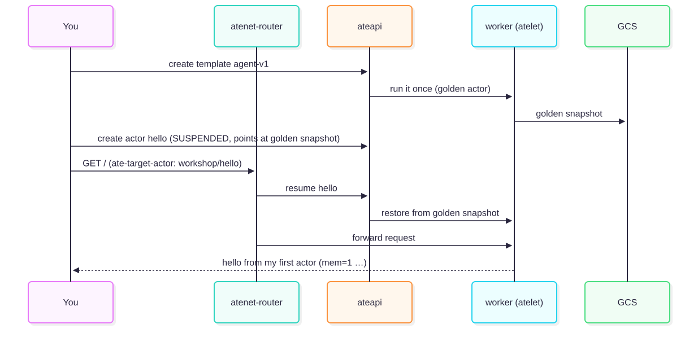
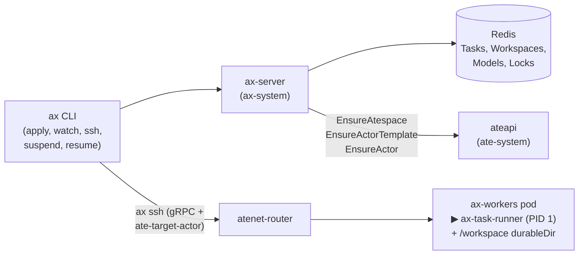

# Untrusted Code on Secure Runtimes: Agent Substrate on Kubernetes

## Introduction
Duration: 02:00

In this workshop, you build and operate your own fleet of AI agents on [Agent Substrate](https://github.com/agent-substrate/substrate),
starting from a bare GKE cluster. In about 85 minutes, you:

- Install Substrate and learn what each of its components does.
- Build a Go agent, run it as a Substrate **actor**, and suspend and resume it across workers.
- Connect the agent to a model (Gemini on the Gemini platform) through an always-on gateway, and lock down its egress.
- Run 20 agents on 2 workers with request parking and idle suspend.
- Monitor the fleet in Prometheus and Google Cloud console dashboards.

You build everything you deploy: the agent, the gateway, and (in source mode) Substrate itself go into your own Artifact Registry repository.

### Prerequisites
- A Google Cloud project where you have the **Owner** role, with a GKE **1.37+** cluster that has Workload Identity, managed
  OpenTelemetry, Managed Service for Prometheus, no node auto-upgrade, no spot nodes, and 2× `c3-standard-4` nodes.
- Familiarity with Kubernetes. You don't need prior Substrate knowledge.

## Setup
Duration: 10:00

The goal of this section is to point the workshop at your Google Cloud project, create the cloud resources that Substrate needs,
and start the Substrate installation in the background. The installation runs while you take the architecture tour.

### What you need
- A Google Cloud project where you have the **Owner** role, and a GKE **1.37+** cluster in that project. The cluster requires Workload Identity,
  managed OpenTelemetry, Managed Service for Prometheus, no node auto-upgrade (or an active maintenance exclusion), and no spot nodes. Use the cluster that your instructor created, or create one in Step 3 below (see also the [Substrate Google Cloud guide](https://github.com/ai-on-gke/substrate-gke/tree/main/tools/setup-gcp)).
- `kubectl` configured to point at that cluster (`kubectl config current-context`).
- Locally installed tools: `gcloud`, `kubectl`, `go` 1.27+, `ko`, `jq`, `envsubst` (gettext), `curl`, `git`, `python3`.
  You need a running **Docker** daemon with `buildx` only to build Substrate from source (empty `SUBSTRATE_IMAGE_REPO`).
  Cloud Shell includes all of these tools except `ko`: run `go install github.com/google/ko@latest`.

### Steps

1. **Activate Cloud Shell.** Open the Google Cloud console and click **Activate Cloud Shell** in the top-right
   toolbar to launch Cloud Shell — a self-contained VM in your browser with all the required tools except `ko` — and run all the commands in this lab from there. Install `ko` first:
   ```bash
   go install github.com/google/ko@latest
   ```
2. **Clone the workshop repository.** Clone the repository and move into its root directory:
   ```bash
   git clone https://github.com/GoogleCloudPlatform/agent-substrate-workshop
   cd agent-substrate-workshop
   ```
3. **Create a GKE cluster (if your instructor didn't pre-create one).** If your project already has a cluster (`gcloud container clusters list`), skip to Step 4. Otherwise, create a zonal GKE 1.37 cluster with Workload Identity, managed OpenTelemetry, Managed Service for Prometheus, and a 48-hour maintenance exclusion to block node auto-upgrades during the workshop:
   ```bash
   export PROJECT_ID="YOUR_PROJECT_ID"
   export CLUSTER_LOCATION="us-central1-a"
   export CLUSTER_NAME="ate-cluster"

   gcloud services enable container.googleapis.com --project "$PROJECT_ID"
   gcloud beta container clusters create "$CLUSTER_NAME" \
     --project "$PROJECT_ID" \
     --location "$CLUSTER_LOCATION" \
     --release-channel rapid \
     --cluster-version 1.37 \
     --machine-type c3-standard-4 \
     --num-nodes 2 \
     --workload-pool "$PROJECT_ID.svc.id.goog" \
     --enable-managed-prometheus \
     --managed-otel-scope=COLLECTION_AND_INSTRUMENTATION_COMPONENTS

   gcloud container clusters update "$CLUSTER_NAME" \
     --project "$PROJECT_ID" \
     --location "$CLUSTER_LOCATION" \
     --add-maintenance-exclusion-name workshop-freeze \
     --add-maintenance-exclusion-start "$(date -u +%Y-%m-%dT%H:%M:%SZ)" \
     --add-maintenance-exclusion-end "$(date -u -d '+2 days' +%Y-%m-%dT%H:%M:%SZ 2>/dev/null || date -u -v+2d +%Y-%m-%dT%H:%M:%SZ)" \
     --add-maintenance-exclusion-scope no_minor_or_node_upgrades
   ```
4. **Configure the environment.** Copy the example environment file and set `PROJECT_ID` and `CLUSTER_LOCATION` to your cluster's exact zone or
   region from `gcloud container clusters list` (a zonal cluster such as `us-central1-a` won't match
   `us-central1`). If your cluster isn't named `ate-cluster`, set `CLUSTER_NAME` as well. Every other
   variable has a working default.
   ```bash
   gcloud container clusters list --project YOUR_PROJECT_ID    # NAME and LOCATION
   cp workshop.env.example workshop.env
   ${EDITOR:-nano} workshop.env
   ```
5. **Run preflight checks.** Verify your local tools and the cluster's version, Workload Identity, managed OpenTelemetry,
   and node pool settings. Fix any issues that the script flags before you continue.
   ```bash
   make preflight
   ```
6. **Create Google Cloud resources.** Create a Cloud Storage bucket for snapshots, an Artifact Registry repository for your container images,
   and IAM bindings for Substrate's components, your gateway, and the Prometheus UI. The script grants image pull access
   (`roles/artifactregistry.reader`) on that single repository, not the entire project.
   ```bash
   make gcp
   ```
7. **Add `bin/` to your `PATH`.** The installer builds the `kubectl ate` plugin into `bin/kubectl-ate`. The
   `make` targets find it automatically, but `make install-status` and the "Hello actor" section onwards expect `kubectl ate`
   on your shell's `PATH`. Run the following command from the repository root:
   ```bash
   export PATH="$PWD/bin:$PATH"
   ```
   This setting applies only to your current terminal session. To persist it, add the same line with the absolute repository path instead of `$PWD` to
   `~/.zshrc` or `~/.bashrc`. If you use direnv, add `PATH_add bin` to an `.envrc` file at the repository root.
8. **Start the installation in the background.** This target clones Substrate at `SUBSTRATE_REF`, builds `kubectl ate`,
   deploys `ate-system`, pins a worker image that matches the control plane, and
   increases the router's parked-request budget and shutdown grace period.
   ```bash
   make install-bg
   make install-status     # check progress at any time; the install takes about 5–10 minutes
   ```
   After the installation finishes, `kubectl ate --help` works. Running `make verify MODULE=0` verifies that `bin/` is on your `PATH`.
9. **Create the dashboards.** Create the workshop dashboard and Substrate's three dashboards in Cloud Monitoring.
   They remain empty until the "Observe the fleet" section, but creating them now ensures that data is already flowing when you get there.
   ```bash
   make dashboards
   ```
10. **Build local tools.** Build `bin/egressctl`, which you use in the "Make it an agent" section.
    ```bash
    make tools
    ```

### What just happened
- `workshop.env` is the only file you edit for configuration. Scripts write generated state (image
  digests, the Substrate version, and tokens) into `.workshop/`, which Git ignores.
- Substrate requires three things from Google Cloud: a **Cloud Storage bucket** for snapshots, **Workload Identity** so its
  components can write to that bucket, and a **GKE cluster version** that supports Pod certificates and ClusterTrustBundles,
  which Substrate uses to give every actor an identity.

### Checkpoint
```bash
make verify MODULE=0
```

**Stuck?** Run `make catch-up MODULE=1` to run all of these steps in the foreground, and see
[troubleshooting](instructor/troubleshooting.md).

## Architecture tour
Duration: 10:00

The goal of this section is to learn what each piece of Agent Substrate does before you use it. You inspect
the live system while the installation finishes (`make install-status`).

### Why not a Pod per agent?

An agent spends most of its life **waiting**: for a user, for a model, or for a tool. A Pod per agent
reserves CPU and memory during all of that idle time, and deleting the Pod loses the agent's memory.
Substrate runs agents as **actors**. An actor is a sandboxed process that Substrate can **suspend** (checkpointing it to Cloud Storage and
freeing its slot) and **resume** on *any* worker, often in about a second, with its memory intact. A few worker Pods serve
many actors.

> **Comparison with [kubernetes-sigs/agent-sandbox](https://github.com/kubernetes-sigs/agent-sandbox):**
> `agent-sandbox` is a separate project with no Substrate integration. It assigns each sandbox its own Pod.
>
> | agent-sandbox | Agent Substrate | Difference |
> |---|---|---|
> | Sandbox (a Pod) | Actor (a process in a worker) | Many actors share a few workers |
> | SandboxTemplate | ActorTemplate | Substrate takes a **golden snapshot** of the template |
> | SandboxWarmPool | WorkerPool | Workers are generic; any worker runs any actor of a matching template |
> | SandboxClaim | create / resume actor | Resume restores memory, not just disk |
> | Suspend = delete the Pod | Suspend = checkpoint memory and disk to Cloud Storage | Resume on *any* worker |
>
> Note the naming overlap: Substrate also has a `SandboxConfig` CRD, which configures gVisor and microVM runtimes.
>
> **Where does [AX (`google/ax`)](https://github.com/google/ax) fit?**
> Substrate is the **runtime and sandbox** layer: it isolates, snapshots, routes to, and suspends or resumes
> actor processes across shared workers, without caring what runs inside them. **AX (Agent eXecutor)** is a higher-level,
> `kubectl`-style **control plane** (`ax.io/v1alpha1`) built on top of Substrate. You declare a `Workspace` (Git repositories,
> files, MCP servers, skills), a `Task` (image, command, resources), and a `Model`, and AX compiles them into the
> Substrate `ActorTemplate` and `Actor` records that you build by hand from "Hello actor" through "Density and idle" ([optional lab B](#9)
> runs AX on this cluster).

### The pieces



| Component | Job |
|---|---|
| **ateapi** | The control API (gRPC). `kubectl ate` and your own code call it to create, suspend, resume, and delete actors. Creating an `ActorTemplate` also instructs `ateapi` to run that template's golden-snapshot actor once before the template becomes ready for use. |
| **Postgres** | Stores Substrate's records: atespaces, templates, actors, workers, and tags. **These are not Kubernetes objects.** |
| **atecontroller** | Reconciles `WorkerPool` CRDs into worker Pods (one Kubernetes `Deployment` per pool) and registers each Pod with `ateapi` as a Worker. |
| **atelet** | Runs on each worker. Starts actors in a gVisor sandbox, and snapshots and restores them to and from Cloud Storage. |
| **atenet-router** | The front door. Routes HTTP requests using the `ate-target-actor` header. If the target actor is suspended, the router **parks the request, resumes the actor, and then forwards the request**. |
| **atenet-egress** | Proxies every outbound connection from an actor. **Denies traffic by default**; `EgressPolicy` opens specific destinations. |
| **k8s-credential-provider** | Resolves `ate-secret://k8s.io/…` references from Kubernetes Secrets for `atenet-egress` when an `https` `EgressPolicy` rule injects headers (optional lab J). Denies access by default until you grant specific namespaces. |
| **podcertcontroller** | Issues certificates so actors and components have cryptographic identities. Clients trust `ateapi` through a `ClusterTrustBundle`. |

**CRDs vs. records**

| Kubernetes CRDs (`kubectl get`) | Substrate records (`kubectl ate get`) |
|---|---|
| WorkerPool, SandboxConfig, CSIDriverConfig | Atespace, ActorTemplate, Actor, Worker, Tag |

`EgressPolicy` is also a Substrate record, with one policy per actor (`kubectl ate get egress-policy NAME -a workshop`).
In the "Make it an agent" section, you apply policies using the workshop's `egressctl` tool (built in the setup), which can apply a single policy
file to every actor at once.

An **atespace** is Substrate's tenancy boundary for records, similar to a Kubernetes namespace but for actors.
It is separate from a Kubernetes namespace. Your `WorkerPool` lives in the Kubernetes namespace `workshop`, and your actors live in the atespace `workshop`.

### Look around

```bash
make install-status                              # wait for "Agent Substrate is ready"
kubectl -n ate-system get deploy,ds,sts,svc
kubectl get crd | grep ate.dev
kubectl get sandboxconfigs                       # gvisor-default — the runtime profile actors use
kubectl get clustertrustbundles -l podcert.ate.dev/canarying=live
kubectl -n ate-system get deploy atenet-egress   # the egress proxy (used in "Make it an agent")
kubectl ate get atespaces
kubectl ate get workers -n workshop              # none yet — "Hello actor" creates a WorkerPool
cat .workshop/worker-image                       # the worker build that matches your control plane
```

Right after the installation finishes, you might see an extra `atenet-router` Pod in the `Terminating` state. That Pod is the previous instance draining:
the installer patches the router with a longer parked-request budget and a 120-second grace period, which triggers a rolling update.

### What just happened
- You inspected the control plane (`ateapi`, `atecontroller`, Postgres), the data plane (`atelet` in each worker, the router, and the egress proxy),
  and the identity plumbing (`podcertcontroller`, `ClusterTrustBundle`).
- The worker image must come from the **same build** as the control plane. The installation script
  records this image in `.workshop/worker-image` so that your `WorkerPool` stays in sync.

### Checkpoint
```bash
make verify MODULE=1
```
**Stuck?** Run `make catch-up MODULE=2`.

## Hello actor
Duration: 15:00

The goal of this section is to build your agent image, give Substrate workers to run it, register a template, create
an actor, and send requests to it through the router.



### Steps

1. **Customize the greeting.** Open `app/cmd/agent/main.go`, find `WORKSHOP(module-2)`, and change the greeting.
   Then build and push the image. `ko` prints a digest-pinned image reference and saves it to `.workshop/agent-image`.
   ```bash
   make build-agent
   ```
   `ko` might log warnings such as `git doesn't contain any tags` and `git is in a dirty state … M app/cmd/agent/main.go`. Those warnings are
   expected because you just edited the file, and the build still succeeds.
2. **Create a WorkerPool.** A `WorkerPool` is a Kubernetes CRD. The controller reconciles it into worker Pods that run `atelet`.
   ```bash
   scripts/render.sh modules/02-hello-actor/manifests/workerpool.yaml.tmpl   # inspect the rendered manifest
   scripts/render.sh modules/02-hello-actor/manifests/workerpool.yaml.tmpl | kubectl apply -f -
   kubectl -n workshop get pods -w          # press Ctrl+C when 2 Pods are Running
   kubectl ate get workers -n workshop
   ```
3. **Create an atespace.** An atespace is the tenancy boundary for Substrate records.
   ```bash
   kubectl ate create atespace workshop
   ```
4. **Create an ActorTemplate.** Inspect `modules/02-hello-actor/manifests/template.yaml.tmpl`: it defines the container image, a readiness
   probe, the snapshot fidelity (`preferredFidelity`), resource limits (`cpuMillicores`, `memoryBytes`), and one durable directory.
   ```bash
   scripts/render.sh modules/02-hello-actor/manifests/template.yaml.tmpl | kubectl ate create actor-template -f -
   kubectl ate get actor-template agent-v1 -a workshop            # repeat until GOLDEN TAG appears
   kubectl ate get actor-template agent-v1 -a workshop -o yaml    # inspect status.goldenSnapshotStatus.goldenTag.name
   ```
   Substrate starts your container once on a free worker, waits for its `wakeupProbe` (`/readyz`) to pass, and snapshots it.
   That **golden snapshot** serves as the starting point for every actor created from this template. Creating an actor
   restores this snapshot instead of cold-booting a process.
5. **Create an actor.**
   ```bash
   kubectl ate create actor hello --template=agent-v1 -a workshop
   kubectl ate get actors -a workshop       # SUSPENDED: the record exists, but it isn't running on a worker
   ```
6. **Send requests to the actor.** The router selects the target actor from the `ate-target-actor` header.
   ```bash
   make forward-router                      # port-forwards atenet-router to localhost:8080
   curl -H 'ate-target-actor: workshop/hello' localhost:8080/
   curl -H 'ate-target-actor: workshop/hello' localhost:8080/
   curl -s -H 'ate-target-actor: workshop/hello' localhost:8080/state | jq
   kubectl ate get actors -a workshop       # RUNNING, with a worker assigned
   kubectl ate get workers -n workshop
   ```
   The router **parks** the first request while it resumes `hello`. `mem` counts requests in memory.
   `disk=-1` because the agent doesn't use its durable directory yet (you configure that in the "Suspend and resume" section).

### What just happened
- **`WorkerPool`** provides capacity: generic, pre-started worker Pods. **`ActorTemplate`** defines what to run.
  An **`Actor`** is an individual instance with its own identity and state. Actors don't map 1:1 to Pods:
  any worker in the selected pool can run any actor of that template.
- The `workload: workshop-agent` label serves two distinct purposes: on the `WorkerPool`, the
  template's `workerSelector` matches it to select a pool; on the Pod template (`spec.template.labels`),
  Kubernetes applies it to the worker Pods so that `kubectl get pods -l workload=workshop-agent`
  can find them.
- `create actor` is lightweight. It writes a database record that points to the golden snapshot. The actor first runs
  when a request arrives.
- `kubectl ate` is a `kubectl` plugin that calls **`ateapi`**. Actors live in Postgres rather than etcd, so
  `kubectl get actors` doesn't exist.

### Checkpoint
```bash
make verify MODULE=2
```
**Stuck?** Run `make catch-up MODULE=3`. If `agent-v1` or its actors exist in a broken state, run `make catch-up MODULE=3 RESET=1` to delete and recreate them from the solution.

## Suspend and resume
Duration: 12:00

The goal of this section is to see what survives a suspend, where the snapshot goes, and how the router brings an actor back,
possibly on a different worker.


### Part A: Full-memory suspend (template `agent-v1`)

1. Generate some state, then note the worker Pod and the boot ID:
   ```bash
   for i in 1 2 3; do curl -s -H 'ate-target-actor: workshop/hello' localhost:8080/; done
   curl -s -H 'ate-target-actor: workshop/hello' localhost:8080/state | jq '{memCount, bootID}'
   kubectl ate get actors -a workshop       # check the WORKER POD column
   ```
   (Inside the sandbox, the agent's `hostname` is always `actor`, so use the
   `WORKER POD` column to see which worker hosts it.) If the port-forward stopped, restart it with `make forward-router`.
2. Suspend the actor and watch the worker free up:
   ```bash
   kubectl ate suspend actor hello -a workshop
   kubectl ate get actors -a workshop       # SUSPENDED, no worker
   kubectl ate get workers -n workshop      # both workers free
   ```
3. Send another request to the actor:
   ```bash
   curl -s -H 'ate-target-actor: workshop/hello' localhost:8080/
   curl -s -H 'ate-target-actor: workshop/hello' localhost:8080/state | jq '{memCount, bootID}'
   ```
   `mem` **continues** from where it left off, and the `bootID` remains the **same**. The process never restarted:
   Substrate checkpointed its memory to Cloud Storage and restored it, possibly on the other worker.
   You see the router's resume metrics in the dashboards in the "Observe the fleet" section.

### Part B: Disk-only suspend (template `agent-v2`)

A full-memory snapshot is powerful, but it can be large. Many agents only need their files. `agent-v2` suspends
with **VOLUMES** fidelity (`SNAPSHOT_FIDELITY_VOLUMES`): Substrate saves only the durable directory, and resume cold-boots the process.

4. Point the agent at its durable directory. In `app/cmd/agent/main.go`, find `WORKSHOP(module-3)` and set
   `DataDir: "/data"`. Then build the updated image:
   ```bash
   make build-agent
   ```
5. Keep `hello` suspended. Creating a new template requires a **free worker** to run its golden-snapshot actor, and your pool has two workers.
   Create the new template and an actor:
   ```bash
   kubectl ate suspend actor hello -a workshop 2>/dev/null; kubectl ate get actors -a workshop
   diff modules/02-hello-actor/manifests/template.yaml.tmpl modules/03-suspend-resume/manifests/template.yaml.tmpl
   scripts/render.sh modules/03-suspend-resume/manifests/template.yaml.tmpl | kubectl ate create actor-template -f -
   kubectl ate get actor-template agent-v2 -a workshop -o yaml | grep -A2 goldenTag   # repeat until set
   kubectl ate create actor memo --template=agent-v2 -a workshop
   ```
6. Follow the actor's logs in a second terminal (`cd` into your workshop checkout first if a new tab starts in `$HOME`). The log stream follows the actor across workers and restarts:
   ```bash
   source scripts/env.sh     # in the new terminal, from the repo root: puts bin/ (kubectl ate) on PATH
   kubectl ate logs actor memo -a workshop -f
   ```
   Most of the output comes from gVisor's runtime logging (`I…` and `W…` lines from `cli.go`,
   `config.go`, and similar files, wrapped in JSON). Watch for the agent's `agent listening …` line. Append
   `| grep -v '"message":"[IW][01]'` (or `| grep 'agent listening'`) to filter for the agent's output.
7. Generate state, suspend the actor, and send another request:
   ```bash
   for i in 1 2 3; do curl -s -H 'ate-target-actor: workshop/memo' localhost:8080/; done
   kubectl ate suspend actor memo -a workshop
   curl -s -H 'ate-target-actor: workshop/memo' localhost:8080/
   ```
   Now `mem=1` because the suspend discarded memory. `disk` kept counting because the file lives in `/data`. The
   boot ID is new, and the logs show a fresh `agent listening` line.

### Templates are immutable
You didn't edit `agent-v1`; instead, you created `agent-v2`. A template's golden snapshot bakes in its container image,
command, environment variables, **and the memory of the process at snapshot time**. Changing any of those settings requires a new
template version. Existing actors keep their assigned template, so `hello` continues to run `agent-v1`.

### What just happened

| Feature | `preferredFidelity: MEMORY` (`hello`) | `preferredFidelity: VOLUMES` (`memo`) |
|---|---|---|
| Saved on suspend | Memory and `durableDir` | `durableDir` only |
| Resume behavior | Restores process (same `bootID`) | Cold-boots process (new `bootID`) |
| Snapshot size | ~ memory footprint | ~ files written |
| Best suited for | Agents with warm in-memory context | Agents that store state on disk |

- Suspending an actor frees the worker so that the next actor can use it. That's how a few workers serve many actors, as you explore in the "Density and idle" section.
- The router makes resume transparent to `curl` by parking the request until the actor is running.
- The scheduler might assign a resumed actor back to the **same** worker it suspended from. With only two
  workers, that behavior is expected, so `make verify MODULE=3` logs a warning instead of failing if the worker Pod doesn't change.

### Checkpoint
```bash
make verify MODULE=3
```
**Stuck?** Run `make catch-up MODULE=4`. If `agent-v2` or its actors exist in a broken state, run `make catch-up MODULE=4 RESET=1` to delete and recreate them from the solution.

## Make it an agent
Duration: 13:00

The goal of this section is to give the actor a model backend without giving it credentials. An always-on **gateway** holds the
model access, and a deny-by-default **egress policy** lets the actor reach the gateway and nothing else.


### Why use a gateway?
- **Template environment variables are literal and baked into every snapshot.** If you put an API key in a template, Substrate writes it to Cloud Storage and includes it in every clone.
- Actors don't receive a Kubernetes ServiceAccount token. The gateway does, so it uses **Workload Identity** to call Gemini.
- The gateway is always on and lightweight. Actors are the resource-intensive, suspendable part. This split between
  **presence** (always on) and **cognition** (suspendable) is the core pattern behind production agent systems on Substrate.

### Steps

1. **Deploy the gateway.** The gateway serves `/v1/model` (calling Gemini, or returning a mock response if `MOCK_LLM=true` or
   the Gemini call fails) and `/chat/{actor}`, which forwards requests to the router with the `ate-target-actor` header set.
   ```bash
   make gateway
   make forward-gateway            # port-forwards the gateway to http://localhost:8081
   curl -s localhost:8081/v1/model -d '{"messages":[{"role":"user","content":"Say hi in five words"}]}' | jq
   ```
   `backend` shows which model answered (`gemini`). If a Gemini call fails (for example, with a `403` error while the Workload Identity
   binding propagates), the gateway answers that request from a mock fallback instead: `backend` is `mock-fallback`
   and `upstreamError` reports what the platform returned. As a result, the `502` response from the agent in step 3 comes from
   egress blocking, not the model.
2. **Free a worker, then configure the agent to call the model.** Suspend `memo` so that the new template's golden-snapshot
   actor has a free worker. In `app/cmd/agent/main.go`, find `WORKSHOP(module-4)` and set `ModelURL: os.Getenv("MODEL_URL")`.
   ```bash
   kubectl ate suspend actor memo -a workshop
   make build-agent
   cat modules/04-make-it-an-agent/manifests/template.yaml.tmpl     # note the MODEL_URL environment variable
   scripts/render.sh modules/04-make-it-an-agent/manifests/template.yaml.tmpl | kubectl ate create actor-template -f -
   kubectl ate get actor-template agent-v3 -a workshop -o yaml | grep -A2 goldenTag   # repeat until set
   kubectl ate create actor buddy --template=agent-v3 -a workshop
   ```
3. **Send a chat request and watch it fail.**
   ```bash
   curl -s localhost:8081/chat/buddy -d '{"message":"What is Agent Substrate?"}'; echo
   ```
   The request returns a `502` error: `model call failed: …`. The agent tried to reach the gateway, but **egress is deny-by-default**
   and `buddy` has no policy. Without a policy, Substrate doesn't open an outbound tunnel at all, which is why the error
   reads `connection reset by peer` rather than "denied": the proxy drops the connection before anything can
   refuse it.
4. **Allow traffic to the gateway only.**
   ```bash
   cat modules/04-make-it-an-agent/manifests/egress-gateway.yaml
   make egress POLICY=modules/04-make-it-an-agent/manifests/egress-gateway.yaml ACTOR=buddy
   scripts/egress.sh get --actor=buddy
   curl -s localhost:8081/chat/buddy -d '{"message":"What is Agent Substrate?"}' | jq
   ```
   `atenet-egress` caches each actor's policy for a few seconds, so the immediate
   next call might still hit the cached state; retry once if needed. You don't need to suspend or
   resume `buddy` for the new policy to take effect because egress policies operate independently of the actor's lifecycle.
   `EgressPolicy` is a Substrate record that you can inspect with `kubectl ate get egress-policy buddy -a workshop -o yaml`.
   Both commands show `metadata.name: default` rather than `buddy`: an actor has at most one policy, which Substrate stores under the
   fixed name `default` and looks up by the actor it belongs to.
   `make egress` runs `bin/egressctl` (a 100-line Go client in `app/cmd/egressctl`) instead of
   `kubectl ate create egress-policy`, because `create` fails when a policy already exists and `update`
   requires the record's current metadata.
   For comparison, `egress-open.yaml` allows all outbound traffic; avoid using it in production.
5. **Verify that conversation state survives a suspend.**
   ```bash
   curl -s localhost:8081/chat/buddy -d '{"message":"My name is Sam. Remember it."}' | jq .reply
   curl -s localhost:8081/chat/buddy -d '{"message":"Give me one fun fact."}' | jq .reply
   kubectl ate suspend actor buddy -a workshop
   curl -s localhost:8081/chat/buddy -d '{"message":"What is my name?"}' | jq
   curl -s localhost:8081/actors/buddy/state | jq
   ```
   The conversation history lives in `/data/history.json` and in memory, and both survive the suspend and resume cycle. The `turn` count continues from where it left off.
   Even if the model's first reply claims that it can't remember across
   conversations, the agent sends the full conversation history with every turn, as the response to "What is my name?" confirms.

### If the model isn't available
Run `MOCK_LLM=true make gateway`, or update the running Deployment with `kubectl -n workshop set env deploy/gateway MOCK_LLM=true`.
Everything else in the workshop behaves the same. Once the gateway is running, `make gateway` and `make catch-up`
preserve its live `MOCK_LLM` value (`workshop.env` sets only the initial deployment); run `MOCK_LLM=false make gateway` to switch back.

### What just happened
- The actor holds **no secrets**. Workload Identity binds the gateway's Kubernetes ServiceAccount to `roles/aiplatform.user`.
- **Egress is per-actor and deny-by-default.** An actor without a policy can't open outbound connections at all.
  A hostname rule scoped to the gateway provides least-privilege access for this setup. Note that a hostname rule grants access to the entire host (`gateway.workshop.svc.cluster.local`), not
  just `/v1/model`: because the same Service also serves `/chat/{actor}`, `/actors/…`, and `/metrics`, an actor that can
  reach the model endpoint can also reach those paths. A production deployment serves `/v1/model` on a dedicated Service and allows only that hostname.
- The egress proxy checks the `Host` header of every request against the actor's current `EgressPolicy`, refreshing policies
  from `ateapi` every few seconds. A policy update applies to a *running* actor's next outbound call without requiring a
  suspend, resume, or restart.
- The gateway's `/chat/{actor}` endpoint acts as a lightweight **front door**: it sets the `ate-target-actor` header, and the router
  resumes the actor if needed. In the "Density and idle" section, the gateway also learns *when* to suspend idle actors.

### Checkpoint
```bash
make verify MODULE=4
```
**Stuck?** Run `make catch-up MODULE=5`. If `agent-v3` or its actors exist in a broken state, run `make catch-up MODULE=5 RESET=1` to delete and recreate them from the solution.

## Density and idle
Duration: 10:00

The goal of this section is to run 20 agents on 2 workers, observe what happens when multiple actors need a worker at the same time, and add
the one piece that Substrate leaves to your application: **deciding when an actor is idle**.

### Steps

1. **Free the workers.** Suspend `buddy`, which is still `RUNNING` and holding a worker slot.
   ```bash
   kubectl ate suspend actor buddy -a workshop
   kubectl ate get actors -a workshop
   ```
2. **Create a swarm of actors.** Creating actors is fast and lightweight because each one is a database record pointing to `agent-v3`'s golden snapshot.
   ```bash
   for i in $(seq -w 1 20); do kubectl ate create actor swarm-$i --template=agent-v3 -a workshop; done
   make egress POLICY=modules/04-make-it-an-agent/manifests/egress-gateway.yaml ALL=1
   kubectl ate get actors -a workshop
   ```
   `ALL=1` applies the policy to every actor that currently exists. If you create additional actors later, you must apply a policy to them as well.
   Using `ALL=1` also applies the policy to `hello` and `memo`, which never call a model. While harmless in this workshop, it violates least
   privilege; in production, apply policies per template or per actor, as you did in the "Make it an agent" section for `buddy`.
3. **Fill both workers.** If the gateway port-forward stopped, restart it (`make forward-gateway`).
   ```bash
   curl -s localhost:8081/chat/swarm-01 -d '{"message":"hi"}' | jq -c '{turn, backend}'
   curl -s localhost:8081/chat/swarm-02 -d '{"message":"hi"}' | jq -c '{turn, backend}'
   kubectl ate get workers -n workshop           # both workers are busy
   ```
4. **Send a request to a third actor.** *(Optional: in an instructor-led session, your instructor might demonstrate or describe this step.)*
   ```bash
   time curl -s localhost:8081/chat/swarm-03 -d '{"message":"hi"}'; echo
   ```
   The router **parks** the request while it waits for a free worker. After the 60-second parked-request budget expires, the router returns
   a `503` error. Even though `swarm-01` and `swarm-02` finished responding, they remain in the `RUNNING` state:
   **Substrate never suspends an actor automatically.** It can't know whether your agent is idle, thinking, or
   waiting on a background tool call.
5. **Configure the gateway to suspend idle actors.** Because the gateway proxies every chat turn, it knows when each actor
   last handled a request. When you set `IDLE_AFTER`, the gateway suspends `RUNNING` actors that have had no in-flight requests for that duration.
   ```bash
   kubectl -n workshop set env deploy/gateway IDLE_AFTER=3s
   kubectl -n workshop rollout status deploy/gateway   # wait for the rollout to complete
   make forward-gateway                                # restart the port-forward to the new gateway Pod
   while true; do clear; kubectl ate get actors -a workshop; sleep 1; done   # swarm-01 and swarm-02 suspend within ~5s; press Ctrl+C to exit
   ```
   See `app/internal/idle/idle.go` for the implementation: the front door feeds an activity tracker, and a background loop (about 200 lines
   in total) checks every second (`IDLE_CHECK_EVERY`) and calls `SuspendActor` over gRPC using the gateway's
   own identity.
6. **Oversubscribe the worker pool.** Send requests to four actors simultaneously across the two workers:
   ```bash
   for a in swarm-03 swarm-04 swarm-05 swarm-06; do
     (curl -s -o /dev/null -w "$a %{http_code} %{time_total}s\n" localhost:8081/chat/$a -d '{"message":"hi"}') &
   done; wait
   ```
   All four requests return `200`. Two actors answer immediately. The router parks the other two requests until the idle-suspender frees their workers,
   so they finish in about 5–8 seconds (3 seconds of idle time, up to 1 second until the next check, a suspend and a restore, plus the
   1–2 second model call).
7. **Observe work that bypasses the gateway** (optional). Every actor exposes a `/work?steps=N` endpoint that consumes CPU for about
   0.3 seconds per step during the request. Ask `swarm-03` for about 18 seconds of work, but send the request directly to the router instead of
   going through the gateway:
   ```bash
   make forward-router    # restart if the port-forward from "Hello actor" stopped
   curl -s -w '\nHTTP %{http_code} in %{time_total}s\n' -H 'ate-target-actor: workshop/swarm-03' 'localhost:8080/work?steps=60'
   ```
   The request fails with a `502` error after 3–5 seconds. Because the request bypassed the gateway, the gateway's tracker considered `swarm-03`
   idle and suspended it mid-request. Substrate froze the entire sandbox, including the running loop. That work isn't
   lost: the next time anything wakes `swarm-03`, the loop resumes from the exact step where it froze and finishes, even though the original
   caller disconnected. If you send the same request through the gateway
   (`curl -s 'localhost:8081/actors/swarm-03/work?steps=60'`), it returns `200` because the in-flight request pauses
   the idle timer. The call takes about 30 seconds instead of 18 seconds because waking `swarm-03` also resumes the earlier frozen job,
   and both jobs share one CPU. To see both finish, wake `swarm-03` and read its logs in a single command (logs stream only from
   a running actor, and it suspends again 3 seconds later):
   ```bash
   curl -s -o /dev/null localhost:8081/actors/swarm-03/state; kubectl ate logs actor swarm-03 -a workshop | grep 'work done'
   ```
   If an actor runs work that outlives an HTTP request (such as a background job or queue consumer), the actor must report its activity to the component that manages
   idle suspension. The gateway's tracker provides a `Touch` method for this purpose.

> **Note: Clones share initial state.** Substrate restores every swarm actor from the same golden snapshot, so
> any value computed *before* the snapshot is identical across all of them:
> ```bash
> for a in swarm-03 swarm-04; do curl -s localhost:8081/actors/$a/state | jq -r .bootID; done
> ```
> Both actors report the same `bootID`. If your agent generates IDs, seeds a random number generator, or fetches credentials at startup, perform those actions on
> the first request (or after restore) rather than at process boot.
>
> Handle wall-clock time carefully as well. The sandbox clock jumps forward when an actor resumes. A duration measured across a suspend
> includes the time spent suspended, and a timing loop that runs immediately after a restore can produce unexpected results while the clock catches up.
> Count completed work rather than wall-clock time if a suspend can occur mid-operation.

### What just happened
- **Density** comes from suspending idle actors. Twenty actors fit on two workers because at most two actors are awake at the same time. Each
  worker has a `cpu: 1` limit that its actors share, and each actor requests `cpu: 1` (`cpuMillicores: 1000`). Substrate workers can
  host multiple actors concurrently, so increasing the worker CPU limit (or reducing each actor's CPU request) packs more active actors onto each worker.
- **Request parking** absorbs traffic bursts: incoming requests wait, up to the router's timeout budget, for the target actor to acquire a worker.
- **Idle detection belongs to your application**, because only your application knows what "idle" means. A gateway or front door that observes all traffic
  is a natural place to implement it. Production systems also autoscale the `WorkerPool` itself (see optional lab G).
- **Suspend early.** On this cluster configuration, a snapshot is about 1 MB (P95 is about 4 MB). Suspending takes about 0.4 seconds,
  and restoring takes about 0.25 seconds. The five Cloud Storage writes per snapshot cost about $0.000025, whereas a `c3-standard-4` worker
  costs about $0.00006 per second. An actor that stays idle for more than a couple of seconds is cheaper to suspend, which is why
  this workshop sets `IDLE_AFTER` to `3s`. The main trade-off is how often you want the next request to wait for a
  restore.
- **Idle means "no tracked work is running."** Suspending an actor freezes everything in the sandbox, including background work that
  bypassed the gateway (step 7).

### Checkpoint
```bash
make verify MODULE=5
```
**Stuck?** Run `make catch-up MODULE=6`.

## Observe the fleet
Duration: 12:00

The goal of this section is to answer "what is my fleet doing?" in three ways: live PromQL queries, Google Cloud console dashboards, and
per-actor logs. You use both Substrate's built-in telemetry and your application's metrics.



Two metric sources flow into a single store:
- **Substrate** exports OpenTelemetry metrics through GKE's managed collector. Because its metric names contain dots
  (for example, `ate.workerpool.workers`), PromQL queries quote them inside braces: `{"ate.workerpool.workers"}`.
- **Your gateway** exposes Prometheus metrics on `/metrics`. A `PodMonitoring` resource instructs Google Cloud Managed Service for Prometheus to scrape that endpoint.

Both sources write to Cloud Monitoring, so you can query them together using PromQL.

### Steps

1. **Scrape the gateway and start the Prometheus UI.**
   ```bash
   cat observability/podmonitoring.yaml
   make observe
   make prometheus-ui          # opens http://localhost:9090 (in Cloud Shell: Web Preview > Change port > 9090)
   ```
2. **Generate traffic.** In a second terminal (`cd` into your workshop checkout first if a new tab starts in `$HOME`), send bursty chat traffic across the swarm for 3 minutes:
   ```bash
   source scripts/env.sh     # in the new terminal, from the repo root: puts bin/ (kubectl ate) on PATH
   make load
   ```
3. **Run queries in the Prometheus UI** (`http://localhost:9090` → **Graph**, or Web Preview `:9090` in Cloud Shell). Copy each query from
   [observability/queries.md](observability/queries.md) (if your `CLUSTER_NAME` in `workshop.env` isn't
   `ate-cluster`, replace `cluster="ate-cluster"` to match):
   - **How many workers are busy vs. idle?** `max by ("ate.worker.state") ({"ate.workerpool.workers", "ate.workerpool.name"="agents", cluster="ate-cluster"})`
     (Use `max` rather than `sum` because each `ateapi` replica reports the entire pool.) A busy worker appears as `partial` rather than
     `at_capacity` because the state counts actor slots (`1` of the default `1000`), not CPU utilization.
   - **How often did the router resume a suspended actor?** Run the `"ate.router.resume"` query.
   - **How long does a resume take?** Run the lifecycle P95 latency query.
   - **What are the chat turn outcomes and active actor counts?** Run the gateway metric queries.

   Data points appear **1–3 minutes** after the traffic that produces them. If a chart is empty, wait a minute and run the query again.
4. **View dashboards in the Google Cloud console.** Open
   `https://console.cloud.google.com/monitoring/dashboards?project=$PROJECT_ID`:
   - **Agent Substrate Workshop** (your dashboard): shows fleet status, actor lifecycle, router requests, snapshots, and gateway metrics on a single page.
   - Substrate's **gRPC**, **E2E latency**, and **Snapshot** dashboards: provide the platform maintainers' operational views.

   While `make load` runs, watch active actors track worker capacity, resumed requests rise, and idle suspends follow each traffic burst.
5. **Follow a single actor across workers.** Because an actor isn't tied to a single Pod, its logs aren't tied to a single Pod either. In this step, you
   wake `buddy`, let it suspend again, and delete the worker Pod it ran on so that the next resume lands
   on a different Pod. First, stop `make load` if it is still running. In one terminal, stream `buddy`'s logs:
   ```bash
   kubectl ate logs actor buddy -a workshop -f
   ```
   In a second terminal, resume `buddy` and record its worker Pod name:
   ```bash
   source scripts/env.sh     # if this is a fresh terminal, from the repo root: puts bin/ (kubectl ate) on PATH
   kubectl ate resume actor buddy -a workshop
   FIRST=$(kubectl ate get actor buddy -a workshop -o json | jq -r .status.workerAssignment.workerPod)
   echo "$FIRST"
   ```
   The gateway suspends idle actors after about 3 seconds. Wait about 10 seconds, then verify that no actors are running on
   that worker. `buddy` should show `ACTOR_STATE_SUSPENDED`, and that Pod's worker entry should show `0/1000` actors:
   ```bash
   kubectl ate get actors -a workshop
   kubectl ate get workers -n workshop
   ```
   Deleting a worker Pod terminates any actor still running on it, so always verify that the worker is empty first. Next, delete the
   worker Pod and resume `buddy` with tracing enabled:
   ```bash
   kubectl -n workshop delete pod "$FIRST"
   kubectl ate --trace resume actor buddy -a workshop     # prints: Tracing enabled. Trace ID: <id>
   ```
   The Deployment replaces the deleted Pod, and `buddy` wakes up on a different worker Pod.
   The log stream prints `Actor is currently running on pod …` twice with two different Pod names and continues streaming.
   The `Actor restoring` and `Actor restored` log entries include a `trace_id` field that matches the
   trace ID printed by the CLI.

   `kubectl ate logs` streams logs only from the Pod that currently hosts the actor. To view the complete history across Pods, open Logs Explorer in the Google Cloud console (replace `ate-cluster` if your `CLUSTER_NAME` differs):
   ```
   resource.type="k8s_container"
   resource.labels.cluster_name="ate-cluster"
   (labels."ate.actor.name"="buddy" OR jsonPayload."ate.actor.name"="buddy")
   ```
   This query returns a single timeline across three components and two workers: `ateworker`'s `Actor restoring`, `atelet`'s
   `Restore timing breakdown`, `ateapi`'s `Actor state changed` (`resuming`, `running`, `suspended`), and
   your agent's own log lines. Include both clauses in the `OR` filter: `ateapi` and `atelet` write actor identity into `jsonPayload` rather than
   `labels`, so filtering only on `labels` misses the state transitions.

   Next, replace the filter with `jsonPayload.trace_id="<id>"`, using the trace ID from the `--trace` resume command. This query isolates that
   single request across `ateapi`, `atelet`, and `ateworker`. Paste the same ID into **Cloud Trace** → **Trace Explorer** to
   inspect the request as a waterfall of spans.

### What just happened
- Substrate's telemetry describes the **platform**: workers, lifecycle operations, routing, and snapshots.
  Your gateway's metrics describe your **application**: chat turns, model latency, token usage, and idle policy. Operating a fleet requires both.
- Every dashboard widget uses a PromQL query defined in `observability/dashboard.json`, which you can reuse in alerting policies.
- `make dashboards` is idempotent: edit the JSON file and run the command again to update the dashboards.
- **Managed Prometheus doesn't scrape actors directly.** Actors share a generic hostname and IP address inside the sandbox, and pushing OTLP metrics directly from an actor
  requires an `http` `EgressPolicy` rule for the OpenTelemetry collector (`docs/observability.md`). Instead, all application-level
  metrics in this section come from the always-on gateway, while per-actor details live in Cloud Logging (step 5).
- Metrics omit actor identity to avoid creating a separate time series per actor. Logs and traces include actor identity, and a
  `trace_id` links them together: the CLI prints the ID, every Substrate log entry for that request includes it, and Cloud
  Trace visualizes the end-to-end spans.

### Checkpoint
```bash
make verify MODULE=6
```
**Stuck?** Run `make catch-up MODULE=7`.

## Wrap-up
Duration: 03:00

The goal of this section is to review how the primitives you used map to real-world agent systems, cover the platform's current limits, and show how to clean up or continue with the optional labs.

### What you built

| What you built | Substrate primitive | Where production systems use it |
|---|---|---|
| `WorkerPool` `agents` | Generic, pre-started capacity | Every deployment |
| Templates `agent-v1` → `agent-v3` | Immutable template and golden snapshot | **google/ax (`Task`)**: hashes image and env into `<task>-tmpl-<hash>` |
| `hello`, `memo` | Suspend/resume, `MEMORY` vs. `VOLUMES` fidelity | **google/ax (`Workspace`)**: `/workspace` `durableDir` with `VOLUMES` fidelity |
| Gateway `/v1/model` | Presence vs. cognition split | **always-on-agent**: presence service and suspendable cognition actor |
| Gateway-only `EgressPolicy` | Deny-by-default egress | **agent-substrate/env**: sandboxed shells for LLM tools |
| `swarm-01…20` and idle-suspend | Density and request parking | **agent-swarm**: 50 agents on 2–5 autoscaled workers, 4 per worker |
| Dashboards and logs | OpenTelemetry and Managed Service for Prometheus | Operating any of the systems above |
| `buddy` remembers your name | Durable per-actor state | **hermes**: an agent with durable identity |

**Going one layer up: [`agent-substrate/env`](https://github.com/agent-substrate/env) and [`google/ax`](https://github.com/google/ax).**
From "Hello actor" through "Density and idle", you configured templates, `/data` persistence, readiness probes, routing headers, and model access
by hand to see how each Substrate primitive works. Higher-level tools package those patterns for you:
`agent-substrate/env` ([optional lab A](#9)) wraps a sandboxed shell and file API in an
actor with a built-in MCP server, and **AX** ([optional lab B](#9)) embeds `env`'s guest
gRPC services (`ax ssh`) inside a declarative `Task`, `Workspace`, and `Model` control plane (`ax apply -f`).

For comparison, **agent-sandbox** (`kubernetes-sigs/agent-sandbox`) addresses a similar use case — running a
Pod per agent session — with no Substrate integration. Its `SandboxTemplate` corresponds to
`ActorTemplate` and `SandboxWarmPool` corresponds to `WorkerPool`, but suspending a Sandbox deletes the Pod, whereas suspending an
actor checkpoints memory so it can resume on any worker. See the "Architecture tour" section for the full comparison table.

### Limits to know before you build
- **Authorization inside an atespace is role-based (`AccessPolicy`).** Any principal granted `editor` or `admin` on an atespace can act on all actors in that atespace (there are no per-actor ACLs).
- **`CRASHED` actors require intervention** (from a human or your controller): `resume` rejects crashed actors, so run `kubectl ate revert actor X -a Y`
  to roll the actor back to `SUSPENDED` at its last snapshot before resuming, or delete it with `kubectl ate delete actor X -a Y`.
- **Idle detection is your application's responsibility** (see "Density and idle"), and so is `WorkerPool` sizing (see optional lab G).
- Substrate currently supports IPv4 only, no GPUs, and one `durableDir` per actor under gVisor.
- **Managed Prometheus doesn't scrape actors directly.** Because actors share a generic hostname and IP address inside the sandbox, Prometheus
  scraping runs on the always-on tier (see "Observe the fleet"), or actors push OTLP metrics to the collector through an `http`
  `EgressPolicy` rule (`docs/observability.md`). Per-actor details live in logs.
- Template environment variables are literal and stored in snapshots. Keep secrets in a gateway or use egress credential injection (see optional lab J).
- Substrate evolves quickly. Pin `SUBSTRATE_REF` and rebuild worker images alongside the control plane.

### Keep going: optional labs

The optional labs appear in order of how much they modify your cluster. Complete them in order so that a later lab
doesn't affect an earlier one:
- **Labs A–E** stay within their own namespace and actors.
- **Labs F–H** and **J** modify shared, cluster-wide resources; run each lab's cleanup step before moving on.
- **Lab I** adds a nested-virtualization node pool and a cluster-wide `SandboxConfig`.

| Lab | What you do | Cluster impact |
|---|---|---|
| **[A — Agent environments with `agent-substrate/env`](#9)** (start here) | Install `ate-env` on your cluster and drive sandboxed shells through a CLI and MCP. | Adds the `ate-env` namespace, atespace, and `WorkerPool` |
| **[B — Declarative tasks and workspaces with `google/ax`](#9)** | Deploy the AX control plane (`ax-server`), apply `Workspace` and `Task` manifests, inspect the Substrate records it creates, and open a shell with `ax ssh`. | Adds the `ax-system` namespace, `ax-workshop` atespace, and `ax-workers` `WorkerPool` |
| [C — What counts as idle?](#9) | Coordinate background work with idle-suspend using a heartbeat that keeps a busy actor awake. | Uses your agent and adds one new template |
| [D — Tags, clone, revert](#9) | Tag an actor snapshot, clone it into a new actor, and revert state. | Uses your actors; toggles idle-suspend off and back on |
| [E — Your own gRPC client](#9) | Call `ateapi` directly from Go. | Uses your actors |
| [F — Observability deep dive](#9) | Configure alerts, SLOs, tracing, and a per-actor drill-down dashboard. | Creates project alert policies; deliberately crashes actors on two workers and saturates the pool |
| [G — Autoscale the WorkerPool](#9) | Configure a HorizontalPodAutoscaler based on worker demand. | Claims the cluster's `external.metrics.k8s.io` API; clean up before lab H |
| [H — agent-swarm at 50:20](#9) | Deploy the reference multi-agent demo. | Claims the `external.metrics.k8s.io` API, patches router flags, and requests ~11.5 GiB of memory; clean up afterward |
| [I — microVM sandbox class](#9) | Run actors with hardware-virtualized microVM isolation instead of gVisor. | Adds a tainted nested-virtualization node pool and a cluster-wide `SandboxConfig`; incurs additional node cost |
| [J — Egress credential injection](#9) | Use `ate-secret://` rules so the egress proxy injects credentials without exposing them to actors. | Adds a `workshop-secrets` namespace and grants `workshop` access in `k8s-credential-provider-namespace-policy` |

### Clean up
If the project exists only for this workshop, deleting the project is the simplest complete cleanup. Otherwise:
```bash
make teardown          # deletes workshop resources; keeps the cluster, bucket, and Artifact Registry repository
YES=1 scripts/teardown.sh --all   # also deletes the bucket, Artifact Registry repository, IAM bindings, and snapshot transfer service account
make delete-cluster    # deletes the cluster's PersistentVolumeClaims (and their disks) first, then deletes the cluster
```
At an instructor-led event, check with your instructor before you delete a cluster that they provisioned.

## Appendix: Optional content

### Optional lab A — Agent environments with `agent-substrate/env` (30–45 min)

> **Cluster impact:** Namespace-scoped. Adds the `ate-env` namespace, atespace and WorkerPool next to the workshop; nothing in `workshop` changes.

[`agent-substrate/env`](https://github.com/agent-substrate/env) gives an LLM (or you) a **sandboxed shell
environment** that lives in a Substrate actor. You create it, run commands, read and write files, and let it
sleep. It wakes up with its files intact (verify this on your cluster — see the note in step 2). It exposes a
CLI, a Go client, a Python client, and a built-in **MCP** server.

It's the pattern you built in Modules 4–5 (an always-on API in front of suspendable actors), productized.

> **env is alpha and pre-v1.** No tagged release of env (latest: `v0.0.10`) pins a substrate build close to
> ours. This lab instead pins env at a specific commit on its `main` branch — see "Which env commit, and why"
> below for the compatibility check we ran before choosing it.

#### Which env commit, and why

Our `SUBSTRATE_REF` is `v1.0.0-rc.2` (pinned in `app/go.mod` as `go.ate.dev/substrate v1.0.0-rc.2`).

We checked every env tag and `main`:

| env ref | substrate pin (`go.mod`) | compatibility with `v1.0.0-rc.2` |
|---|---|---|
| `v0.0.7`–`v0.0.10` | `v0.0.0-20260717234919-a2d55e99e02e` (2026-07-17) | Pre-`v0.2.0` (`readyz`, `snapshotsConfig`) |
| `2c780cd` | `go.ate.dev/substrate v0.5.1-0.20261018212731-ddb46651d605` (2026-10-18) | Matches `v1.0.0-rc.2` with [`patch-env-v060.py`](./patch-env-v060.py) (`ServiceAccount/ate-env-api`, `ate-env manifest access-policy`, `workerSelector` without `sandboxConfig`, `ate.dev/v1` `WorkerPool`, `go.ate.dev/substrate/api/ateapi/v1`, cluster-default snapshot storage location, and integer `cpuMillicores`/`memoryBytes` limits) |

This lab pins `env` at:

```
ENV_REF=2c780cd94891c134cd10375a30a5e1e662ee2c2d   # env, 2026-10-18
```

A small idempotent patch script ([`patch-env-v060.py`](./patch-env-v060.py)) updates the `ateapi`/`v1` imports, `ResourceRequirements`, and `SnapshotConfig` and bumps `go.ate.dev/substrate` to `v1.0.0-rc.2`.

#### Two things to know before you start

- **The guest image ships almost nothing.** `ate-env-guest`'s container base is the official `bash` image
  (Alpine + `bash`, from env's `.ko.yaml`). There is no `curl`, `python3`, or `pip` unless you change that
  base image yourself. Step 3 below checks what's actually there and uses `wget` (part of Alpine's busybox)
  instead of `curl` for the egress check. `pip`/PyPI access is still worth locking down for when *you* add a
  Python-capable base image later — hence the policy in step 5.
- **There's no `/work` directory.** The guest's filesystem and process root default to `/` (env's own
  quickstart writes to paths like `/note.txt`), so this lab does the same. Don't assume a scratch directory
  exists unless you create one.

#### 1. Build and install (you build every image)

```bash
source scripts/env.sh   # workshop.env into this shell (bash or zsh): KO_DOCKER_REPO, BUCKET_NAME, REPO_ROOT, …
ENV_REF=2c780cd94891c134cd10375a30a5e1e662ee2c2d
git clone https://github.com/agent-substrate/env .workshop/env 2>/dev/null; git -C .workshop/env fetch origin "$ENV_REF" && git -C .workshop/env checkout "$ENV_REF"
cd .workshop/env
python3 "$REPO_ROOT/optional/A-env/patch-env-v060.py" .
go build ./... && go test ./cmd/ate-env/
export KO_DOCKER_REPO
API_IMAGE=$(ko build --base-import-paths ./cmd/ate-env-api)
GUEST_IMAGE=$(ko build --base-import-paths ./cmd/ate-env-guest)
go build -o "$REPO_ROOT/bin/ate-env" ./cmd/ate-env
cd "$REPO_ROOT"

# --replicas 2 matches this workshop's WorkerPool size (module 2); env's own default is 5.
# Pre-create the ate-env atespace and grant ate-env-api's ServiceAccount editor on it (v0.6.0+ enforces
# OpenFGA authorization by default):
kubectl ate create atespace ate-env 2>/dev/null || true
ate-env manifest access-policy | kubectl ate create access-policy -a ate-env -f - 2>/dev/null || true
ate-env manifest --api-image "$API_IMAGE" --worker-image "$(cat .workshop/worker-image)" --replicas 2 \
  | kubectl apply -f -
kubectl -n ate-env rollout status deploy/ate-env-api
ate-env manifest template --guest-image "$GUEST_IMAGE" --snapshots-bucket "gs://$BUCKET_NAME/ate-env/" --cpu 1 --memory 512Mi \
  | kubectl ate create actor-template -f -
kubectl ate get atespaces                                      # "ate-env" is listed next to "workshop"
kubectl ate get actor-template default-template -a ate-env     # repeat until GOLDEN TAG is set (~20s)
```

This creates a Kubernetes namespace `ate-env` (labeled `ate.dev/api-access: "true"`) with its own WorkerPool (`default-template-workerpool`, 2
workers; it sets no Pod CPU or memory limits, so `kubectl ate get workers -n ate-env` shows each worker offering
the whole node, unlike the workshop's 1-CPU workers from Module 5) and the `ate-env-api` Deployment, which plays the role of your gateway: it's the one always-on piece
that proxies to the (suspendable) environment actors. `ate-env` itself is a plain Go binary — no image to
build, no cluster access needed to run it, just an address to the API service.

#### 2. Use an environment

```bash
scripts/forward.sh ate-env-api ate-env svc/ate-env-api 7777 7777   # background port-forward; `make stop-forwards` stops it
ate-env create dev1
ate-env dev1 shell 'uname -a; echo hello > /note.txt; ls -la /note.txt'
echo "print('hi from the sandbox')" | ate-env dev1 write /hi.py
ate-env dev1 read /hi.py
ate-env suspend dev1
kubectl ate get actors -a ate-env            # dev1 SUSPENDED
ate-env dev1 shell 'cat /note.txt'       # auto-resumes; verify the file is still there
```

> **Verify on your cluster:** env's `ActorTemplate` (from `manifest template` above) sets
> `snapshotConfig.preferredFidelity: SNAPSHOT_FIDELITY_MEMORY`, so `/note.txt` (in the rootfs overlay) and
> in-memory state survive the suspend even without an explicit `durableDir` volume (compare with Module 3's
> `SNAPSHOT_FIDELITY_MEMORY` vs. `SNAPSHOT_FIDELITY_VOLUMES`).

#### 3. Multiplexing

```bash
for i in $(seq 1 10); do ate-env create env$i; ate-env env$i shell "echo env$i > /id"; ate-env suspend env$i; done
kubectl ate get actors -a ate-env
ate-env env7 shell 'cat /id'
```

Ten environments, two workers — the same density story as your swarm in Module 5.

While a couple of these are still resuming, check what's actually in the guest image:

```bash
ate-env dev1 shell 'which curl python3 pip wget sh; cat /etc/os-release | head -2'
```

Expect `curl`, `python3`, and `pip` to come back empty, and `wget` and `sh` to be found — see "Two things to
know before you start" above.

#### 4. Drive it over MCP

The API exposes a built-in MCP server at `POST /v1alpha/envs/{id}/mcp` with tools `read_file`, `write_file`,
and `shell` (`internal/mcp/tools.go` at `ENV_REF`; env's top-level README also lists `edit_file`, `glob`,
and `grep`, but those aren't registered at this commit). It uses the MCP **Streamable HTTP** transport,
which requires an `Accept` header naming both response formats it can produce, even for a plain JSON reply:

```bash
curl -s -X POST localhost:7777/v1alpha/envs/dev1/mcp \
  -H 'Content-Type: application/json' -H 'Accept: application/json, text/event-stream' \
  -d '{"jsonrpc":"2.0","id":1,"method":"tools/list"}' | jq '.result.tools[].name'
curl -s -X POST localhost:7777/v1alpha/envs/dev1/mcp \
  -H 'Content-Type: application/json' -H 'Accept: application/json, text/event-stream' \
  -d '{"jsonrpc":"2.0","id":2,"method":"tools/call","params":{"name":"shell","arguments":{"command":"cat /note.txt"}}}' | jq
```

Point any MCP client at that URL (`http://localhost:7777/v1alpha/envs/<id>/mcp`) and your LLM gets a
persistent, sandboxed, suspendable shell plus file tools.

#### 5. Lock down egress (env sets no policy)

From the workshop you know an actor with no EgressPolicy has no outbound network at all. Give the sandboxes
just PyPI, the way you'd lock down a real coding-agent sandbox:

```bash
source scripts/ate-api.sh
egressctl -a ate-env apply -f optional/A-env/egress-pypi.yaml --all
ate-env suspend dev1
ate-env dev1 shell '
  wget -q --no-check-certificate -T 5 -O /dev/null https://pypi.org/simple/ && echo "pypi: reachable" || echo "pypi: FAILED (check the policy)"
  wget -q --no-check-certificate -T 5 -O /dev/null https://example.com 2>/dev/null && echo "example.com: reachable (should not happen)" || echo "example.com: denied"
'
```

`wget` stands in for `curl` here for the reason in "Two things to know before you start." Why
`--no-check-certificate`? For `https` hostname rules, the egress gateway terminates TLS and presents a
certificate it minted for `pypi.org`, which chains to the gateway's MITM CA (`egress-mitm.ate.dev`). The env
template doesn't mount that CA ([lab J](#9)'s step 5 shows how, with a
`systemInfo` trust-bundle volume), so a verifying client stops at `certificate verify failed`.
Either way, what matters is the contrast between the two lines: pypi.org gets through the gateway, and
example.com is refused.

#### 6. Find it on the dashboard

Same signals as Module 6, filtered to the `ate-env` atespace instead of `workshop`:

```bash
make prometheus-ui   # http://localhost:9090
```

Paste into the Prometheus UI (or Cloud Console → Monitoring → Metrics Explorer → PromQL):

| Question | PromQL |
|---|---|
| Fleet: worker state on env's pool | `max by ("ate.worker.state") ({"ate.workerpool.workers", "ate.workerpool.name"="default-template-workerpool", cluster="ate-cluster"})` |
| Multiplexing: did ~10 envs ever need more than 2 workers? | `{"ate.workerpool.desired_workers", "ate.workerpool.name"="default-template-workerpool", cluster="ate-cluster"}` vs `{"ate.workerpool.ready_workers", "ate.workerpool.name"="default-template-workerpool", cluster="ate-cluster"}` |
| Suspend/resume latency for envN | `histogram_quantile(0.95, sum by (le, "ate.actor.operation.name") (rate({"ate.actor.lifecycle.operation.duration_bucket", cluster="ate-cluster"}[5m])))` |
| Did `ate-env envN shell` trigger a resume or join a warm one? | `sum by ("ate.router.resume") (rate({"atenet.router.route.duration_count", top_level_controller_name="atenet-router", cluster="ate-cluster"}[5m]))` |

In Cloud Console → Logging → Logs Explorer, the per-actor view from Module 6 works the same way, just with
the atespace swapped (ateapi writes it in `jsonPayload`, not `labels`):
```
resource.type="k8s_container"
resource.labels.cluster_name="ate-cluster"
resource.labels.namespace_name="ate-system"
"Actor state changed"
jsonPayload."ate.atespace"="ate-env"
```
That's the whole `dev1`/`env1`…`env10` fleet suspending and resuming, next to the fleet you already built.
The workshop's own Cloud Monitoring dashboard (`observability/dashboard.json`, applied in Module 0) and
substrate's three dashboards (applied by `make dashboards`) are fixed to the `workshop` atespace and the
`agents` WorkerPool, so they won't show `ate-env` traffic directly — use the ad hoc queries above for this
atespace, the same way you used the Prometheus UI in Module 6 (if your `CLUSTER_NAME` in `workshop.env` is
not `ate-cluster`, replace `ate-cluster` in the queries above).

#### Read the code

- `cmd/ate-env/manifest.go`: how env generates its namespace, WorkerPool, `ServiceAccount/ate-env-api`, and API Deployment/Service, plus
  the separate `manifest access-policy` and `manifest template` subcommands. Compare it with your own
  Module 2 manifests — `buildWorkerPool` labels the WorkerPool `ate-env/workerpool: default-template-workerpool`, and `buildActorTemplate` sets the matching `workerSelector` so env's actors run on `default-template-workerpool` rather than the workshop's `agents` pool.
- `internal/ate/client.go`: a second production ateapi client — TLS, a re-read-on-every-call bearer token
  file, and the same `ate-target-actor` router header your gateway sets. Compare its `fileTokenCreds` with
  `app/internal/ateclient`'s `fileToken`: same idea, independently written.

#### Clean up

```bash
for e in dev1 $(seq -f 'env%g' 1 10); do ate-env delete "$e"; done
kubectl ate delete actor-template default-template -a ate-env
kubectl ate delete atespace ate-env
ate-env manifest --api-image x --worker-image x | kubectl delete -f - --ignore-not-found
make stop-forwards   # stops step 2's ate-env-api forward (and the workshop's other port-forwards)
```

#### Next

Continue to [Optional lab B — Declarative tasks and workspaces with `google/ax`](#9) (which embeds `env`'s guest gRPC server inside `ax-task-runner` to power `ax ssh`), or back to [Module 7 — Wrap-up](../../modules/07-wrap-up/README.md) for the rest of the optional labs.

### Optional lab B — Declarative tasks and workspaces with `google/ax` (30–45 min)

> **Cluster impact:** Namespace-scoped. Adds the `ax-system` namespace, `ax-workshop` atespace, and an `ax-workers` WorkerPool next to the workshop; nothing in `workshop` changes.

[AX (`google/ax`, Agent eXecutor)](https://github.com/google/ax) is a declarative orchestrator (`ax.io/v1alpha1`) built on top of Agent Substrate. Where [lab A (`agent-substrate/env`)](#9) gave you an imperative sandboxed shell, AX gives you `kubectl`-style manifests for the three things every agent deployment repeats:

- **`Workspace`**: pre-wires Git repositories, seed files (like `AGENTS.md`), MCP servers, and skills so the sandbox starts with its environment already in place.
- **`Task`**: binds one or more `Workspace`s, a container image, a command, and environment variables, and reconciles them into a Substrate `ActorTemplate` and `Actor`.
- **`Model`**: stores LLM provider configuration and Kubernetes Secret references in one place instead of in every task's environment.

Under the hood, AX compiles those manifests into the exact Substrate primitives you built by hand in Modules 2–5 — and embeds `agent-substrate/env`'s guest gRPC server inside its task runner (`ax-task-runner`) to power `ax ssh`.



#### Which AX commit, and why

Our `SUBSTRATE_REF` is `v1.0.0-rc.2` (pinned in `app/go.mod` as `go.ate.dev/substrate v1.0.0-rc.2`).

Upstream `google/ax` pins an older Substrate commit (`v0.0.0-20260918201817-944abe3278b8` in `go.mod`). This lab pins AX at:

```
AX_REF=ac2332829f22360ff97b0ba34d94dd0dd782f17e   # google/ax main, 2026-10-12
```

Step 1 runs [`optional/B-ax/patch-ax-v040.py`](patch-ax-v040.py) to bring it up to `v1.0.0-rc.2` before building:

1. **Substrate `v1.0.0-rc.2` proto and module path changes**: `github.com/agent-substrate/substrate/pkg/proto/ateapipb` → `go.ate.dev/substrate/api/ateapi/v1` (`v1.0.0-rc.2`), `ContainerReadyz` → `WakeupProbe` + `HttpGetAction` (pointed at `/healthz` so the actor transitions to `RUNNING` as soon as the runner's HTTP server starts, while `TaskReconciler` polls `/readyz?check=workspace`), `SnapshotsConfig` (with `OnPause`/`OnResume`) → `SnapshotConfig` (`PreferredFidelity: SNAPSHOT_FIDELITY_VOLUMES`, omitting `StorageLocation` so the cluster's `--snapshot-location` is used), `SandboxConfig` removed from `ActorTemplate` (the `WorkerPool` determines the sandbox class), `ResourceRequirements.Limits` (`CpuMillicores: 1000`, `MemoryBytes: 536870912`), `WorkerPodIp` → `WorkerPodIps`, `DeleteActorRequest.AnyState` removed, `GetAtespace` checked before `CreateAtespace` (so an `editor` on a pre-created atespace does not need `can_create_atespace` on `global:root`), and a retry in `EnsureActor` while the template's golden snapshot finishes (`FailedPrecondition`).
2. **`ko`-built runner path**: AX's `.ko.yaml` already configures `cmd/ax-task-runner` to use `alpine/git:latest` (Alpine + `git`, `sh`, `wget`), which lets `ko build` produce a `@sha256:` digest-pinned runner image without Docker. The patch switches `DefaultGuestCommand` in `internal/substrate/client.go` from `/usr/local/bin/ax-task-runner` to `/ko-app/ax-task-runner` where `ko` places the binary.
3. **`WorkerSelector`, `VOLUMES`-fidelity marker path, and namespace-scoped RBAC**: adds `workerSelector: {workload: ax-worker}` so AX tasks run on their own `ax-workers` pool instead of the workshop's `agents` pool, moves AX's maiden-run marker directory (`DefaultAXDir` in `internal/workspace/setup.go`) from `/ax` to `/workspace/.ax` so it lives inside the `/workspace` `durableDir` and survives a `SNAPSHOT_FIDELITY_VOLUMES` suspend/resume ([Module 3 Part B](../../modules/03-suspend-resume/README.md#part-b-disk-only-suspend-template-agent-v2)), labels `Namespace/ax-system` with `ate.dev/api-access: "true"`, and removes the cluster-wide Secret `ClusterRole` and `ClusterRoleBinding` from `deploy/ax-server.yaml` so the deployment stays strictly namespace-scoped to `ax-system`.

#### 1. Build and deploy AX (you build every image)

```bash
source scripts/env.sh   # workshop.env into this shell (bash or zsh): KO_DOCKER_REPO, BUCKET_NAME, REPO_ROOT, …
export PATH="$REPO_ROOT/bin:$PATH"
AX_REF=ac2332829f22360ff97b0ba34d94dd0dd782f17e
git clone https://github.com/google/ax .workshop/ax 2>/dev/null; git -C .workshop/ax checkout -f "$AX_REF"
python3 optional/B-ax/patch-ax-v040.py .workshop/ax
(cd .workshop/ax && go build ./... && go test ./internal/controller/ ./internal/workspace/)

export KO_DOCKER_REPO
export RUNNER_IMAGE=$(cd .workshop/ax && ko build --base-import-paths ./cmd/ax-task-runner)
(cd .workshop/ax && go build -o "$REPO_ROOT/bin/ax" ./cmd/ax)

# Deploy the ax-workers WorkerPool, Redis, and ax-server in ax-system
# (patch-ax-v040.py stripped the ClusterRole/ClusterRoleBinding from deploy/ax-server.yaml;
# delete any leftover grant if you applied an unpatched manifest earlier):
kubectl delete clusterrolebinding,clusterrole ax-server --ignore-not-found
scripts/render.sh optional/B-ax/workerpool.yaml.tmpl | kubectl apply -f -
kubectl apply -f .workshop/ax/deploy/redis.yaml
kubectl -n ax-system rollout status deploy/ax-redis --timeout=180s
sed "s|gs://dberkov-gke-dev3/ate-env/|gs://$BUCKET_NAME/ax/|g" .workshop/ax/deploy/ax-server.yaml \
  | (cd .workshop/ax && ko apply -f -)
kubectl -n ax-system rollout status deploy/ax-server --timeout=180s
# Pre-create the ax-workshop atespace and grant ax-server's ServiceAccount editor on it
# (v0.6.0+ enforces OpenFGA authorization by default):
kubectl ate create atespace ax-workshop 2>/dev/null || true
kubectl ate create access-policy -a ax-workshop -f - 2>/dev/null <<'EOF' || true
bindings:
  - role: editor
    members:
      - user:system:serviceaccount:ax-system:ax-server
EOF
kubectl -n ax-system get pods -l workload=ax-worker     # 2 worker pods Running
kubectl ate get workers -n ax-system                    # 2 Ready workers registered with ateapi
```

Look at `.workshop/ax/deploy/ax-server.yaml`: `ax-server` mounts the same `serviceAccountToken` (audienced to `api.ate-system.svc`) and `servicedns.podcert.ate.dev/identity` `ClusterTrustBundle` projected volumes you saw on the workshop gateway — so it can call `ateapi` over TLS and route readiness checks through `atenet-router`.

#### 2. Declare a Workspace and a Task

Read [`optional/B-ax/task.yaml.tmpl`](task.yaml.tmpl): it declares a `Workspace` (`demo-workspace`) that seeds `AGENTS.md` and `hello.sh`, and a `Task` (`demo-task`) that mounts it at `/workspace`, runs `/bin/sh hello.sh`, and sets `debug: true` so `ax ssh` works.

```bash
scripts/render.sh optional/B-ax/task.yaml.tmpl | ax apply -f -
ax get workspaces -a ax-workshop
ax get tasks -a ax-workshop                # PHASE is Suspended: AX creates tasks asleep by default
```

Why did `ax apply` create `demo-task` in `Suspended` phase? Behind that one command, `ax-server` created the `ax-workshop` atespace, generated a dedicated `ActorTemplate` for `demo-task` (whose golden snapshot runs in the background on `ax-workers` and writes to `gs://$BUCKET_NAME/ax/`), and created the `demo-task` actor in `SUSPENDED` state.

Note too that you didn't start a port-forward before running `ax`: the CLI inspects your active Kubernetes context (`ax ctx`), opens a background port-forward to `ax-server` (`ax tunnel list`), and reuses it across commands.

#### 3. Peel back the curtain with `kubectl ate`

Before resuming the task, inspect the Substrate records `ax-server` created for it:

```bash
kubectl ate get atespaces                                     # ax-workshop is listed next to workshop
kubectl ate get actor-templates -a ax-workshop                # demo-task-tmpl-<8-hex-chars> (GOLDEN TAG set after ~15s)
kubectl ate get actors -a ax-workshop                         # demo-task in ACTOR_STATE_SUSPENDED
TMPL=$(kubectl ate get actor-templates -a ax-workshop -o json | jq -r '.actorTemplates[0].metadata.name')
kubectl ate get actor-template "$TMPL" -a ax-workshop -o yaml
```

Compare that generated `ActorTemplate` with the ones you wrote by hand in Modules 2–4:

- **Name (`demo-task-tmpl-<hash>`)**: `TaskReconciler` (`internal/controller/reconciler.go`) hashes the image and environment variables into the template name. Because both AX `Task`s and Substrate `ActorTemplate`s are immutable ([Module 3](../../modules/03-suspend-resume/README.md#templates-are-immutable)), changing a task's spec requires either a new task name or deleting and recreating the task (`ax delete task …` then `ax apply -f …`, which discards the previous actor state and generates a fresh template digest).
- **Entrypoint (`/ko-app/ax-task-runner`)**: AX never sets your `spec.command` as the container entrypoint. Instead, it injects the task and workspace YAML into `AX_TASK_YAML` and `AX_WORKSPACES_YAML` env vars and boots `ax-task-runner` as PID 1 on port 80 (`wakeupProbe: /healthz`, with `/readyz` reporting `200 OK` once `SetupWorkspace` finishes).
- **Storage (`preferredFidelity: SNAPSHOT_FIDELITY_VOLUMES`, `durableDir: /workspace`)**: AX uses the disk-only snapshot fidelity from Module 3 Part B. Only `/workspace` is saved to GCS on suspend; on resume, `ax-task-runner` cold-boots, sees `/workspace/.ax/initialized-workspace`, skips workspace setup, and starts your command against the restored files.

#### 4. Resume, inspect over `ax ssh`, and suspend

Wake the task and inspect its conditions:

```bash
ax resume task demo-task -a ax-workshop
ax get tasks -a ax-workshop                # PHASE: Running, with WORKER-IP assigned
ax describe task demo-task -a ax-workshop  # Conditions: WorkspaceReady=True, Ready=True
```

When `spec.debug: true` is set on a task, `ax-task-runner` multiplexes [`agent-substrate/env`](#9)'s guest gRPC services (`Process` and `FileSystem`) onto port 80 using `h2c` (`internal/metadata/server.go`). `ax ssh` connects to those services through `atenet-router` by setting the `ate-target-actor: ax-workshop/demo-task` gRPC metadata header:

```bash
ax ssh demo-task -a ax-workshop -- ls -la /workspace /workspace/.ax
ax ssh demo-task -a ax-workshop -- cat /workspace/AGENTS.md /workspace/run.log
```

`ax-task-runner` also runs an in-sandbox HTTP metadata server on `$AX_METADATA_URL` (`http://127.0.0.1:80`) so an agent can introspect its own `Task` and `Workspace` specs without an SDK:

```bash
ax ssh demo-task -a ax-workshop -- sh -c 'wget -qO- "$AX_METADATA_URL/metadata/v1alpha1/ax/task"'
ax ssh demo-task -a ax-workshop -- sh -c 'wget -qO- "$AX_METADATA_URL/metadata/v1alpha1/ax/workspaces"'
```

Now write a file to `/workspace`, suspend the task, verify that its worker is freed, and resume it:

```bash
ax ssh demo-task -a ax-workshop -- sh -c 'echo "saved before sleep" > /workspace/note.txt'
ax suspend task demo-task -a ax-workshop
kubectl ate get actors -a ax-workshop      # demo-task SUSPENDED
kubectl ate get workers -n ax-system       # both ax-workers pods show 0/1000 actors

ax resume task demo-task -a ax-workshop
ax ssh demo-task -a ax-workshop -- cat /workspace/note.txt /workspace/run.log
```

Notice two things in the output:
1. `/workspace/note.txt` is intact (`saved before sleep`).
2. `/workspace/run.log` now has **two** `booted task` lines — because AX uses `SNAPSHOT_FIDELITY_VOLUMES`, resuming cold-boots `ax-task-runner` and re-runs `spec.command` against the restored `/workspace` directory, while `/workspace/.ax/initialized-workspace` prevented `SetupWorkspace` from overwriting `AGENTS.md`.

#### 5. Clone a Git repository and lock down egress

A `Workspace` can also clone Git repositories (`spec.git`) before the task reports `WorkspaceReady`. Because an actor has **deny-by-default egress** ([Module 4](../../modules/04-make-it-an-agent/README.md)) and AX does not yet attach an `EgressPolicy` automatically, a task that clones from GitHub needs an `EgressPolicy` before its first resume.

Because `ax apply` creates tasks in `Suspended` phase, you can apply the task, attach [`optional/B-ax/egress-github.yaml`](egress-github.yaml) to its actor while it is still asleep, and then resume it:

```bash
ax suspend task demo-task -a ax-workshop
scripts/render.sh optional/B-ax/git-task.yaml.tmpl | ax apply -f -
source scripts/ate-api.sh
egressctl -a ax-workshop apply -f optional/B-ax/egress-github.yaml --actor=repo-task
ax resume task repo-task -a ax-workshop
ax describe task repo-task -a ax-workshop
ax ssh repo-task -a ax-workshop -- ls -la /workspace/env
```

Check why `git` needed no extra CA flags here (unlike `wget --no-check-certificate` in [lab A step 5](#9)): `egress-github.yaml` uses a `tlsPassthrough` rule on port 443 rather than an `https` MITM rule, so `atenet-egress` inspects only the TLS SNI hostname (`github.com`) and forwards the encrypted connection untouched. Verify that `github.com` is allowed and everything else is denied:

```bash
ax ssh repo-task -a ax-workshop -- sh -c '
  wget -q -T 5 -O /dev/null https://github.com/agent-substrate/env && echo "github.com: reachable" || echo "github.com: FAILED"
  wget -q -T 5 -O /dev/null https://example.com 2>/dev/null && echo "example.com: reachable (should not happen)" || echo "example.com: denied"
'
```

#### 6. Find it on the dashboard

Use the same signals from [Module 6](../../modules/06-observe/README.md), filtered to the `ax-workers` pool and `ax-workshop` atespace (replace `ate-cluster` if your `CLUSTER_NAME` in `workshop.env` differs):

```bash
make prometheus-ui   # http://localhost:9090
```

| Question | PromQL |
|---|---|
| Worker state on AX's pool | `max by ("ate.worker.state") ({"ate.workerpool.workers", "ate.workerpool.name"="ax-workers", cluster="ate-cluster"})` |
| Desired vs ready workers on `ax-workers` | `{"ate.workerpool.desired_workers", "ate.workerpool.name"="ax-workers", cluster="ate-cluster"}` vs `{"ate.workerpool.ready_workers", "ate.workerpool.name"="ax-workers", cluster="ate-cluster"}` |
| Suspend/resume latency across templates | `histogram_quantile(0.95, sum by (le, "ate.actor.operation.name") (rate({"ate.actor.lifecycle.operation.duration_bucket", cluster="ate-cluster"}[5m])))` |

And in Cloud Console → Logging → Logs Explorer:

```
resource.type="k8s_container"
resource.labels.cluster_name="ate-cluster"
resource.labels.namespace_name="ate-system"
"Actor state changed"
jsonPayload."ate.atespace"="ax-workshop"
```

#### Read the code

In `.workshop/ax`:

- `internal/controller/reconciler.go`: how `TaskReconciler.Reconcile` turns a `Task` + `Workspace`s into an `Atespace`, a digest-named `ActorTemplate` (`<task>-tmpl-<hash>`), and an `Actor`, then polls `/readyz?check=workspace` to set the `WorkspaceReady` and `Ready` conditions.
- `internal/substrate/client.go`: `BuildActorTemplate` — compare the protobuf `ActorTemplate` it constructs with the YAML templates you wrote in Modules 2–4.
- `internal/metadata/server.go`: how `ax-task-runner` serves `/healthz`, `/readyz`, `/metadata/v1alpha1/ax/{task,workspaces}`, and (when `spec.debug: true`) `github.com/agent-substrate/env/guest` on port 80 over `h2c`.
- `internal/workspace/setup.go`: `SetupWorkspace` — how files, shallow/full Git clones, skills directories, and the maiden-run marker file (`MarkerName`) are initialized inside `/workspace`.

#### Clean up

```bash
ax delete task demo-task -a ax-workshop
ax delete task repo-task -a ax-workshop
ax delete workspace demo-workspace -a ax-workshop
ax delete workspace repo-workspace -a ax-workshop
ax tunnel stop
kubectl ate delete atespace ax-workshop
kubectl delete namespace ax-system --ignore-not-found
```

#### Next

Back to [Module 7 — Wrap-up](../../modules/07-wrap-up/README.md) for the rest of the optional labs.

### Optional lab C — What counts as idle? (20 min)

> **Cluster impact:** Namespace-scoped. Changes your agent and adds template `agent-v4`; the gateway and other actors are untouched.

**Goal:** see what idle-suspend does to work that runs with no request in flight, and fix it by having the
actor tell the gateway it's busy.

**You'll need:** the Module 5 end state: the gateway with `IDLE_AFTER=3s`, the swarm, and its egress policy
(`make catch-up MODULE=6` gets you there). Keep `make forward-gateway` running (localhost:8081).

Module 5 step 7 froze a request that skipped the gateway. This lab goes through the gateway, but the work
outlives the request.

#### 1. A background job gets frozen

Every actor has `POST /jobs?steps=N`. It answers `202` right away and does the work in the background, about
0.3s per step. Give swarm-13 about 18s of work through the gateway and watch it:
```bash
curl -s -X POST 'localhost:8081/actors/swarm-13/jobs?steps=60'   # {"heartbeat":false,"steps":60}
while true; do kubectl ate get actor swarm-13 -a workshop; sleep 1; done   # Ctrl-C once it's SUSPENDED
```
swarm-13 is SUSPENDED about 3s later. The gateway saw a request that finished in half a second and then
nothing, so by its rules the actor was idle. The job was frozen mid-loop.

Wait half a minute, then wake swarm-13 and read its log in one go. Logs only come from a running actor, and
this one is back asleep 3s later:
```bash
curl -s -o /dev/null localhost:8081/actors/swarm-13/state; kubectl ate logs actor swarm-13 -a workshop | grep 'job step' | grep -v 'gap 0\.'
```
Each line is JSON. The log can include lines from earlier wakes on the same worker, so this keeps only the
lines with a big gap, and the last one is where the job was frozen:
`{"time":"…","message":"… job step 14/60 (gap 55.8s)"}`. The job picked up where it froze. Wake it
again a few seconds later and it has moved on about a dozen steps. The job only runs in the 3–4s after each
time someone talks to swarm-13.

#### 2. Tell the gateway you're busy

The gateway only knows about requests. To know about the job, it has to hear from the actor while the job
runs. But the actor can't just call "I'm busy", because it doesn't know its own name. Every actor's hostname is
`actor`, every clone starts from the same memory, and the router strips the routing header before the request
reaches the actor. So the gateway sends a callback URL with each job, in a `Busy-URL` header:
`http://gateway.workshop.svc.cluster.local/actors/swarm-13/busy`. A POST there restarts that actor's idle clock.
The job in step 1 got one too; agent-v3 just ignores it.

In `app/cmd/agent/main.go`, find `WORKSHOP(lab-c)` and set `Heartbeat: true`. The job then POSTs its
`Busy-URL` every second until it finishes (`app/internal/agent/work.go`). Build it into a new template. A
golden snapshot can't change, so this is agent-v4:
```bash
make build-agent
scripts/render.sh optional/C-what-counts-as-idle/template.yaml.tmpl | kubectl ate create actor-template -f -
kubectl ate get actor-template agent-v4 -a workshop     # repeat until GOLDEN TAG is set (~25s)
kubectl ate create actor cruncher --template=agent-v4 -a workshop
scripts/egress.sh apply modules/04-make-it-an-agent/manifests/egress-gateway.yaml --actor=cruncher
```
The egress policy matters. The heartbeat is an outbound call to the gateway, and a new actor has no policy, so
without one every heartbeat gets a connection reset. Give the policy 10s to reach the egress cache
(Module 4 step 4).

#### 3. Run the job again

```bash
curl -s -X POST 'localhost:8081/actors/cruncher/jobs?steps=60'   # {"heartbeat":true,"steps":60}
while true; do kubectl ate get actor cruncher -a workshop; sleep 1; done   # Ctrl-C once it's SUSPENDED
```
This time cruncher stays RUNNING for the whole job and is suspended about 3s after it ends. Count the
heartbeats on the gateway:
```bash
curl -s localhost:8081/metrics | grep '^workshop_busy_heartbeats_total'   # one per second of work, ~17
```
The counter lives in the gateway pod's memory, so it starts from 0 whenever the gateway rolls
(`make idle-off`/`idle-on` in labs D and F, or any `kubectl set env`). Compare before/after within one run.
cruncher was suspended again before you could read its log, so check the job in Cloud Logging. Give it ~15s
after the job ends for the log to arrive:
```bash
PROJECT_ID="$(sed -n 's/^PROJECT_ID=//p' workshop.env)"   # your project, not whatever gcloud defaults to
gcloud logging read 'resource.type="k8s_container" AND labels."ate.actor.name"="cruncher" AND jsonPayload.textPayload:"job done"' \
  --project "$PROJECT_ID" --freshness=10m --format='value(jsonPayload.textPayload)'   # …job done: 60 steps in 17.5s, max gap 0.3s
```
No gap: the job never froze. The gateway log shows the suspend a few seconds after the job ended:
`kubectl -n workshop logs deploy/gateway | grep cruncher`.

Now send the same job straight to the router (`make forward-router`, localhost:8080):
```bash
curl -s -X POST -H 'ate-target-actor: workshop/cruncher' 'localhost:8080/jobs?steps=60'   # {"heartbeat":false,...}
```
No `Busy-URL`, so nothing to call: cruncher is frozen mid-job, just like swarm-13.

Run the gateway job once more. The frozen job wakes up too, and both finish: Cloud Logging shows one
`job done` for each, and the old one reports a gap as long as it was frozen (about a minute). The two share the CPU, so each takes about
twice as long and you'll count about twice the heartbeats.

#### What just happened
- **Idle means "nothing I know of is running."** The gateway knows about requests, and now about heartbeats.
  Anything else in the sandbox gets frozen along with it: a background job, a timer, a queue consumer.
- **Awake is all or nothing.** A heartbeat keeps the whole sandbox running, not just the job that sends it.
  Anything else that was frozen gets to run too.
- **The deciding party hands out the callback.** The actor can't name itself, so the gateway, which knows
  whom it's talking to, puts the name in the URL.
- **Heartbeats trade density for correctness.** A heartbeat every second is safe against a 3s `IDLE_AFTER`
  checked every second. Beat less often than that and the job freezes between beats.

#### Think about it
- A job that hangs keeps beating, so its actor never sleeps. Cap how long a job may keep an actor awake, or
  beat only while the job makes progress.
- `/busy` has no authentication. Anything that can reach the gateway can keep any actor awake. A real system
  would sign the `Busy-URL` per job, or accept heartbeats only from the actor it names.
- Could the job say "done" instead of the gateway waiting 3s? What would you do with that?

#### Clean up
```bash
kubectl ate delete actor cruncher -a workshop
scripts/egress.sh delete --actor=cruncher
kubectl ate delete actor-template agent-v4 -a workshop
```
Keep `Heartbeat: true` or set it back: agent-v3's golden snapshot doesn't change either way.

#### Next

Back to [Module 7 — Wrap-up](../../modules/07-wrap-up/README.md) for the rest of the optional labs.

### Optional lab D — Tags, clone, revert (20 min)

> **Cluster impact:** Namespace-scoped. Works on `buddy` and a clone. It switches the gateway's idle-suspend off (`make idle-off`) and back on (`make idle-on`) at the end.

Starts from the end of Module 4 or later (`make catch-up MODULE=5` gets you a `buddy` actor on `agent-v3`
if you skipped ahead).

A **tag** takes its own copy of an actor's external snapshot. Suspending the actor again — or deleting it —
can't touch what the tag copied. You can create a new actor from a tag (**clone**) or send a diverged actor
back to its own last snapshot (**revert**).

> **Fact-checked against the substrate source** (`cmd/kubectl-ate/internal/cmd/tag.go`,
> `revert_actor.go`, `actor.go` at `SUBSTRATE_REF`): `create tag` takes `--actor` and `-a/--atespace`, not a
> snapshot fidelity — `--scope` here means the *tag's* visibility (`atespace` or `published`), not the
> MEMORY/VOLUMES snapshot fidelity you set on a template. And `revert actor` takes **no `--tag` flag at
> all**: it sends a crashed or running actor (or a paused actor with a node-local snapshot) back to **its own last external snapshot**, discarding
> only the execution since then. See "What to notice" below for why that's actually the more useful demo.

**First, turn off idle-suspend for this lab.** Module 5's gateway suspends any actor that's been idle
for 3s, and a suspend *is* a new snapshot: it would overwrite buddy's "pineapple" snapshot with whatever
buddy said last, and leave it SUSPENDED, a state `revert` refuses. `make idle-off` sets `IDLE_AFTER=0s` and
restarts the gateway port-forward on localhost:8081 (the gateway pod rolls); `make idle-on` at the end puts
it back.

```bash
make idle-off             # also (re)starts the gateway port-forward; never hand-roll `kubectl port-forward &`
curl -s localhost:8081/chat/buddy -d '{"message":"The secret word is pineapple."}' | jq .reply

# Suspend before tagging. An actor keeps exactly one external snapshot, replaced by its next suspend;
# only a tag survives that. (docs/api-guide.md: "To keep the snapshot a suspend just wrote, tag it with
# CreateTag while the actor is still suspended.")
kubectl ate suspend actor buddy -a workshop
kubectl ate create tag knows-pineapple --actor buddy -a workshop   # --scope defaults to "atespace"
kubectl ate get tags -a workshop

# Clone: a new actor that borrows buddy's tagged snapshot instead of agent-v3's golden snapshot.
kubectl ate create actor buddy-2 --template=agent-v3 --tag knows-pineapple -a workshop
make egress POLICY=modules/04-make-it-an-agent/manifests/egress-gateway.yaml ACTOR=buddy-2
curl -s localhost:8081/chat/buddy-2 -d '{"message":"What is the secret word?"}' | jq .reply   # pineapple

# Same past, same bootID: buddy-2 hasn't suspended yet (idle-suspend is off), so it's running the exact FULL
# snapshot buddy had when you tagged it (module 3's "restore process, same bootID" callout, module 5's
# "clones share a past" callout — this is the same mechanism, just via a tag instead of a golden snapshot).
curl -s localhost:8081/actors/buddy/state   | jq -r .bootID
curl -s localhost:8081/actors/buddy-2/state | jq -r .bootID    # same

# Diverge buddy, then revert it — not to the tag, to its OWN last snapshot (still "pineapple",
# since it hasn't been suspended again).
curl -s localhost:8081/chat/buddy -d '{"message":"Forget that. The secret word is now mango."}' | jq .reply
kubectl ate revert actor buddy -a workshop
curl -s localhost:8081/chat/buddy -d '{"message":"What is the secret word?"}' | jq .reply     # pineapple again
curl -s localhost:8081/actors/buddy/state | jq '{turns, bootID}'                              # turns rolled back; bootID matches buddy-2's

make idle-on              # restore Module 5's IDLE_AFTER=3s
```
With idle-suspend on, the diverge-then-revert above only works if both commands run within 3s: the
suspender would snapshot "mango" first. That's the lesson of this lab from the other side: anything that
suspends replaces the actor's one external snapshot, and only a tag keeps an older one.

#### What to notice
- **Tag scope vs. snapshot fidelity are different knobs.** `--scope atespace|published` on a tag
  controls who can read it (its own atespace, or any atespace via a published reference) — it does not
  choose MEMORY vs. VOLUMES. Snapshot fidelity is set once, on the template, via `snapshotConfig.preferredFidelity`
  (`agent-v3` uses `SNAPSHOT_FIDELITY_MEMORY`, from Module 4).
- **A clone shares its past with the source** (same `bootID`, same conversation), exactly like the
  golden-snapshot callout in Module 5 — except here the shared point is whatever moment you tagged, not the
  template's golden snapshot. Anything that must be unique per actor (generated IDs, seeded randomness,
  fetched credentials) has to be regenerated on the first request after the clone starts, not at boot.
- **Revert is not "go to this tag."** It has no target snapshot argument — it discards a crashed or running
  actor's current execution (or a paused actor's node-local snapshot) and drops it back to SUSPENDED against whatever external snapshot it
  already has. That's still a real "undo," just scoped to "since the last suspend," not to an arbitrary
  point in history. To revert to an arbitrary earlier point, delete the actor and clone a fresh one from a
  tag instead — which is exactly what the clone step above did.
- Revert rolls back **everything in the snapshot's fidelity**, including `/data` for a `VOLUMES`-fidelity template.
- Use cases: checkpoints before risky tool calls, forking a conversation (clone), an "undo" for the last
  turn or tool call (revert), and warm-starting many actors from one prepared state (clone, at scale — see
  optional lab H).

#### Clean up
```bash
kubectl ate delete actor buddy-2 -a workshop   # if it says "another operation is in progress", wait ~3s for idle-suspend to finish and retry
kubectl ate delete tag knows-pineapple -a workshop
```
(Delete the actor before the tag — an actor created from a tag borrows its snapshot until its own first
suspend, and substrate doesn't yet stop you from deleting a tag out from under a clone that still needs it.)

#### Next
Back to [Module 7 — Wrap-up](../../modules/07-wrap-up/README.md) for the rest of the optional labs.

### Optional lab E — Your own gRPC client (outline)

> **Cluster impact:** Namespace-scoped. A client program that lists, creates, suspends and resumes your own actors.

**Goal:** write a Go program that drives ateapi directly: list, create, suspend, and resume actors, without
going through `kubectl ate` or the gateway.

**You'll need:** the workshop's `app/internal/ateclient` package (`Dial`, `TLSConfig`, the file-token
credential — confirmed present in this checkout) and `scripts/ate-api.sh` (which already wraps
`scripts/lib.sh`'s `port_forward`, so sourcing it never hand-rolls a `kubectl port-forward`; it works from
bash or zsh and leaves your shell's options alone).

1. `source scripts/ate-api.sh` to get `ATE_API_ADDR`, `ATE_TOKEN_FILE`, and `ATE_CA_FILE` — the same
   address/token/CA `kubectl-ate` itself uses (`api.ate-system.svc:443` via port-forward, a short-lived
   token audienced to `api.ate-system.svc`, and the `servicedns.podcert.ate.dev/identity`
   ClusterTrustBundle).
2. Copy `app/cmd/egressctl/main.go` to `app/cmd/fleetctl/main.go` and keep its flag parsing and
   `ateclient.Dial` call — `Dial` returns an `ateapipb.ControlClient`, which already has every RPC you need
   (`ListActors`, `ResumeActor`, `SuspendActor`, …).
3. Implement `list` (`ListActors` with paging — see `getActorsCmd` in substrate's
   `cmd/kubectl-ate/internal/cmd/actor.go` for the paging loop shape), `wake NAME` (`ResumeActor`), and
   `sleep-all` (`SuspendActor` on every actor whose `state` is `ACTOR_STATE_RUNNING`).
   `ResumeActorResponse` has no status of its own: it wraps the actor (`GetActor().GetStatus()`) plus a
   `GetResumed()` bool. And the gateway's idle-suspender (`IDLE_AFTER=3s`, Module 5) acts on *every* RUNNING
   actor in the atespace, including the ones `fleetctl wake` resumed, so a `list` a few seconds after `wake`
   shows SUSPENDED again. Run `sleep-all` right after a `wake`, or `make idle-off` first (and `make idle-on`
   after).
4. Add a fake-server test with `app/internal/testutil.FakeControl`, the way `internal/idle`'s tests do
   (`StartFake` spins up an in-process fake ateapi over TLS). Note: at this checkout `FakeControl` implements
   `ListActors` and `SuspendActor` (plus the EgressPolicy verbs) but not `ResumeActor` — you'll need to add a
   small `ResumeActor` stub to it before `wake`'s test can run against the fake. A shape that works well: give
   `main` a `run(args []string, out io.Writer) error`, and have the test call `run` with `-addr`/`-ca-file`
   pointing at `StartFake`'s server, so the test goes through the same `ateclient.Dial` path as the real CLI.
5. Stretch: `watch`, which polls `ListActors` on an interval and prints state transitions (diff the actor
   list between polls).

Status: outline — contributions welcome.

### Optional lab F — Observability deep dive (30 min)

> **Cluster impact:** Shared, with a revert. Creates alert policies in the project, deliberately crashes every actor on two workers (including [lab A](#9)'s, if they share them), and saturates the pool for 7 minutes. Step 1 ends with a revert loop and `make idle-on`; run them before moving on.

Starts from the end of Module 6 (`make catch-up MODULE=7`).

> **Fact-checked against the substrate checkout at `SUBSTRATE_REF`** (`docs/metrics/registry/metrics.yaml`,
> `internal/ateattr/ateattr.go`, `internal/ateworker/stats.go`) and this repo's own `observability/dashboard.json`
> and `observability/queries.md`. Two corrections from an earlier draft of this lab, called out inline below:
> the resume operation's label value is lowercase `resume`, not `RESUME`; and a logs-based metric over
> per-actor events must stay labeled by template/pool, never by actor name — see step 3.

#### 1. Alerts on what the fleet already tells you

Two of these come straight from the canned queries in `observability/queries.md`; the other two are the
signals [Module 6](../../modules/06-observe/README.md) already teaches as the gaps to watch: crashes (the actor
loses everything since its last snapshot until someone runs `kubectl ate revert actor`) and a WorkerPool whose ready workers never catch up with desired.

The policy files use `${CLUSTER_NAME}` and `${ATESPACE}` (from `workshop.env`), so `scripts/render.sh` fills
them in before `gcloud` reads them. Every query is pinned to your cluster: several clusters can report into
one project (a shared workshop project, or your own second cluster), and an alert without a `cluster`
filter would page on theirs too.

```bash
source scripts/env.sh   # workshop.env into this shell (bash or zsh)
for f in alert-actor-crashes alert-workers-desired-vs-ready alert-resume-latency alert-router-503; do
  scripts/render.sh "optional/F-observability-deep-dive/$f.json" > "/tmp/$f.json"
  gcloud monitoring policies create --project "$PROJECT_ID" --policy-from-file="/tmp/$f.json"
done
```

- **`alert-actor-crashes.json`** is a **log-based** alert: it matches ateapi's `Actor crashed` record in your
  atespace and extracts the actor's name into the incident, so the alert tells you *which* actor, not just
  *that* one crashed. (Why not a metric alert on `ate.actor.crashes`? That counter's series is born at 1
  the first time a template's actor crashes, and `increase()` needs two samples, so a metric alert misses
  the first crash of every template; that's why Module 6's "Crashes" query shows the running total instead,
  and a total can't say *which* actor. The log record has no such gap, and
  its actor name is fine in a log where it would be a cardinality problem as a metric label.) Trigger it
  by crashing an actor. The easiest repeatable way without touching an actor's own code is to delete its
  worker pod while it's RUNNING:
  ```bash
  curl -s localhost:8081/chat/swarm-05 -d '{"message":"Tell me a long story."}' >/dev/null &
  sleep 1; kubectl -n workshop delete pod -l workload=workshop-agent --wait=false
  kubectl ate get actors -a workshop | grep CRASHED
  ```
  Every actor RUNNING on those workers crashes (and, if you did [lab A](#9), env's actors
  on them too). The same record is what you'd search by hand in Logs Explorer:
  ```
  resource.type="k8s_container"
  jsonPayload."ate.actor.state"="crashed"
  ```
  It names the actor (`ate.actor.name`, `ate.actor.uid`) and the operation it was in
  (`ate.actor.operation.name`). For *why*, read the actor itself:
  `kubectl ate get actor NAME -a workshop -o yaml` shows `status.crash.message` and `crashTime` (for the pod
  delete above, "worker pod went away while hosting the actor"). A CRASHED actor stays CRASHED, so **bring
  each one back** before you move on:
  ```bash
  for ns in workshop ate-env; do                  # ate-env only exists if you did lab A
    for a in $(kubectl ate get actors -a "$ns" 2>/dev/null | awk '/CRASHED/{print $2}'); do
      kubectl ate revert actor "$a" -a "$ns"      # back to SUSPENDED from its last snapshot
    done
  done
  ```
- **`alert-workers-desired-vs-ready.json`** fires when the `agents` WorkerPool's ready workers stay below
  what it asked for, for 5 minutes. It's hard to trigger honestly in the workshop's own 2-replica pool
  without breaking your cluster (over-request node capacity, or drop a quota) — read it as the alert you'd
  actually run in production, per the metric registry's own note: *"the cause is usually an empty node pool,
  a quota, or a worker pod that cannot start."*
- **`alert-resume-latency.json`** and **`alert-router-503.json`** are easier to trigger live. For the second
  one, turn the idle-suspender off, so nothing frees a worker once it's used (`internal/idle/idle.go`:
  `IdleAfter <= 0` is a no-op), and saturate both workers for 7 minutes. Parked requests hit the router's
  60s budget, error turns climb, and the alert's 5-minute condition holds while the load is still running:
  ```bash
  make idle-off                            # IDLE_AFTER=0s; restarts the gateway port-forward
  CONCURRENCY=4 DURATION=420 make load     # ~7 min; the alert fires after ~5–7 min
  make idle-on                             # IDLE_AFTER=3s again: step 5 needs a free worker
  ```
  (The default 180s load ends before a 5-minute condition can complete.) If you've already done
  [lab G](#9) (it comes after this one), its HPA grows the pool under this load and the errors may never
  reach 10%: delete the HPA first (`kubectl -n workshop delete hpa agents`) and re-apply it afterwards.

#### 2. An SLO on chat success
In Cloud Console → Monitoring → SLOs, create a request-based SLO on the gateway:
good = `workshop_chat_turns_total{outcome="ok", cluster="ate-cluster"}`, total = `workshop_chat_turns_total{cluster="ate-cluster"}` (replace `ate-cluster` if your `CLUSTER_NAME` differs), target 99%, rolling 1 day.
Watch the error budget burn during step 1's `IDLE_AFTER=0s` run.

#### 3. Usage events as a logs-based metric — labeled by template/pool, not actor
Every worker emits an `"Actor usage sampled"` log line per actor per poll tick (`internal/ateworker/stats.go`) —
CPU, memory, and identity, but *as a log*, not a metric series, specifically
**because** it carries actor identity. Module 6 already made this point for `ate.template.name`-labeled
metrics; the same rule applies when you build your own logs-based metric from these events: keep actor
identity in the log filter you eyeball, but never promote it to a metric label.

```bash
gcloud logging metrics create actor_usage_events --project "$PROJECT_ID" \
  --description="Actor usage samples, labeled only by template and pool (never actor — cardinality)" \
  --log-filter='resource.type="k8s_container" AND jsonPayload.msg="Actor usage sampled"'
```
In the metric's settings (Logs Explorer → your new metric → "Convert to a metric" panel, or Metrics Explorer
→ edit), add label extractors for `jsonPayload."ate.template.name"` and `jsonPayload."ate.workerpool.name"` — **not**
`jsonPayload."ate.actor.name"`. (`gcloud logging metrics create` has no flag for label extractors, which is why
this part is in the Console. Note the `jsonPayload.` prefix: `ateworker`'s usage samples and `ateapi`'s `Actor state changed`
records both carry `ate.*` in `jsonPayload`.) Chart it in Metrics
Explorer grouped by template: this tells you which *template*
generates the most usage events under `make load`, without ever creating a per-actor time series.

To drill into one actor's own usage events (a log search, not a metric — no cardinality limit applies here),
use Logs Explorer directly:
```
resource.type="k8s_container"
jsonPayload.msg="Actor usage sampled"
jsonPayload."ate.actor.name"="swarm-01"
```

#### 4. Extend the workshop dashboard
Add a tile for worker utilization — awake actors (gateway) against desired workers (substrate) for the
`agents` pool — to `observability/dashboard.json`, then run `make dashboards`. It updates in place.
`bash scripts/test/dashboards_test.sh` lints your edit (12-column grid, every tile has a title, dotted names
quoted, at least 10 queries).

```json
{
  "xPos": 0, "yPos": 36, "width": 6, "height": 4,
  "widget": {
    "title": "Worker utilization (awake actors / desired workers, pool agents)",
    "xyChart": {
      "dataSets": [{
        "timeSeriesQuery": {"prometheusQuery": "max(workshop_actors_awake) / max({\"ate.workerpool.desired_workers\", \"ate.workerpool.name\"=\"agents\"})"},
        "plotType": "LINE", "legendTemplate": "utilization"
      }],
      "yAxis": {"label": "ratio", "scale": "LINEAR"}
    }
  }
}
```
Add it as a new element of `mosaicLayout.tiles` (the dashboard's last tile currently ends at `yPos: 32`,
`height: 4`, so `yPos: 36` is the next free row).

#### 5. Traces
`kubectl ate` propagates a trace context on request, but doesn't export its own spans anywhere — it's
substrate's server-side components (ateapi, atenet-router, atelet) that export OTLP through the GKE managed
collector into Cloud Trace. Enable it per-command with `--trace`, and it prints the trace ID it generated so
you can find that exact call in Cloud Trace:

```bash
kubectl ate --trace resume actor buddy -a workshop
# stderr: Tracing enabled. Trace ID: <32 hex chars>
```
(If `buddy` is already RUNNING, suspend it first so the resume actually happens:
`kubectl ate suspend actor buddy -a workshop`.)

Open Cloud Trace → Trace Explorer, paste the printed trace ID into "Find a specific trace", and look at the
span breakdown for that one resume: ateapi's steps (`step.AssignWorker`, `step.CallAteletRestore`, …),
atelet's snapshot download and OCI prep, and an `ateworker-gvisor` span. That last one is tagged
`ate.otlp.relay=relay`: ateworker runs inside the sandbox with no network of its own, so atelet relays its
OTLP out for it. Data plane traffic (the router forwarding your actual chat request) is sampled at 1%, so
this per-command trace ID is the reliable way to find *a specific* call rather than hoping a resume shows
up in a random sample.

Spans carry actor identity too. In Trace Explorer, filter on the span attribute `ate.actor.name` = `buddy`
to list every traced operation on that actor, including failed ones.

**Join the trace to its logs.** Every Substrate log record written while handling that request carries
the same ID as a top-level `trace_id` field (Cloud Logging doesn't link them for you, since the entry's
own `trace` field is left empty). In Logs Explorer:
```
resource.type="k8s_container"
jsonPayload.trace_id="<the ID the CLI printed>"
```
You get the request across three components: ateapi (`Picked worker`, the lease, `Actor state changed`),
atelet (`Image cache hit`, `Restore timing breakdown`), and ateworker (`About to run runsc restore`, `Wakeup probe reached 200`).
Records from untraced requests carry a `trace_id` too, with `trace_flags` `00`: not sampled, so no spans
exist for it.

**Where did the restore time go?** Open the `Restore timing breakdown` record. Its
`ate.actor.restore.duration.*` fields split the resume into phases (`total` plus each step), and
`ate.snapshot.kind` says which snapshot it came from. To compare resumes of one actor:
```
resource.type="k8s_container"
jsonPayload.msg="Restore timing breakdown"
jsonPayload."ate.actor.name"="buddy"
```

#### Clean up
```bash
gcloud monitoring policies list --project "$PROJECT_ID" --filter='displayName~"^Workshop:"' \
  --format='value(name)' | xargs -r -n1 gcloud monitoring policies delete --project "$PROJECT_ID" --quiet
gcloud logging metrics delete actor_usage_events --project "$PROJECT_ID" --quiet
```

#### Next
Back to [Module 7 — Wrap-up](../../modules/07-wrap-up/README.md) for the rest of the optional labs.

### Optional lab G — Autoscale the WorkerPool (30 min)

> **Cluster impact:** Cluster-wide, with a clean-up. Claims the cluster's only `external.metrics.k8s.io` APIService and puts an HPA on `agents`. Run the clean-up before [lab H](#9).

**Goal:** grow and shrink the number of workers with demand, so idle-suspend (Module 5) and capacity work
together instead of a fixed `replicas: 2`.

**You'll need:** the Module 5 end state (the swarm, `IDLE_AFTER=3s`). This lab brings its own Prometheus,
so it doesn't depend on Module 6's Managed Prometheus, but Module 6's dashboard is where you'll watch it.

This is the same autoscaler [optional lab H](#9)'s agent-swarm runs for its
`conf-workers` pool (`manifests/autoscaling.yaml.tmpl` there), pointed at your `agents` pool.

> **Only one adapter can serve `external.metrics.k8s.io` per cluster.** This lab registers its
> prometheus-adapter there, and so does lab H's `hack/deploy.sh up` (it refuses to run if another adapter
> holds it). Do one lab at a time: run the other lab's clean-up first.

#### 1. The WorkerPool is already scalable

The WorkerPool CRD wires a `/scale` subresource, so a standard `HorizontalPodAutoscaler` can target it
directly, like a Deployment:
```bash
kubectl get crd workerpools.ate.dev -o yaml | grep -A3 subresources
kubectl -n workshop get workerpool agents -o jsonpath='{.status}{"\n"}'   # replicas, readyReplicas, selector
```

#### 2. The signal: worker demand

CPU is the wrong signal for a WorkerPool. A worker's CPU says nothing about the requests *waiting* for a
worker, and those are what more workers would fix. Substrate exports both halves of demand:

- `ate.workerpool.workers` by `ate.worker.state` (ateapi): how many workers host at least one actor
  (`partial` or `at_capacity`). A busy workshop worker shows as `partial`, not `at_capacity`: the state counts
  actor slots (1 of ateworker's default 1000), not CPU, so count both.
- `atenet.router.parking.active` (atenet-router): requests parked at the router waiting for a worker
  (Module 5's 60s parking budget). Each one needs a seat; a workshop worker has 1 seat (1 CPU limit, 1 CPU
  per actor).

So: **demand (in workers) = busy workers + ceil(parked requests / seats per worker)**. The HPA's target is
1 per replica, so it asks for exactly that many workers, between 2 and 4.

#### 3. Install Prometheus, prometheus-adapter and the HPA

`autoscaling.yaml.tmpl` deploys a small Prometheus that scrapes `atenet-router` and `ate-api-server`
every 5s (Managed Prometheus works too, but its ingestion delay makes the HPA a minute late), the
prometheus-adapter with one external rule (`workshop_worker_demand`, the formula above), and the HPA. The
APIService is a separate file and goes on last: an APIService with no ready backend breaks API discovery for
the whole cluster.
```bash
scripts/render.sh optional/G-hpa-workerpool/autoscaling.yaml.tmpl | kubectl apply -f -
kubectl -n workshop rollout status deploy/workshop-prometheus deploy/workshop-prometheus-adapter --timeout=180s
scripts/render.sh optional/G-hpa-workerpool/autoscaling-apiservice.yaml.tmpl | kubectl apply -f -
kubectl get apiservice v1beta1.external.metrics.k8s.io        # AVAILABLE True after ~30s
kubectl get --raw /apis/external.metrics.k8s.io/v1beta1/namespaces/workshop/workshop_worker_demand | jq '.items[].value'
kubectl -n workshop get hpa agents                           # TARGETS n/1, not <unknown>
```
A `FailedGetExternalMetric` event in `kubectl describe hpa agents` during the first ~30s is expected: the
adapter answers before Prometheus has scraped anything. It stops once `TARGETS` shows a number.

#### 4. Load it
```bash
kubectl -n workshop get hpa agents -w &     # stop it with `kill %1` when you're done
CONCURRENCY=4 make load
```
Four chats at a time against two workers: two actors get workers, the other two park at the router, and
demand jumps to 4. The pool grows within about 15–30s of the burst, and every new worker starts from the
template's golden snapshot, so scaling out doesn't change the warm-start story from Module 2. Compare the
load's `==> status codes` summary with Module 6's run on a fixed 2 workers.

Watch the same thing on the dashboard: `ate.workerpool.workers` by state (Module 6), and
`{"ate.workerpool.desired_workers", "ate.workerpool.name"="agents", cluster="ate-cluster"}` (replace `ate-cluster` if your `CLUSTER_NAME` differs). When the load stops, the gateway
idle-suspends every actor within 3s, demand drops to 0, and the pool shrinks back to 2 after the HPA's
2-minute scale-down window.

#### What to notice
- **Idle-suspend and autoscaling are two halves of one loop.** Idle-suspend frees seats on the workers you
  have; the HPA adds workers when seats run out. Without idle-suspend (`IDLE_AFTER=0s`), every actor you ever
  talked to holds a seat, demand never falls, and the pool sits at `maxReplicas`.
- **Node capacity has to keep up with `maxReplicas`.** Module 5's oversubscription lesson applies to nodes
  too: 4 workers × 250m CPU / 1Gi requests fit on the workshop's two nodes; a bigger `maxReplicas` needs
  cluster autoscaling or a bigger node pool, or new workers sit `Pending`.
- **The router is shared.** `atenet.router.parking.active` has no atespace label, so parked requests for other
  pools (lab A's `ate-env`, lab B's `ax-workers`, lab H's `conf-workers`) count as demand here too.

#### Clean up
Delete the APIService first, for the same discovery reason as above:
```bash
scripts/render.sh optional/G-hpa-workerpool/autoscaling-apiservice.yaml.tmpl | kubectl delete -f - --ignore-not-found
scripts/render.sh optional/G-hpa-workerpool/autoscaling.yaml.tmpl | kubectl delete -f - --ignore-not-found
kubectl -n workshop patch workerpool agents --type merge -p '{"spec":{"replicas":2}}'
```

#### Next
Back to [Module 7 — Wrap-up](../../modules/07-wrap-up/README.md) for the rest of the optional labs.

### Optional lab H — agent-swarm at 50:20 (30 min)

> **Cluster impact:** Cluster-wide, with a clean-up. Claims the `external.metrics.k8s.io` APIService (run [lab G](#9)'s clean-up first), patches `atenet-router` flags that aren't restored, and needs ~11.5 GiB of node memory at full scale. Run its clean-up before lab I.

[agent-swarm](https://github.com/moficodes/agent-swarm) is the reference conference demo: 50 attendee
actors (`attendee-01`…`attendee-50`) on an autoscaled WorkerPool (`conf-workers`, 2 to 5 pods), with a
presenter "stage" UI. Its gateway uses a **relay** instead of egress: the actor has no egress at all, and
instead of calling out itself it returns a `model_call` step; the gateway calls Gemini and posts the result
back through the router. Compare that with Module 4's gateway-only-egress pattern.

Each `conf-workers` pod hosts `DEMO_CONF_ACTORS_PER_WORKER` actors at once (default 4). `hack/deploy.sh` sets
the worker's CPU limit to that many CPUs plus 500m, and each actor asks for 1 CPU, so the limit decides the
seat count (the shared-budget rule from [Module 5](../../modules/05-density-idle/README.md)). At the default
maximum of 5 workers, 20 of the 50 attendees run at once and the rest wait suspended. An HPA scales the pool
on worker demand: workers that are `partial` or `at_capacity`, plus one worker for every
`DEMO_CONF_ACTORS_PER_WORKER` requests parked at the router.

> **Fact-checked against an agent-swarm checkout** — its `README.md`,
> `hack/deploy.sh`, `manifests/workerpool.yaml.tmpl`, `manifests/actortemplate.yaml.tmpl`, and `go.mod`:
> - agent-swarm must pin `go.ate.dev/substrate v1.0.0-rc.2`, the same as this workshop's
>   `SUBSTRATE_REF`, with `manifests/workerpool.yaml.tmpl` (`apiVersion: ate.dev/v1`, `sandboxClasses`), `manifests/actortemplate.yaml.tmpl` (`preferredFidelity: SNAPSHOT_FIDELITY_MEMORY`, `cpuMillicores`/`memoryBytes`, no `sandboxConfig` or `storageLocation`), and an OpenFGA `access-policy` for `conf-gateway`.
> - The gateway image is built with **`docker buildx`**, not `ko` (`hack/deploy.sh`'s `conf_build_gateway`
>   runs `docker buildx build --platform=linux/amd64 --push`). Only the *worker* image
>   (`ko://go.ate.dev/substrate/cmd/ateworker-gvisor`, in `manifests/workerpool.yaml.tmpl`) is
>   `ko`-resolved. You still push everything into your own `KO_DOCKER_REPO` — `hack/deploy.sh` reuses that
>   env var as the target registry for the Docker build too — but you need `docker` with `buildx` installed
>   as well as `ko`.
> - **Keep `--patch-router`.** agent-swarm's `hack/deploy.sh` requires a `--parked-request-budget` of at least
>   60s, any `--route-timeout` at least 60s, and `terminationGracePeriodSeconds` of at least 120 on
>   `atenet-router`, and refuses to deploy otherwise. This workshop's `install-substrate.sh` sets the budget
>   (60s) and the grace period (120s), but a cluster installed before that change still has substrate's
>   default 60s grace, and `hack/deploy.sh up` then fails with a "needs these changes" error.
>   `--patch-router` covers that case (it sets all three, and says so: "not restored on delete").

#### Before you start

agent-swarm refuses to deploy unless your cluster runs the substrate version pinned in its `go.mod`. Its
`main` moves, so re-check the pin against `SUBSTRATE_REF` before each event:
```bash
git clone https://github.com/moficodes/agent-swarm .workshop/agent-swarm
grep 'substrate ' .workshop/agent-swarm/go.mod     # expect v1.0.0-rc.2, the SUBSTRATE_REF in workshop.env
```
If they differ, `hack/deploy.sh up` stops and prints the pin and the cluster's version (agent-swarm's
README has a "Bumping Substrate" section). Use an agent-swarm commit whose pin matches rather than bumping
either side on the day.

Skip agent-swarm's `hack/create-cluster.sh` and its one-time `setup-gcp` project setup. Your workshop
cluster and `make gcp` already cover both: GKE 1.37, an upgrade freeze,
the snapshot bucket, a registry, and the Workload Identity bindings.

You'll also need `docker` with the `buildx` plugin, on top of the workshop's usual tools.

Two things to know about sharing the cluster with the workshop:
- agent-swarm installs prometheus-adapter as the cluster's `v1beta1.external.metrics.k8s.io` APIService, and
  refuses to run if another adapter (the Stackdriver adapter, KEDA, or [lab G](#9)'s
  prometheus-adapter) already serves it. If you did lab G, run its clean-up first.
- Its workers land on the same two nodes as the workshop's `agents` pool. At the default 4 seats, each
  `conf-workers` pod requests 500m CPU and 2304Mi memory (512Mi per seat plus 256Mi), so 5 of them take
  about 11.5 GiB. If pods stay `Pending`, run `make teardown` first or lower `DEMO_CONF_MAX_WORKERS`.

#### Deploy

`source scripts/env.sh` exports `PROJECT_ID` (it's required for the whole workshop), and `hack/deploy.sh` treats "is
`PROJECT_ID` set" as its only mock-vs-Gemini switch — it does **not** read this workshop's `MOCK_LLM`. So by
default this deploys with real Gemini calls through a fresh `conf-gateway` GSA. Run it in a subshell with
`PROJECT_ID` unset if you want mock replies instead:

```bash
source scripts/env.sh   # workshop.env into this shell (bash or zsh)
cd .workshop/agent-swarm
export KO_DOCKER_REPO BUCKET_NAME VERTEX_LOCATION="$REGION" KO_DEFAULTPLATFORMS   # KO_DEFAULTPLATFORMS: linux/amd64 unless workshop.env says otherwise
# Optional, with defaults: DEMO_CONF_ACTORS=50 DEMO_CONF_MIN_WORKERS=2 DEMO_CONF_MAX_WORKERS=5 DEMO_CONF_ACTORS_PER_WORKER=4
( export PROJECT_ID; hack/deploy.sh up --patch-router )        # real Gemini calls, or:
( unset PROJECT_ID;  hack/deploy.sh up --patch-router )        # mock replies, no model cost
cd "$REPO_ROOT"
scripts/forward.sh conf-gateway ate-demo-conf svc/conf-gateway 8090 80   # never hand-roll `kubectl port-forward &`
open "http://localhost:8090/stage?key=$(kubectl get secret conf-gateway -n ate-demo-conf -o jsonpath='{.data.PRESENTER_TOKEN}' | base64 -d)"
```
`?key=` sets a cookie and redirects (303) to `/stage`, which is what a browser wants. From `curl`, send the key
as a header instead: `curl -H "X-Presenter-Key: $KEY" localhost:8090/stage`. After a `hack/deploy.sh down`
and `up`, run the same `scripts/forward.sh` line again: the Service's pods changed.
Pick one of the two `hack/deploy.sh up` lines, not both.

#### Things to find
- `manifests/actortemplate.yaml.tmpl`: `preferredFidelity` is `SNAPSHOT_FIDELITY_MEMORY` (or `onCommit: SNAPSHOT_CONTENT_SCOPE_FULL` before `v0.5.0`), and
  there's no `durableDir` at all — conversation history lives only in the actor's checkpointed memory, so a
  suspend/resume (or a worker pod loss) has to bring it back through the memory snapshot, not a file.
- The stage header. It shows the pod count ("3 of 5", or "scaling N → M" while the HPA resizes the pool),
  the seat count (pods × seats per pod), and the oversubscription ratio (attendees ÷ seats), next to the
  turns parked at the router. Each worker card lists its seats and the actor in each. Chat from a few
  attendee slots at once and watch the pool grow with `kubectl -n ate-demo-conf get hpa conf-workers -w`.
  It grows within about 20s of a burst and shrinks 5 minutes after the burst ends.
- The stage view's live worker and actor states. Match them against your workshop dashboard queries, just
  pointed at this atespace instead — `observability/dashboard.json` and `observability/queries.md` are fixed
  to `workshop`/`agents`, so use ad hoc PromQL the way [optional lab A](#9) does for
  `ate-env`:

  | Question | PromQL |
  |---|---|
  | Worker state on `conf-workers` | `max by ("ate.worker.state") ({"ate.workerpool.workers", "ate.workerpool.name"="conf-workers", cluster="ate-cluster"})` |
  | 50 attendees on 2–5 workers: desired vs ready | `{"ate.workerpool.desired_workers", "ate.workerpool.name"="conf-workers", cluster="ate-cluster"}` vs `{"ate.workerpool.ready_workers", "ate.workerpool.name"="conf-workers", cluster="ate-cluster"}` |
  | Resume latency for `attendee-NN` | `histogram_quantile(0.95, sum by (le, "ate.actor.operation.name") (rate({"ate.actor.lifecycle.operation.duration_bucket", "ate.template.name"="conf-agent", cluster="ate-cluster"}[5m])))` |

  Like `observability/queries.md`, these are pinned to `cluster="ate-cluster"`: Managed Prometheus is per
  project, not per cluster. Change the matcher if your `CLUSTER_NAME` is different.

  In Logs Explorer, swap the atespace label the way lab A does:
  `resource.type="k8s_container"`, `"Actor state changed"`, `jsonPayload."ate.atespace"="ate-demo-conf"` (ateapi writes the atespace in `jsonPayload`, not `labels`).
- `substrate-gaps.md`: the maintainers' list of what Substrate doesn't do yet — worth comparing against
  [Module 7](../../modules/07-wrap-up/README.md#limits-to-know-before-you-build)'s own limits list.

#### Clean up
```bash
cd .workshop/agent-swarm
hack/deploy.sh down
cd "$REPO_ROOT" && make stop-forwards
```
`hack/deploy.sh down` leaves the router flags and the `conf-gateway` service account's IAM bindings in
place — it prints the `gcloud` commands to remove them if you want them gone.

#### Next
Back to [Module 7 — Wrap-up](../../modules/07-wrap-up/README.md) for the rest of the optional labs.

### Optional lab I — microVM sandbox class (45–60 min)

> **Cluster impact:** Changes the cluster. Adds a nested-virt node pool (one extra `c3-standard-4`, billed until you delete it) and a cluster-wide `SandboxConfig`. **Taint the pool** (step 1): without it, gVisor snapshots taken on that node crash when they restore anywhere else.

**Goal:** run the same agent under substrate's microVM sandbox class (`ateworker-microvm`: a Kata guest on Cloud
Hypervisor) instead of gVisor, and compare isolation, cold start, and snapshot size.

**You'll need:** Module 5 done (`agent-v3`, `buddy`, the gateway), and the substrate checkout at
`SUBSTRATE_REF` that `make install` cloned into `.workshop/substrate`. MicroVMs are opt-in and take more
setup than gVisor, which is installed unconditionally: a node pool with `/dev/kvm`, the VM assets in your
bucket, and a worker image built for the microVM class. Run on a GKE cluster on 2026-09-28.

```bash
source scripts/env.sh    # workshop.env into this shell (bash or zsh): PROJECT_ID, BUCKET_NAME, KO_DOCKER_REPO, …
```

1. **A nested-virtualization node pool, tainted.** `--enable-nested-virtualization` exposes `/dev/kvm` to
   the node, and `workshop-pool=microvm` is what step 3's WorkerPool selects:
   ```bash
   gcloud beta container node-pools create microvm --project "$PROJECT_ID" \
     --cluster "$CLUSTER_NAME" --location "$CLUSTER_LOCATION" \
     --machine-type c3-standard-4 --num-nodes 1 --enable-nested-virtualization \
     --node-labels=workshop-pool=microvm \
     --node-taints=ate.dev/sandboxClass=microvm:NoSchedule
   kubectl get nodes -l workshop-pool=microvm      # Ready about 15s after the command returns
   ```
   **Why this taint:** the gVisor WorkerPools (`agents`, lab H's `conf-workers`, lab A's and lab B's pools) have no
   nodeSelector and tolerate only `ate.dev/sandboxClass=gvisor:NoSchedule`, so without this taint
   they land on this node too. A nested-virt CPU exposes the `vmx` feature, so a gVisor snapshot taken there
   fails to restore on an ordinary node (`runsc restore … incompatible FeatureSet: missing features: map[vmx:{}]`)
   and the actor goes CRASHED. Use `ate.dev/sandboxClass=microvm:NoSchedule` (not an arbitrary key): the `atelet`
   DaemonSet tolerates `ate.dev/sandboxClass:NoSchedule`, and without `atelet` on the node the `/dev/kvm` device
   plugin (`ate.dev/kvm`) is never registered and `agents-vm` stays `Pending`.
   On a regional cluster, `--num-nodes` is per zone.
2. **Stage the microVM assets and apply the `SandboxConfig`.** `ate-setup deploy sandboxconfig --sandbox-classes=microvm` downloads
   cloud-hypervisor, virtiofsd, and the Kata guest kernel and rootfs, uploads them to a dedicated asset bucket (`gs://${BUCKET_NAME}-assets/microvm-assets/`),
   and applies the cluster-wide `SandboxConfig` named `microvm`. Because `make install` passes `--sandbox-classes=gvisor`, create the asset bucket, grant `atelet` read access, and deploy the `microvm` `SandboxConfig` now:
   ```bash
   gcloud storage buckets create "gs://${BUCKET_NAME}-assets" --project "$PROJECT_ID" --location "$REGION" --uniform-bucket-level-access
   PROJECT_NUMBER="$(gcloud projects describe "$PROJECT_ID" --format='value(projectNumber)')"
   gcloud storage buckets add-iam-policy-binding "gs://${BUCKET_NAME}-assets" \
     --member="principal://iam.googleapis.com/projects/${PROJECT_NUMBER}/locations/global/workloadIdentityPools/${PROJECT_ID}.svc.id.goog/subject/ns/ate-system/sa/atelet" \
     --role="roles/storage.objectViewer" --condition=None
   (cd .workshop/substrate && GOWORK=off CLOUDSDK_STORAGE_PARALLEL_COMPOSITE_UPLOAD_ENABLED=False go run ./cmd/ate-setup deploy sandboxconfig --sandbox-classes=microvm --storage-bucket-name="$BUCKET_NAME")
   kubectl get sandboxconfigs
   ```
   The comments at the top of
   `.workshop/substrate/manifests/ate-install/sandboxconfig-microvm.yaml.tmpl` explain each field.
3. **A microVM worker pool and template.** The WorkerPool needs substrate's `ateworker-microvm` worker image:
   `make install` built only `ateworker-gvisor`. Build it the way `scripts/install-substrate.sh` builds the
   gVisor one, then apply [`workerpool.yaml.tmpl`](workerpool.yaml.tmpl) (Module 2's pool plus
   `sandboxClasses: [{name: microvm, configRef: {name: microvm}}]`, the node pool's label, and a toleration for its taint) and
   [`template.yaml.tmpl`](template.yaml.tmpl) (`agent-v3` with `workerSelector` matching `workshop-agent-vm`):
   ```bash
   export MICROVM_WORKER_IMAGE="$(cd .workshop/substrate && export GOWORK=off KO_DOCKER_REPO KO_DEFAULTPLATFORMS &&
     ver="$(git describe --tags --always --dirty)" &&
     ./hack/run-tool.sh ko build --base-import-paths "--ldflags=-X=go.ate.dev/substrate/internal/version.Version=$ver" ./cmd/ateworker-microvm)"
   scripts/render.sh optional/I-microvm/workerpool.yaml.tmpl | kubectl apply -f -
   kubectl -n workshop get pods -l workload=workshop-agent-vm -o wide     # Running on the microvm node
   scripts/render.sh optional/I-microvm/template.yaml.tmpl | kubectl ate create actor-template -f -
   kubectl ate get actor-template agent-vm-v1 -a workshop -o yaml | grep -A2 goldenTag   # repeat until set (~20s)
   ```
   `diff modules/04-make-it-an-agent/manifests/template.yaml.tmpl optional/I-microvm/template.yaml.tmpl`
   shows everything that changed: in `v0.6.0`+, the sandbox class is chosen on the `WorkerPool` (`sandboxClasses`), not on the `ActorTemplate`, so `template.yaml.tmpl` simply selects the microVM pool via `workerSelector`. `.workshop/substrate/demos/counter/counter-microvm-template.yaml.tmpl` is
   substrate's own reference.
4. Create an actor on `agent-vm-v1`, give it the same egress as `buddy`, and chat with it:
   ```bash
   kubectl ate create actor vm1 --template=agent-vm-v1 -a workshop
   scripts/egress.sh apply modules/04-make-it-an-agent/manifests/egress-gateway.yaml --actor=vm1
   make forward-gateway
   curl -s localhost:8081/chat/vm1 -d '{"message":"Hi, my name is Sam."}'
   sleep 10; curl -s localhost:8081/chat/vm1 -d '{"message":"What is my name?"}'   # after an idle suspend
   ```
   Then compare restore P95 and snapshot size against gVisor's `agent-v3`
   on the workshop dashboard (`ate.actor.restore.duration` and `atelet.snapshot.size` both carry `ate.template.name`,
   and restore duration also carries the sandbox-class metric attribute, per `docs/metrics/registry/metrics.yaml` in the substrate
   checkout, so the workshop dashboard's "Actor restore P95 by template" and "Snapshot image size P95 by template" tiles show
   both side by side). Substrate's own "Snapshot Size & QPS" dashboard filters to `file.name="pages.img"`,
   gVisor's memory file, so microVM snapshots (`memory-ranges`) don't appear there.
5. Discuss: when is the stronger VM boundary worth the extra cold-start and setup cost?

For local (non-GKE) experimentation with the same runtime, `.workshop/substrate/docs/dev/microvm-local.md`
covers a kind-cluster path with Lima on Apple Silicon.

### Optional lab J — Egress credential injection (60–90 min)

> **Cluster impact:** Namespace-scoped (`workshop` and `workshop-secrets`), plus a one-line entry in `ate-system`'s `k8s-credential-provider-namespace-policy` `ConfigMap`. Safe to run alongside the rest of the workshop.

**Goal:** let an actor call an authenticated external API without ever holding the credential.
`HttpRuleEffects.replace_headers` lets a matching `https` rule replace a placeholder request header with a value that comes
from an `ate-secret://<provider-class>/<provider-name>/<tail>` reference
(`api/ateapi/v1/ateapi.proto`, `CredentialHeader`), resolved at request time by dialing a
**credential provider**, a small gRPC service (`api/credprovider/v1/credprovider.proto`).

> **Fact-checked against the substrate checkout at `SUBSTRATE_REF` (v1.0.0-rc.2):** substrate ships the built-in
> `k8s.io` provider (`cmd/credential-provider/kubernetes-secrets`) with manifests in
> `manifests/egress-credential-injection/` and a guide in `docs/egress-credential-injection.md`. It resolves
> `ate-secret://k8s.io/default/<namespace>/<secret>/<key>` from a Kubernetes Secret, and it denies by default:
> a ConfigMap (`k8s-credential-provider-namespace-policy`) lists which atespace may read which namespaces.
> In `v0.4.0`+, the egress gateway always runs with MITM TLS termination enabled (`egress-mitm.ate.dev` CA) and
> `ate-setup deploy` requires `--credential-provider` (`{"name":"k8s.io"}`, `{"enabled":false}`, or a custom
> `{"class":…,"endpoint":…}`). The workshop's `make install` passes `--credential-provider='{"name":"k8s.io"}'`,
> which deploys `k8s-credential-provider`, its `NetworkPolicy`, and `atenet-egress` wired to it out of the box.

**You'll need:**
- `ko`, and an API key for any HTTPS API. The steps use `https://httpbin.org`, which needs no real key and
  echoes the headers it received back to you, so you can see the injected header.

1. Read `docs/egress-credential-injection.md`, `api/credprovider/v1/credprovider.proto` (the one-RPC plugin contract), and the `k8s.io`
   provider in `cmd/credential-provider/kubernetes-secrets` and its manifests in `manifests/egress-credential-injection/`.
2. **Verify the credential provider is running.** Because `make install` passes `--credential-provider='{"name":"k8s.io"}'`,
   `k8s-credential-provider` and `atenet-egress` are already deployed and wired together:
   ```bash
   kubectl -n ate-system rollout status deploy/k8s-credential-provider
   kubectl -n ate-system get networkpolicy k8s-credential-provider
   kubectl -n ate-system logs deploy/atenet-egress --all-containers | grep 'egress credential injection enabled'
   make forward-router   # step 5 sends requests through localhost:8080
   ```
   *(If you installed the cluster with `ATE_CREDENTIAL_PROVIDER='{"enabled":false}'`, enable `k8s.io` now with
   `(cd .workshop/substrate && GOWORK=off go run ./cmd/ate-setup deploy atenet --credential-provider='{"name":"k8s.io"}') && make patch-router && make forward-router`.)*
3. Put your API key in a Secret, say `example-api` with key `token` in namespace `workshop-secrets`, and add a
   `k8s-credential-provider-namespace-policy` entry letting atespace `workshop` read `workshop-secrets`. The provider reads its
   policy only at startup, so restart it afterwards:
   ```bash
   kubectl create namespace workshop-secrets
   kubectl -n workshop-secrets create secret generic example-api --from-literal=token=my-demo-token
   kubectl -n ate-system edit configmap k8s-credential-provider-namespace-policy
   # Under data.namespace-policy.yaml, replace `policies: []` with:
   #   policies:
   #   - atespace: workshop
   #     allowedNamespaces: [workshop-secrets]
   kubectl -n ate-system rollout restart deploy/k8s-credential-provider
   kubectl -n ate-system rollout status deploy/k8s-credential-provider
   ```
   (The default `ConfigMap` starts with `policies: []` and a commented-out `team-a` / `ns1` example under `data.namespace-policy.yaml`; replace `policies: []` with the block above.)
4. Extend `egress-gateway.yaml` with an `https` rule whose `effects.replaceHeaders` replaces the
   `Authorization` header (`prefix: "Bearer "`) with the credential from
   `ate-secret://k8s.io/default/workshop-secrets/example-api/token`. `effects` belongs to the `https` rule,
   next to `hostnames`; [`egress-fetch.yaml`](egress-fetch.yaml) has the finished shape.
5. Add a `/fetch` route to a copy of the agent that calls the API with a placeholder `Authorization: Bearer placeholder` header
   ([`app/cmd/agent-fetch`](../../app/cmd/agent-fetch/main.go) is a finished version). The actor also needs to
   trust both the egress gateway's MITM CA (`egress-mitm.ate.dev`) and public root CAs (`system-roots.ate.dev`).
   [`template.yaml.tmpl`](template.yaml.tmpl) is agent-v3 plus a `systemInfo` volume with
   `trustBundle.names: [egress-mitm.ate.dev, system-roots.ate.dev]` and `SSL_CERT_FILE`
   (substrate's `docs/egress-trust-bundle.md` explains both):
   ```bash
   export FETCH_IMAGE="$(cd app && ko build --base-import-paths ./cmd/agent-fetch)"
   scripts/render.sh optional/J-credential-injection/template.yaml.tmpl | kubectl ate create actor-template -f -
   kubectl ate get actor-template agent-fetch-v1 -a workshop                 # repeat until GOLDEN TAG is set (~20s)
   kubectl ate create actor fetch1 --template=agent-fetch-v1 -a workshop
   scripts/egress.sh apply optional/J-credential-injection/egress-fetch.yaml --actor=fetch1
   curl -s -H 'ate-target-actor: workshop/fetch1' 'localhost:8080/fetch?url=https://httpbin.org/headers'
   curl -s -H 'ate-target-actor: workshop/fetch1' 'localhost:8080/fetch?url=https://example.com/'   # egress denied
   ```
   httpbin's reply shows `"Authorization": "Bearer my-demo-token"`, replacing the agent's placeholder. Now show
   the key is nowhere the actor's owner can see: `kubectl ate get actor-template agent-fetch-v1 -a workshop -o yaml`,
   `kubectl ate get actor fetch1 -a workshop -o yaml`, `scripts/egress.sh get --actor=fetch1`, and the actor's
   logs in Logs Explorer all hold only the `ate-secret://` URI. Only the provider and the egress gateway ever saw
   the key. (One caveat: httpbin *echoes* the header back, so after this call the key is in the actor's memory,
   and in its next `SNAPSHOT_FIDELITY_MEMORY` snapshot. A real API doesn't echo credentials.)
6. Compare with the gateway pattern (Module 4: the gateway holds the model credential and the actor never
   calls out at all). When would you use each — an actor egress rule with provider-injected auth, vs. keeping
   the call entirely on the always-on tier?

#### Clean up

```bash
kubectl ate delete actor fetch1 -a workshop
kubectl ate delete actor-template agent-fetch-v1 -a workshop
kubectl delete namespace workshop-secrets --ignore-not-found
```
