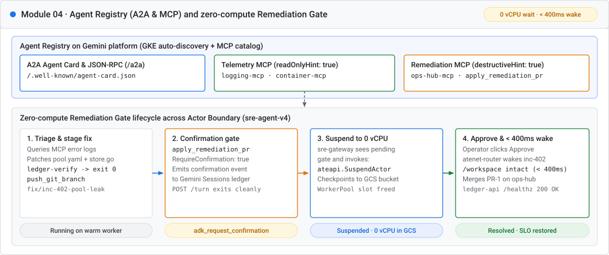

# Agent Registry discovery and zero-compute remediation gate (14 min)

In Modules 01–03, your **Incident Actor** cloned `ledger-api.git` into `/workspace`, recalled **Consolidated Memory**, and executed `SHA-256`-verified **Procedural Skills** from **Skill Registry**. Production SRE triage also requires live observability tools (Cloud Logging, GKE workload health, and Operations Hub) and a hard human-in-the-loop boundary before merging a remediation pull request into `main`.

In Module 04, you build `sre-agent-v4`, the final **Incident Actor** image used through Module 06, by discovering governed **MCP** servers dynamically from **Agent Registry** (`google.golang.org/adk/v2/agentregistry`), advertising the **Platform SRE Triage Agent** over **A2A** (`/.well-known/agent-card.json` + `/a2a`), and wiring ADK Go v2's `RequireConfirmation: true` **Remediation Gate** so `inc-402` checkpoints to **0 vCPU** in Cloud Storage while awaiting human approval and resumes in **under 400 ms** to merge the verified fix.



## How Agent Registry, A2A, and the Zero-Compute Remediation Gate fit together

| Capability | Surface | Security & compute contract |
|---|---|---|
| **GKE auto-registration & A2A Agent Card** | `Deployment/sre-gateway` (`registry.gke.io/functional-type: "AGENT"`, `a2a-protocol.org/agent-card`) + `GET /.well-known/agent-card.json` & `POST /a2a` | GKE **Agent Registry** ingests `Platform SRE Triage Agent` metadata automatically; peer orchestrators invoke `message/send` and `tasks/get` over JSON-RPC 2.0 across the **Governed Broker**. |
| **Dynamic MCP discovery (`adk/v2/agentregistry`)** | `brokerclient.NewAgentRegistryClient` + `brokerclient.DiscoverMCPToolsets` -> `sre-gateway/mcp/{logging-mcp,container-mcp,ops-hub-mcp}` | Keyless **Incident Actors** discover MCP servers and tool safety annotations (`readOnlyHint`, `destructiveHint`) at startup; `sre-gateway` attaches cloud credentials outside the sandbox and blocks unapproved `destructiveHint: true` tools (`HTTP 403`). |
| **Zero-Compute Remediation Gate (`0 vCPU` -> `< 400ms` wake)** | `brokerclient.NewRemediationTools` (`push_git_branch` + `apply_remediation_pr` with `RequireConfirmation: true`) + `POST /api/incidents/INC-402/remediation/{approve,reject}` | When the model invokes `apply_remediation_pr`, ADK emits `adk_request_confirmation` into **Gemini Sessions** and exits `/turn` cleanly; `sre-gateway` immediately calls `ateapi.SuspendActor` (`0 vCPU` in GCS). Approving wakes `inc-402` in `< 400ms` with `/workspace/ledger-api` intact to merge `fix/inc-402-pool-leak` and restore `ledger-api` `/healthz` to `200 OK`. |

## Steps

1. **Inspect the A2A Agent Card and Agent Registry catalog on `sre-gateway`.** Ensure your `sre-gateway` port-forward is running and inspect `/.well-known/agent-card.json` plus `/api/catalog`:
   ```bash
   source scripts/env.sh
   make forward-gateway
   curl -s http://localhost:8081/.well-known/agent-card.json | jq '{name, version, url, skills: [.skills[].id]}'
   curl -s http://localhost:8081/api/catalog | jq '{agents: [.agents[].displayName], mcp_servers: [.mcp_servers[] | {id: .mcpServerId, tools: [.tools[] | {name, readOnly: .annotations.readOnlyHint, destructive: .annotations.destructiveHint}]}]}'
   ```
   Open `http://localhost:8081/catalog` (**Skill & agent catalog** in the **Incident Console**) to inspect the **Agent Registry · A2A agents** and **Agent Registry · governed MCP servers** tables alongside your `SHA-256` **Procedural Skills**. Notice how `query_service_error_logs` and `get_deployment_health` carry green `readOnlyHint` pills, while `apply_remediation_pr`, `delete_production_namespace`, and `drop_ledger_database` carry red `destructiveHint` pills.

2. **Open `app/cmd/agent/main.go` in Cloud Shell Editor and complete `WORKSHOP(module-4)`.** Run the command below in Cloud Shell to open `app/cmd/agent/main.go`:
   ```bash
   cloudshell edit app/cmd/agent/main.go
   ```
   Locate `func buildRunner` in `app/cmd/agent/main.go`. Replace the entire `buildRunner` function with the code you copy below and save the file (`Ctrl+S` or `Cmd+S`—or compare against `modules/04-agent-registry-mcp-a2a/solution/main.go`):
   ```go
   func buildRunner(ctx context.Context, cfg agentruntime.Config, workspaceTools []tool.Tool) (*runner.Runner, error) {
   	llm, err := brokerclient.NewModel(ctx, cfg.BrokerURL, cfg.ModelName, nil)
   	if err != nil {
   		return nil, err
   	}

   	sessionSvc, err := brokerclient.NewSessionService(cfg.BrokerURL, nil)
   	if err != nil {
   		return nil, err
   	}
   	memorySvc, err := brokerclient.NewMemoryService(cfg.BrokerURL, nil)
   	if err != nil {
   		return nil, err
   	}
   	memoryPlugin, err := brokerclient.NewMemoryConsolidationPlugin(sessionSvc, memorySvc)
   	if err != nil {
   		return nil, err
   	}

   	tools := append([]tool.Tool(nil), workspaceTools...)
   	tools = append(tools, loadmemorytool.New(), preloadmemorytool.New())

   	// 1. Attach push_git_branch and confirmation-gated apply_remediation_pr (RequireConfirmation: true).
   	remediationTools, err := brokerclient.NewRemediationTools(cfg.BrokerURL, cfg.WorkspaceDir, nil)
   	if err != nil {
   		return nil, err
   	}
   	tools = append(tools, remediationTools...)

   	skillSource, err := brokerclient.NewSkillSource(cfg.BrokerURL, cfg.WorkspaceDir, nil)
   	if err != nil {
   		return nil, err
   	}
   	skillsTS, err := skilltoolset.New(ctx, skilltoolset.Config{
   		Source: skillSource,
   	})
   	if err != nil {
   		return nil, err
   	}
   	toolsets := []tool.Toolset{skillsTS}

   	// 2. Dynamically discover governed MCP servers (logging-mcp, container-mcp, ops-hub-mcp) from Agent Registry.
   	regClient, err := brokerclient.NewAgentRegistryClient(
   		ctx,
   		cfg.BrokerURL,
   		os.Getenv("GOOGLE_CLOUD_PROJECT"),
   		os.Getenv("REGION"),
   		nil,
   	)
   	if err != nil {
   		return nil, err
   	}
   	mcpToolsets, err := brokerclient.DiscoverMCPToolsets(ctx, regClient, cfg.BrokerURL, nil)
   	if err != nil {
   		return nil, err
   	}
   	toolsets = append(toolsets, mcpToolsets...)

   	triageAgent, err := llmagent.New(llmagent.Config{
   		Name:        "sre_triage_agent",
   		Description: "Platform SRE Triage Agent running inside a keyless Agent Substrate gVisor Incident Actor.",
   		Model:       llm,
   		InstructionProvider: func(agent.ReadonlyContext) (string, error) {
   			return agentruntime.DefaultInstruction, nil
   		},
   		Tools:    tools,
   		Toolsets: toolsets,
   	})
   	if err != nil {
   		return nil, err
   	}

   	return runner.New(runner.Config{
   		AppName:           agentruntime.AppName,
   		Agent:             triageAgent,
   		SessionService:    sessionSvc,
   		MemoryService:     memorySvc,
   		PluginConfig:      runner.PluginConfig{Plugins: []*plugin.Plugin{memoryPlugin}},
   		AutoCreateSession: true,
   	})
   }
   ```
   **What this code does:**
   - `brokerclient.NewRemediationTools(cfg.BrokerURL, cfg.WorkspaceDir, nil)` registers `push_git_branch` (which pushes the verified `/workspace/ledger-api` fix branch over `sre-gateway/ops/git/ledger-api.git`) and `apply_remediation_pr` configured with ADK Go v2's `RequireConfirmation: true` **Remediation Gate** so the actor pauses and suspends to `0 vCPU` in Cloud Storage until a human operator approves.
   - `brokerclient.NewAgentRegistryClient(...)` and `brokerclient.DiscoverMCPToolsets(...)` query **Agent Registry** via `sre-gateway` at startup and attach the governed MCP toolsets (`logging-mcp`, `container-mcp`, `ops-hub-mcp`) to the agent without mounting cloud credentials inside the sandbox.

3. **Build `sre-agent-v4` and warm its Golden Snapshot.** Build the final workshop agent image, register `modules/04-agent-registry-mcp-a2a/manifests/template-v4.yaml.tmpl`, and update `sre-gateway` to default new incidents to `sre-agent-v4`:
   ```bash
   make build-agent
   scripts/render.sh modules/04-agent-registry-mcp-a2a/manifests/template-v4.yaml.tmpl | kubectl ate create actor-template -f -
   until kubectl ate get actor-template sre-agent-v4 -a "$ATESPACE" -o json | jq -e '.status.goldenSnapshotStatus.goldenTag.name' >/dev/null; do sleep 2; done
   DEFAULT_ACTOR_TEMPLATE=sre-agent-v4 make gateway
   make forward-gateway
   ```
   If an older `inc-402` Actor from Modules 01–03 exists in `$ATESPACE`, delete it and wait for teardown to finish so `INC-402` boots cleanly from `sre-agent-v4` (its prior **Session Ledger** and **Consolidated Memory** remain intact):
   ```bash
   kubectl ate delete actor inc-402 -a "$ATESPACE" 2>/dev/null || true
   while kubectl ate get actor inc-402 -a "$ATESPACE" >/dev/null 2>&1; do sleep 1; done
   ```

4. **Trigger end-to-end remediation on `INC-402` and observe immediate `0 vCPU` suspension.** Send a remediation prompt (either via the preset chip in the **SRE triage agent** pane at `http://localhost:8081/` or via `curl`):
   ```bash
   curl -s -X POST http://localhost:8081/api/chat \
     -H 'Content-Type: application/json' \
     -d '{
       "incident_id": "INC-402",
       "template": "sre-agent-v4",
       "prompt": "Stage and remediate INC-402 end-to-end: query MCP logs and health, patch config/pool.yaml and pool/store.go on branch fix/inc-402-pool-leak, verify with ledger-verify, push the branch, and apply_remediation_pr."
     }' | jq '{actor_name, template, remediation_gate_pending, call_id, tool_name, branch: .workspace.branch, verify_ok: .workspace.verify_ok, tool_steps: [(.tool_steps // [])[].name]}'
   ```
   Verify what just happened across the **Actor Boundary**:
   - `inc-402` queried `query_service_error_logs` (`logging-mcp`) and `get_deployment_health` (`container-mcp`), staged the dual fix (`max_open_conns: 32`, `idle_timeout_seconds: 30` in `config/pool.yaml` + `defer rows.Close()` before `ValidateChecksum` in `pool/store.go`) on branch `fix/inc-402-pool-leak`, confirmed `ledger-verify` exited `0`, pushed `fix/inc-402-pool-leak` to `ops-hub`, and called `apply_remediation_pr`.
   - ADK Go v2 emitted `adk_request_confirmation` into the **Session Ledger**, and `sre-gateway` **immediately** suspended `inc-402` to Cloud Storage (`0 vCPU`), freeing the **WorkerPool** slot while waiting for human review:
     ```bash
     kubectl ate get actor inc-402 -a "$ATESPACE"
     ```

5. **Approve the Remediation Gate and verify `< 400ms` resume + `ledger-api` recovery.** Open `http://localhost:8081/` (`Investigations`):
   - Inspect the staged unified diff in **Actor `/workspace` checkout & staged diff** and notice the yellow **Remediation gate paused · awaiting operator approval** banner with the `Suspended · 0 vCPU` badge.
   - Click **Approve remediation** in the banner (or run the `curl` command below):
   ```bash
   curl -s -X POST http://localhost:8081/api/incidents/INC-402/remediation/approve \
     -H 'Content-Type: application/json' \
     -d '{}' | jq '{actor_name, remediation_gate_pending, resume_duration_ms, reply}'
   ```
   `atenet-router` restores `inc-402` from Cloud Storage (`< 400ms`) with `/workspace/ledger-api` intact, ADK executes `apply_remediation_pr` through `/mcp/ops-hub-mcp`, `ops-hub` merges `PR-1` into `main` and reloads `ledger-api`, `INC-402` flips to `RESOLVED`, and `Target service telemetry (ledger-api)` turns green (`Healthy · SLO met`, `/healthz` `200 OK`)!

6. **Test A2A peer invocation (`POST /a2a`).** Confirm an external A2A client can invoke the **Platform SRE Triage Agent** via JSON-RPC 2.0 `message/send`:
   ```bash
   curl -s -X POST http://localhost:8081/a2a \
     -H 'Content-Type: application/json' \
     -d '{
       "jsonrpc": "2.0",
       "id": "a2a-demo-1",
       "method": "message/send",
       "params": {
         "contextId": "inc-403",
         "metadata": {"incident_id": "INC-403"},
         "message": {
           "role": "user",
           "parts": [{"kind": "text", "text": "Triage sibling incident INC-403 using Consolidated Memory from prior ledger-api incidents."}]
         }
       }
     }' | jq '{id: .result.id, state: .result.status.state, reply: .result.parts[0].text}'
   ```
   **What this does and why it matters:**
   - **Standard peer-agent discovery and interoperability (`/.well-known/agent-card.json` + `/a2a`)**: Any external orchestrator or peer agent (in **Agent Registry**, **Gemini Enterprise**, or another team's service) discovers the **Platform SRE Triage Agent** via its standard **A2A Agent Card** and invokes `message/send` over JSON-RPC 2.0—without needing `kubectl-ate` or any Agent Substrate SDK.
   - **Transparent `< 400ms` wake from `0 vCPU` across the Actor Boundary**: Behind `POST /a2a`, `sre-gateway` maps `"contextId": "inc-403"` to the `inc-403` **Incident Actor**, wakes its gVisor sandbox from Cloud Storage (`0 vCPU` -> active), recalls **Consolidated Memory** from `INC-402` across the **Actor Boundary**, and returns a standard A2A `"state": "completed"` task response.

## Checkpoint

Verify your Module 04 state:

```bash
make verify MODULE=4
```

**Need to catch up or reset `sre-agent-v4`?** Run `make catch-up MODULE=5` (add `RESET=1` to rebuild `sre-agent-v4` from `modules/04-agent-registry-mcp-a2a/solution/main.go`).

Next: [Zero-trust governance across the actor boundary](../05-zero-trust-governance/README.md)
