# Architecture tour (10 min)

The goal of this section is to learn what each piece of Agent Substrate does before you use it. You inspect
the live system while the installation finishes (`make install-status`).

## Why not a Pod per agent?

An agent spends most of its life **waiting**: for a user, for a model, or for a tool. A Pod per agent
reserves CPU and memory during all of that idle time, and deleting the Pod loses the agent's memory.
Substrate runs agents as **actors**. An actor is a sandboxed process that Substrate can **suspend** (checkpointing it to Cloud Storage and
freeing its slot) and **resume** on *any* worker, often in about a second, with its memory intact. A few worker Pods serve
many actors.

> **Comparison with [kubernetes-sigs/agent-sandbox](https://github.com/kubernetes-sigs/agent-sandbox):**
> `agent-sandbox` is a separate project with no Substrate integration. It assigns each sandbox its own Pod.
>
> | agent-sandbox | Agent Substrate | Difference |
> |---|---|---|
> | Sandbox (a Pod) | Actor (a process in a worker) | Many actors share a few workers |
> | SandboxTemplate | ActorTemplate | Substrate takes a **golden snapshot** of the template |
> | SandboxWarmPool | WorkerPool | Workers are generic; any worker runs any actor of a matching template |
> | SandboxClaim | create / resume actor | Resume restores memory, not just disk |
> | Suspend = delete the Pod | Suspend = checkpoint memory and disk to Cloud Storage | Resume on *any* worker |
>
> Note the naming overlap: Substrate also has a `SandboxConfig` CRD, which configures gVisor and microVM runtimes.
>
> **Where does [AX (`google/ax`)](https://github.com/google/ax) fit?**
> Substrate is the **runtime and sandbox** layer: it isolates, snapshots, routes to, and suspends or resumes
> actor processes across shared workers, without caring what runs inside them. **AX (Agent eXecutor)** is a higher-level,
> `kubectl`-style **control plane** (`ax.io/v1alpha1`) built on top of Substrate. You declare a `Workspace` (Git repositories,
> files, MCP servers, skills), a `Task` (image, command, resources), and a `Model`, and AX compiles them into the
> Substrate `ActorTemplate` and `Actor` records that you build by hand from "Hello actor" through "Density and idle" ([optional lab B](../../optional/B-ax/README.md)
> runs AX on this cluster).

## The pieces



| Component | Job |
|---|---|
| **ateapi** | The control API (gRPC). `kubectl ate` and your own code call it to create, suspend, resume, and delete actors. Creating an `ActorTemplate` also instructs `ateapi` to run that template's golden-snapshot actor once before the template becomes ready for use. |
| **Postgres** | Stores Substrate's records: atespaces, templates, actors, workers, and tags. **These are not Kubernetes objects.** |
| **atecontroller** | Reconciles `WorkerPool` CRDs into worker Pods (one Kubernetes `Deployment` per pool) and registers each Pod with `ateapi` as a Worker. |
| **atelet** | Runs on each worker. Starts actors in a gVisor sandbox, and snapshots and restores them to and from Cloud Storage. |
| **atenet-router** | The front door. Routes HTTP requests using the `ate-target-actor` header. If the target actor is suspended, the router **parks the request, resumes the actor, and then forwards the request**. |
| **atenet-egress** | Proxies every outbound connection from an actor. **Denies traffic by default**; `EgressPolicy` opens specific destinations. |
| **k8s-credential-provider** | Resolves `ate-secret://k8s.io/…` references from Kubernetes Secrets for `atenet-egress` when an `https` `EgressPolicy` rule injects headers (optional lab J). Denies access by default until you grant specific namespaces. |
| **podcertcontroller** | Issues certificates so actors and components have cryptographic identities. Clients trust `ateapi` through a `ClusterTrustBundle`. |

**CRDs vs. records**

| Kubernetes CRDs (`kubectl get`) | Substrate records (`kubectl ate get`) |
|---|---|
| WorkerPool, SandboxConfig, CSIDriverConfig | Atespace, ActorTemplate, Actor, Worker, Tag |

`EgressPolicy` is also a Substrate record, with one policy per actor (`kubectl ate get egress-policy NAME -a workshop`).
In the "Make it an agent" section, you apply policies using the workshop's `egressctl` tool (built in the setup), which can apply a single policy
file to every actor at once.

An **atespace** is Substrate's tenancy boundary for records, similar to a Kubernetes namespace but for actors.
It is separate from a Kubernetes namespace. Your `WorkerPool` lives in the Kubernetes namespace `workshop`, and your actors live in the atespace `workshop`.

## Look around

```bash
make install-status                              # wait for "Agent Substrate is ready"
kubectl -n ate-system get deploy,ds,sts,svc
kubectl get crd | grep ate.dev
kubectl get sandboxconfigs                       # gvisor-default — the runtime profile actors use
kubectl get clustertrustbundles -l podcert.ate.dev/canarying=live
kubectl -n ate-system get deploy atenet-egress   # the egress proxy (used in "Make it an agent")
kubectl ate get atespaces
kubectl ate get workers -n workshop              # none yet — "Hello actor" creates a WorkerPool
cat .workshop/worker-image                       # the worker build that matches your control plane
```

Right after the installation finishes, you might see an extra `atenet-router` Pod in the `Terminating` state. That Pod is the previous instance draining:
the installer patches the router with a longer parked-request budget and a 120-second grace period, which triggers a rolling update.

## What just happened
- You inspected the control plane (`ateapi`, `atecontroller`, Postgres), the data plane (`atelet` in each worker, the router, and the egress proxy),
  and the identity plumbing (`podcertcontroller`, `ClusterTrustBundle`).
- The worker image must come from the **same build** as the control plane. The installation script
  records this image in `.workshop/worker-image` so that your `WorkerPool` stays in sync.

## Checkpoint
```bash
make verify MODULE=1
```
**Stuck?** Run `make catch-up MODULE=2`.

Next: [Hello actor](../02-hello-actor/README.md)
