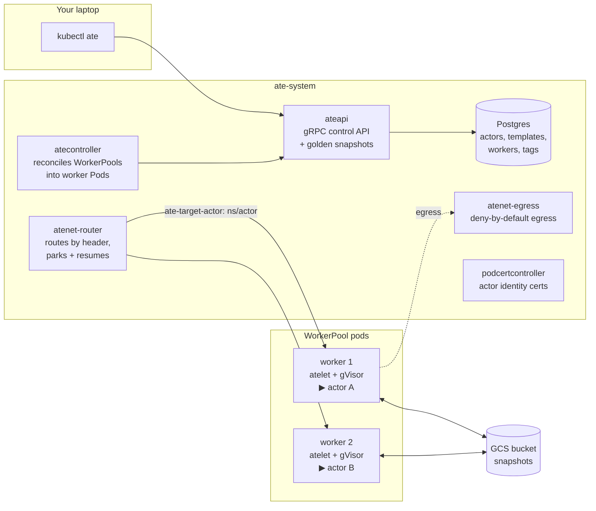

# Module 1 — Architecture tour (10 min)

**Goal:** know what each piece of Agent Substrate does before you use it. You'll poke
at the live system while the install finishes: `make install-status`.

## Why not a Pod per agent?

An agent spends most of its life **waiting**: for a user, for a model, for a tool. A Pod per agent
reserves CPU and memory for all of that idle time, and deleting the Pod loses the agent's memory.
Substrate runs agents as **actors**. An actor is a sandboxed process that can be **suspended** (checkpointed to GCS,
freeing its slot) and **resumed** on *any* worker, often in about a second, with its memory intact. A few worker Pods serve
many actors.

> **Compared with [kubernetes-sigs/agent-sandbox](https://github.com/kubernetes-sigs/agent-sandbox).**
> agent-sandbox is a separate project with no Substrate integration. It gives each sandbox its own Pod.
>
> | agent-sandbox | Agent Substrate | Difference |
> |---|---|---|
> | Sandbox (a Pod) | Actor (a process in a worker) | Many actors share few workers |
> | SandboxTemplate | ActorTemplate | Substrate takes a **golden snapshot** of the template |
> | SandboxWarmPool | WorkerPool | Workers are generic; any worker runs any actor of a matching template |
> | SandboxClaim | create / resume actor | Resume restores memory, not just disk |
> | Suspend = delete the Pod | Suspend = checkpoint memory + disk to GCS | Resume on *any* worker |
>
> Watch for the naming clash: Substrate also has a `SandboxConfig` CRD, but it configures gVisor/microVM runtimes.
>
> **Where does [AX (`google/ax`)](https://github.com/google/ax) fit?**
> Substrate is the **runtime and sandbox** layer: it knows how to isolate, snapshot, route to, and suspend/resume
> actor processes across shared workers, without caring what runs inside them. **AX (Agent eXecutor)** is a higher-level,
> `kubectl`-shaped **control plane** (`ax.io/v1alpha1`) built on top of Substrate: you declare a `Workspace` (Git repos,
> files, MCP servers, skills), a `Task` (image, command, resources), and a `Model`, and AX compiles them into the
> Substrate `ActorTemplate` and `Actor` records you'll build by hand in Modules 2–5 ([optional lab B](../../optional/B-ax/README.md)
> runs AX on this cluster).

## The pieces



| Component | Job |
|---|---|
| **ateapi** | The control API (gRPC). `kubectl ate` and your own code call it to create, suspend, resume, and delete actors. Creating an `ActorTemplate` also drives it to run that template's golden-snapshot actor once, before the template is ready for use. |
| **Postgres** | Stores Substrate's records: atespaces, templates, actors, workers, tags. **These are not Kubernetes objects.** |
| **atecontroller** | Reconciles `WorkerPool` CRDs into worker Pods (a Kubernetes `Deployment` per pool) and registers each Pod with ateapi as a Worker. |
| **atelet** | Runs on each worker. Starts actors in a gVisor sandbox, and snapshots and restores them to and from GCS. |
| **atenet-router** | The front door. Routes HTTP by the `ate-target-actor` header. If the actor is suspended, it **parks the request, resumes the actor, then forwards**. |
| **atenet-egress** | Every outbound connection from an actor goes through here. **Deny by default**; EgressPolicy opens holes. |
| **k8s-credential-provider** | Resolves `ate-secret://k8s.io/…` references from Kubernetes Secrets for `atenet-egress` when an `https` EgressPolicy rule injects headers (optional lab J). Default-deny until granted namespaces. |
| **podcertcontroller** | Issues certificates so actors and components have identities. Clients trust ateapi through a ClusterTrustBundle. |

**CRDs vs records**

| Kubernetes CRDs (`kubectl get`) | Substrate records (`kubectl ate get`) |
|---|---|
| WorkerPool, SandboxConfig, CSIDriverConfig | Atespace, ActorTemplate, Actor, Worker, Tag |

`EgressPolicy` is also a Substrate record, one per actor (`kubectl ate get egress-policy NAME -a workshop`).
Module 4 applies them with the workshop's own `egressctl` (built in Module 0), because it can put one policy
file on every actor at once.

An **atespace** is Substrate's tenancy boundary for records, like a namespace but for actors.
It is not a Kubernetes namespace. Your WorkerPool lives in namespace `workshop`, and your actors live in atespace `workshop`.

## Look around

```bash
make install-status                              # wait for "Agent Substrate is ready"
kubectl -n ate-system get deploy,ds,sts,svc
kubectl get crd | grep ate.dev
kubectl get sandboxconfigs                       # gvisor-default — the runtime profile actors use
kubectl get clustertrustbundles -l podcert.ate.dev/canarying=live
kubectl -n ate-system get deploy atenet-egress   # the egress proxy (Module 4)
kubectl ate get atespaces
kubectl ate get workers -n workshop              # none yet — Module 2 creates a WorkerPool
cat .workshop/worker-image                       # the worker build that matches your control plane
```

Right after the install you may see an extra `atenet-router` pod in `Terminating`. That's the old one draining:
the install patches the router (a longer parked-request budget and a 120s grace period), which rolls it.

## What just happened
- You saw the control plane (ateapi, atecontroller, Postgres), the data plane (atelet in each worker, the router, egress),
  and the identity plumbing (podcertcontroller, ClusterTrustBundles).
- The worker image must come from the **same build** as the control plane. The install script
  recorded it in `.workshop/worker-image` so your WorkerPool can't drift.

## Checkpoint
```bash
make verify MODULE=1
```
**Stuck?** Run `make catch-up MODULE=2`.

Next: [Module 2 — Hello actor](../02-hello-actor/README.md)
