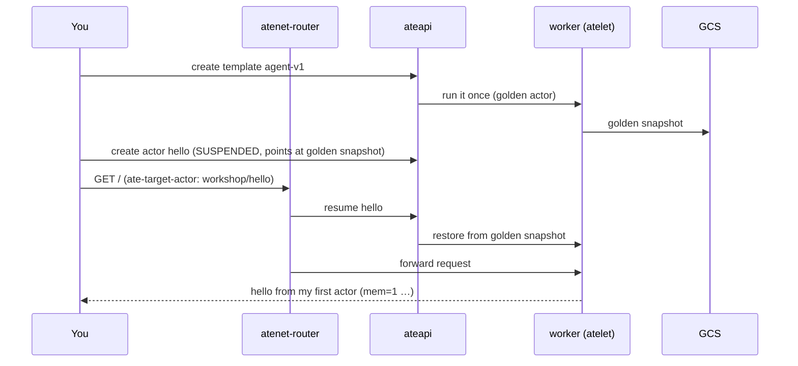

# Module 2 — Hello actor (15 min)

**Goal:** build your agent image, give Substrate workers to run it, register a template, create
an actor, and talk to it through the router.



## Steps

1. **Make it yours.** Open `app/cmd/agent/main.go` and find `WORKSHOP(module-2)`. Change the greeting.
   Then build and push the image. ko prints a digest-pinned reference, which is saved to `.workshop/agent-image`.
   ```bash
   make build-agent
   ```
2. **Workers.** A WorkerPool is a Kubernetes CRD. The controller turns it into worker Pods that run atelet.
   ```bash
   scripts/render.sh modules/02-hello-actor/manifests/workerpool.yaml.tmpl   # read it first
   scripts/render.sh modules/02-hello-actor/manifests/workerpool.yaml.tmpl | kubectl apply -f -
   kubectl -n workshop get pods -w          # Ctrl-C when 2 are Running
   kubectl ate get workers -n workshop
   ```
3. **An atespace.** This is the tenancy boundary for Substrate records.
   ```bash
   kubectl ate create atespace workshop
   ```
4. **A template.** Read `modules/02-hello-actor/manifests/template.yaml.tmpl`: it has the image, a readiness
   probe, the snapshot scope for pause and suspend, the GCS location, the gVisor sandbox, and one durable directory.
   ```bash
   scripts/render.sh modules/02-hello-actor/manifests/template.yaml.tmpl | kubectl ate create actor-template -f -
   kubectl ate get actor-template agent-v1 -a workshop -o yaml    # repeat until status shows a goldenTag
   ```
   Substrate starts your container once on a free worker, waits for `/readyz`, and snapshots it.
   That **golden snapshot** is the starting point for every actor of this template. Creating an actor
   restores a snapshot instead of cold-booting a process.
5. **An actor.**
   ```bash
   kubectl ate create actor hello --template=agent-v1 -a workshop
   kubectl ate get actors -a workshop       # SUSPENDED: it exists, but isn't running anywhere
   ```
6. **Talk to it.** The router picks the actor from the `ate-target-actor` header.
   ```bash
   make forward-router                      # port-forwards atenet-router to localhost:8080
   curl -H 'ate-target-actor: workshop/hello' localhost:8080/
   curl -H 'ate-target-actor: workshop/hello' localhost:8080/
   curl -s -H 'ate-target-actor: workshop/hello' localhost:8080/state | jq
   kubectl ate get actors -a workshop       # RUNNING, with a worker assigned
   kubectl ate get workers -n workshop
   ```
   The first request was **parked** while the router resumed `hello`. `mem` counts requests in memory.
   `disk=-1` because the agent doesn't use its durable directory yet (Module 3).

## What just happened
- **WorkerPool** is capacity: generic, pre-started worker Pods. **ActorTemplate** is what to run.
  An **Actor** is one instance with its own identity and state. Actors don't map to Pods:
  any worker in the selected pool can run any actor of the template.
- The `workload: workshop-agent` label does two different jobs: on the WorkerPool it's what the
  template's `workerSelector` matches to pick a pool, and on the pod template (`spec.template.labels`)
  it's what lands on the actual worker Pods, which is why `kubectl get pods -l workload=workshop-agent`
  finds them.
- `create actor` is cheap. It writes a record that points at the golden snapshot. The actor first runs
  when a request arrives.
- `kubectl ate` is a kubectl plugin that calls **ateapi**. Actors live in Postgres, not etcd, so
  `kubectl get actors` doesn't exist.

## Checkpoint
```bash
make verify MODULE=2
```
**Stuck?** Run `make catch-up MODULE=3`. If `agent-v1` or its actors exist but are broken, run `make catch-up MODULE=3 RESET=1`, which deletes and recreates them from the solution.

Next: [Module 3 — Suspend and resume](../03-suspend-resume/README.md)
