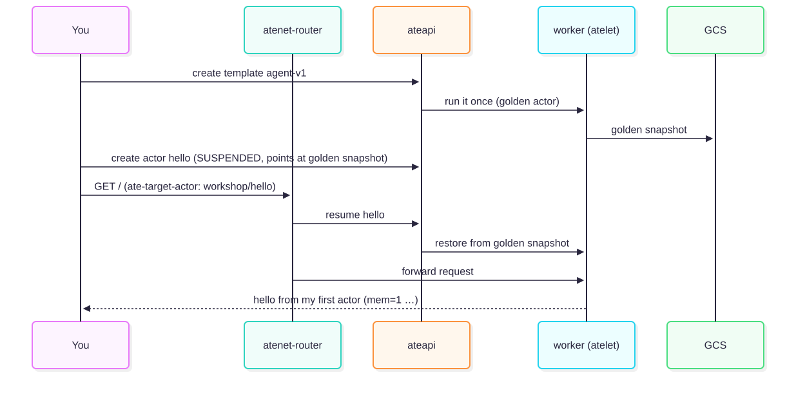

# Hello actor (15 min)

The goal of this section is to build your agent image, give Substrate workers to run it, register a template, create
an actor, and send requests to it through the router.



## Steps

1. **Customize the greeting.** Open `app/cmd/agent/main.go`, find `WORKSHOP(module-2)`, and change the greeting.
   Then build and push the image. `ko` prints a digest-pinned image reference and saves it to `.workshop/agent-image`.
   ```bash
   make build-agent
   ```
   `ko` might log warnings such as `git doesn't contain any tags` and `git is in a dirty state … M app/cmd/agent/main.go`. Those warnings are
   expected because you just edited the file, and the build still succeeds.
2. **Create a WorkerPool.** A `WorkerPool` is a Kubernetes CRD. The controller reconciles it into worker Pods that run `atelet`.
   ```bash
   scripts/render.sh modules/02-hello-actor/manifests/workerpool.yaml.tmpl   # inspect the rendered manifest
   scripts/render.sh modules/02-hello-actor/manifests/workerpool.yaml.tmpl | kubectl apply -f -
   kubectl -n workshop get pods -w          # press Ctrl+C when 2 Pods are Running
   kubectl ate get workers -n workshop
   ```
3. **Create an atespace.** An atespace is the tenancy boundary for Substrate records.
   ```bash
   kubectl ate create atespace workshop
   ```
4. **Create an ActorTemplate.** Inspect `modules/02-hello-actor/manifests/template.yaml.tmpl`: it defines the container image, a readiness
   probe, the snapshot fidelity (`preferredFidelity`), resource limits (`cpuMillicores`, `memoryBytes`), and one durable directory.
   ```bash
   scripts/render.sh modules/02-hello-actor/manifests/template.yaml.tmpl | kubectl ate create actor-template -f -
   kubectl ate get actor-template agent-v1 -a workshop            # repeat until GOLDEN TAG appears
   kubectl ate get actor-template agent-v1 -a workshop -o yaml    # inspect status.goldenSnapshotStatus.goldenTag.name
   ```
   Substrate starts your container once on a free worker, waits for its `wakeupProbe` (`/readyz`) to pass, and snapshots it.
   That **golden snapshot** serves as the starting point for every actor created from this template. Creating an actor
   restores this snapshot instead of cold-booting a process.
5. **Create an actor.**
   ```bash
   kubectl ate create actor hello --template=agent-v1 -a workshop
   kubectl ate get actors -a workshop       # SUSPENDED: the record exists, but it isn't running on a worker
   ```
6. **Send requests to the actor.** The router selects the target actor from the `ate-target-actor` header.
   ```bash
   make forward-router                      # port-forwards atenet-router to localhost:8080
   curl -H 'ate-target-actor: workshop/hello' localhost:8080/
   curl -H 'ate-target-actor: workshop/hello' localhost:8080/
   curl -s -H 'ate-target-actor: workshop/hello' localhost:8080/state | jq
   kubectl ate get actors -a workshop       # RUNNING, with a worker assigned
   kubectl ate get workers -n workshop
   ```
   The router **parks** the first request while it resumes `hello`. `mem` counts requests in memory.
   `disk=-1` because the agent doesn't use its durable directory yet (you configure that in the "Suspend and resume" section).

## What just happened
- **`WorkerPool`** provides capacity: generic, pre-started worker Pods. **`ActorTemplate`** defines what to run.
  An **`Actor`** is an individual instance with its own identity and state. Actors don't map 1:1 to Pods:
  any worker in the selected pool can run any actor of that template.
- The `workload: workshop-agent` label serves two distinct purposes: on the `WorkerPool`, the
  template's `workerSelector` matches it to select a pool; on the Pod template (`spec.template.labels`),
  Kubernetes applies it to the worker Pods so that `kubectl get pods -l workload=workshop-agent`
  can find them.
- `create actor` is lightweight. It writes a database record that points to the golden snapshot. The actor first runs
  when a request arrives.
- `kubectl ate` is a `kubectl` plugin that calls **`ateapi`**. Actors live in Postgres rather than etcd, so
  `kubectl get actors` doesn't exist.

## Checkpoint
```bash
make verify MODULE=2
```
**Stuck?** Run `make catch-up MODULE=3`. If `agent-v1` or its actors exist in a broken state, run `make catch-up MODULE=3 RESET=1` to delete and recreate them from the solution.

Next: [Suspend and resume](../03-suspend-resume/README.md)
