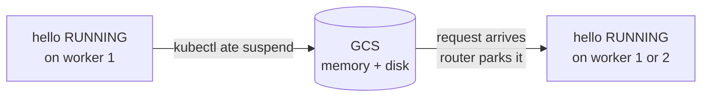

# Module 3 — Suspend and resume (12 min)

**Goal:** see what survives a suspend, where it goes, and how the router brings an actor back,
possibly on a different worker.



## Part A: full-memory suspend (template agent-v1)

1. Make some state, then note the worker and the boot ID:
   ```bash
   for i in 1 2 3; do curl -s -H 'ate-target-actor: workshop/hello' localhost:8080/; done
   curl -s -H 'ate-target-actor: workshop/hello' localhost:8080/state | jq '{memCount, bootID}'
   kubectl ate get actors -a workshop       # the WORKER POD column is the worker
   ```
   (The agent's `hostname` is always `actor` inside the sandbox, so it can't tell you the worker; the
   `WORKER POD` column can.) If the port-forward died, restart it: `make forward-router`.
2. Suspend it and watch the worker free up:
   ```bash
   kubectl ate suspend actor hello -a workshop
   kubectl ate get actors -a workshop       # SUSPENDED, no worker
   kubectl ate get workers -n workshop      # both workers free
   ```
3. Talk to it again:
   ```bash
   curl -s -H 'ate-target-actor: workshop/hello' localhost:8080/
   curl -s -H 'ate-target-actor: workshop/hello' localhost:8080/state | jq '{memCount, bootID}'
   ```
   `mem` **continues** from where it was, and the `bootID` is the **same**. The process never restarted:
   its memory was checkpointed to GCS and restored, possibly on the other worker.
   You'll see the router's resume in the dashboards in Module 6.

## Part B: disk-only suspend (template agent-v2)

A full-memory snapshot is powerful but large. Many agents only need their files. `agent-v2` suspends
with **DATA** scope: only the durable directory is saved, and resume cold-boots the process.

4. Point the agent at its durable directory. In `app/cmd/agent/main.go`, find `WORKSHOP(module-3)` and set
   `DataDir: "/data"`. Then:
   ```bash
   make build-agent
   ```
5. Keep `hello` suspended. A new template needs a **free worker** for its golden actor, and you have two.
   Create the template and an actor:
   ```bash
   kubectl ate suspend actor hello -a workshop 2>/dev/null; kubectl ate get actors -a workshop
   diff modules/02-hello-actor/manifests/template.yaml.tmpl modules/03-suspend-resume/manifests/template.yaml.tmpl
   scripts/render.sh modules/03-suspend-resume/manifests/template.yaml.tmpl | kubectl ate create actor-template -f -
   kubectl ate get actor-template agent-v2 -a workshop -o yaml | grep -A2 goldenTag   # repeat until set
   kubectl ate create actor memo --template=agent-v2 -a workshop
   ```
6. Follow its logs in a second terminal. The stream follows the actor across workers and restarts:
   ```bash
   kubectl ate logs actor memo -a workshop -f
   ```
   Most of what scrolls past is gVisor's own runtime logging (lines starting `I0…`/`W0…`, from `cli.go`,
   `config.go` and so on). The line to watch for is the agent's `agent listening …`. Add
   `| grep -v '^[IW]0'` if you want only the agent's output.
7. Make state, suspend, and come back:
   ```bash
   for i in 1 2 3; do curl -s -H 'ate-target-actor: workshop/memo' localhost:8080/; done
   kubectl ate suspend actor memo -a workshop
   curl -s -H 'ate-target-actor: workshop/memo' localhost:8080/
   ```
   Now `mem=1`: memory was discarded. `disk` kept counting because the file lives in `/data`. The
   boot ID is new, and the logs show a fresh `agent listening` line.

## Templates are immutable
You didn't edit `agent-v1`; you made `agent-v2`. A template's golden snapshot bakes in its image,
command, env, **and the memory of the process when it was snapshotted**. Changing any of it means a new
template version. Existing actors keep their template, so `hello` still runs `agent-v1`.

## What just happened

| | `onCommit: FULL` (hello) | `onCommit: DATA` (memo) |
|---|---|---|
| Saved on suspend | memory + durableDir | durableDir only |
| Resume | restore process (same bootID) | cold boot (new bootID) |
| Snapshot size | ~ memory footprint | ~ files written |
| Good for | agents with warm in-memory context | agents whose state is already on disk |

- Suspend frees the worker, so the next actor can use it. That's how few workers serve many actors (Module 5).
- The router made resume invisible to `curl`. It parked the request until the actor was running.
- The scheduler may hand a resumed actor back to the **same** worker it suspended from — with only two
  workers, that's expected, not a bug. `make verify MODULE=3` warns instead of failing on that.

## Checkpoint
```bash
make verify MODULE=3
```
**Stuck?** Run `make catch-up MODULE=4`. If `agent-v2` or its actors exist but are broken, run `make catch-up MODULE=4 RESET=1`, which deletes and recreates them from the solution.

Next: [Module 4 — Make it an agent](../04-make-it-an-agent/README.md)
