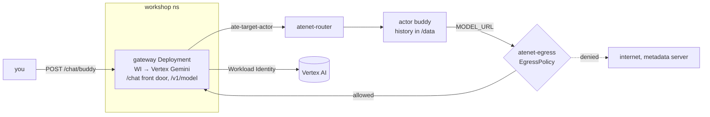

# Module 4 — Make it an agent (13 min)

**Goal:** give the actor a brain without giving it credentials. An always-on **gateway** holds the
model access, and a deny-by-default **egress policy** lets the actor reach the gateway and nothing else.



## Why a gateway?
- **Template env is literal and baked into every snapshot.** A key there ends up in GCS, in every clone, forever.
- Actors don't get a Kubernetes ServiceAccount token. The gateway does, so it uses **Workload Identity** to call Vertex.
- The gateway is always on and cheap. Actors are the expensive, suspendable part. This split between
  **presence** (always on) and **cognition** (suspendable) is the pattern behind real agent systems on Substrate.

## Steps

1. **Deploy the gateway.** It serves `/v1/model` (Vertex Gemini, or a mock if `MOCK_LLM=true` or
   Vertex fails) and `/chat/{actor}`, which forwards to the router with the header set.
   ```bash
   make gateway
   make forward-gateway            # port-forwards the gateway to http://localhost:8081
   curl -s localhost:8081/v1/model -d '{"messages":[{"role":"user","content":"Say hi in five words"}]}' | jq
   ```
   `backend` shows which model answered. If a Vertex call fails (say, a 403 while the Workload Identity
   binding propagates), the gateway answers that request from a mock instead: `backend` is `mock-fallback`
   and `upstreamError` says what Vertex returned. So a `502` from the agent in step 3 is about
   egress, not Vertex.
2. **Free a worker, then teach the agent to call the model.** Suspend `memo` so the new template's golden
   actor has a worker. In `app/cmd/agent/main.go`, find `WORKSHOP(module-4)` and set `ModelURL: os.Getenv("MODEL_URL")`.
   ```bash
   kubectl ate suspend actor memo -a workshop
   make build-agent
   cat modules/04-make-it-an-agent/manifests/template.yaml.tmpl     # note the MODEL_URL env
   scripts/render.sh modules/04-make-it-an-agent/manifests/template.yaml.tmpl | kubectl ate create actor-template -f -
   kubectl ate get actor-template agent-v3 -a workshop -o yaml | grep -A2 goldenTag   # repeat until set
   kubectl ate create actor buddy --template=agent-v3 -a workshop
   ```
3. **Chat, and watch it fail.**
   ```bash
   curl -s localhost:8081/chat/buddy -d '{"message":"What is Agent Substrate?"}'; echo
   ```
   You get a `502`: `model call failed: …`. The agent tried to reach the gateway, but **egress is deny-by-default**
   and `buddy` has no policy — no policy means no tunnel at all, not even a denied one.
4. **Allow exactly one destination.**
   ```bash
   cat modules/04-make-it-an-agent/manifests/egress-gateway.yaml
   make egress POLICY=modules/04-make-it-an-agent/manifests/egress-gateway.yaml ACTOR=buddy
   scripts/egress.sh get --actor=buddy
   curl -s localhost:8081/chat/buddy -d '{"message":"What is Agent Substrate?"}' | jq
   ```
   `atenet-egress` (the router's egress side) caches each actor's policy for a few seconds, so the very
   next call may still see the old "no policy" answer — retry once if so. You don't need to suspend or
   resume `buddy` for the new policy to take effect; it isn't tied to the actor's lifecycle at all.
   EgressPolicy is a Substrate record: see it with `kubectl ate get egress-policy buddy -a workshop -o yaml`.
   `make egress` runs `bin/egressctl`, a 100-line Go client in `app/cmd/egressctl`, rather than
   `kubectl ate create egress-policy`, because `create` fails when a policy already exists and `update`
   needs the record's current metadata.
   For comparison, `egress-open.yaml` allows everything. Don't use it.
5. **A conversation that survives sleep.**
   ```bash
   curl -s localhost:8081/chat/buddy -d '{"message":"My name is Sam. Remember it."}' | jq .reply
   curl -s localhost:8081/chat/buddy -d '{"message":"Give me one fun fact."}' | jq .reply
   kubectl ate suspend actor buddy -a workshop
   curl -s localhost:8081/chat/buddy -d '{"message":"What is my name?"}' | jq
   curl -s localhost:8081/actors/buddy/state | jq
   ```
   History lives in `/data/history.json` and in memory, and both came back. The `turn` count continues.

## If Vertex isn't available
`MOCK_LLM=true make gateway`, or live: `kubectl -n workshop set env deploy/gateway MOCK_LLM=true`.
Everything else in the workshop behaves the same. Once the gateway is running, `make gateway` and `make catch-up`
keep its live `MOCK_LLM` (workshop.env only sets the first deploy); `MOCK_LLM=false make gateway` switches back.

## What just happened
- The actor holds **no secrets**. The gateway's KSA is bound to `roles/aiplatform.user` through Workload Identity.
- **Egress is per actor and deny-by-default.** An actor without a policy can't open outbound connections at all.
  A hostname rule scoped to the gateway is the least privilege that works. It means "only the gateway", not
  "only `/v1/model`": the same host also serves `/chat/{actor}`, `/actors/…` and `/metrics`, so an actor that can
  reach the model can also reach those. A real deployment would serve `/v1/model` on its own Service and allow only that hostname.
- The egress gateway re-checks every request's Host against the actor's current `EgressPolicy`, refetching it
  from `ateapi` every few seconds. A policy change reaches a *running* actor's next outbound call — there's no
  suspend/resume step in the loop, and no restart required.
- The gateway's `/chat/{actor}` is a tiny **front door**: it sets `ate-target-actor`, and the router
  resumes the actor if needed. In Module 5 it also learns *when* to put actors to sleep.

## Checkpoint
```bash
make verify MODULE=4
```
**Stuck?** Run `make catch-up MODULE=5`. If `agent-v3` or its actors exist but are broken, run `make catch-up MODULE=5 RESET=1`, which deletes and recreates them from the solution.

Next: [Module 5 — Density and idle](../05-density-idle/README.md)
