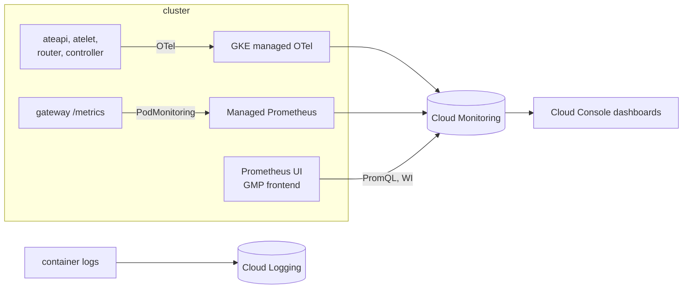

# Module 6 — Observe the fleet (12 min)

**Goal:** answer "what is my fleet doing?" three ways: live PromQL, Cloud Console dashboards, and
per-actor logs. You'll use both Substrate's own telemetry and your app's metrics.



Two sources, one store:
- **Substrate** exports OpenTelemetry through GKE's managed collector. Its names are dotted,
  for example `ate.workerpool.workers`, so PromQL quotes them: `{"ate.workerpool.workers"}`.
- **Your gateway** exposes Prometheus metrics on `/metrics`. A `PodMonitoring` tells Managed Prometheus to scrape it.

Both end up in Cloud Monitoring, so you can query them with PromQL from one place.

## Steps

1. **Scrape the gateway and start a Prometheus UI.**
   ```bash
   cat observability/podmonitoring.yaml
   make observe
   make prometheus-ui          # → http://localhost:9090
   ```
2. **Generate traffic.** In a second terminal, run bursty chats across the swarm for 3 minutes:
   ```bash
   make load
   ```
3. **Ask questions in the Prometheus UI** (http://localhost:9090 → Graph). Copy each query from
   [observability/queries.md](../../observability/queries.md) (if your `CLUSTER_NAME` in `workshop.env` isn't
   `ate-cluster`, change `cluster="ate-cluster"` to match):
   - How many workers are busy vs idle? `max by ("ate.worker.state") ({"ate.workerpool.workers", "ate.workerpool.name"="agents", cluster="ate-cluster"})`
     (`max`, not `sum`: each ateapi replica reports the whole pool.) A busy worker shows as `partial`, not
     `at_capacity`: the state counts actor slots (1 of the default 1000), not CPU.
   - How often did the router have to resume an actor? The `"ate.router.resume"` query.
   - How long does a resume take? The lifecycle P95 query.
   - Chat turns by outcome, and awake vs tracked actors, from your gateway.

   Points appear **1–3 minutes** after the traffic that produced them. If a panel is empty, wait a minute.
4. **Dashboards in Cloud Console.** Open
   `https://console.cloud.google.com/monitoring/dashboards?project=$PROJECT_ID`:
   - **Agent Substrate Workshop** (yours): the fleet, lifecycle, router, snapshots, and gateway on one page.
   - Substrate's **gRPC**, **E2E latency**, and **Snapshot** dashboards: the maintainers' own views.

   While `make load` runs, watch awake actors track worker capacity, "resumed" requests rise, and idle suspends follow each burst.
5. **Follow one actor across workers.** An actor isn't tied to a pod, so its logs aren't either. You'll
   wake `buddy`, let it go back to sleep, and delete the worker pod it ran on, so the next wake has to land
   on a different pod. Stop `make load` first. In one terminal, stream `buddy`'s logs:
   ```bash
   kubectl ate logs actor buddy -a workshop -f
   ```
   In another, wake it and note its pod:
   ```bash
   kubectl ate resume actor buddy -a workshop
   FIRST=$(kubectl ate get actor buddy -a workshop -o json | jq -r .status.workerAssignment.workerPod)
   echo "$FIRST"
   ```
   The gateway suspends idle actors after about 3s. Wait about 10s, then check that nothing is running on
   that worker. `buddy` should be `ACTOR_STATE_SUSPENDED`, and that pod's worker should show `0/1000` actors:
   ```bash
   kubectl ate get actors -a workshop
   kubectl ate get workers -n workshop
   ```
   Deleting a worker pod crashes any actor still running on it, so don't skip this check. Then delete the
   pod and wake `buddy` again:
   ```bash
   kubectl -n workshop delete pod "$FIRST"
   kubectl ate --trace resume actor buddy -a workshop     # prints: Tracing enabled. Trace ID: <id>
   ```
   The deployment replaces the pod, and `buddy` wakes on a different one.
   The stream prints `Actor is currently running on pod …` twice with two different pods, and keeps going.
   The `Actor restoring` / `Actor restored` lines carry a `trace_id`: after the `--trace` resume it's the
   ID the CLI printed.

   The CLI only reaches the pod the actor is on right now. For the full history, open Logs Explorer (replace `ate-cluster` if your `CLUSTER_NAME` differs):
   ```
   resource.type="k8s_container"
   resource.labels.cluster_name="ate-cluster"
   (labels."ate.actor.name"="buddy" OR jsonPayload."ate.actor.name"="buddy")
   ```
   One timeline, from three components and two workers: ateom's `Actor restoring`, atelet's
   `Restore timing breakdown`, ateapi's `Actor state changed` (`resuming`, `running`, `suspended`), and
   your agent's own lines. The `OR` matters. ateapi and atelet put actor identity in `jsonPayload`, not in
   `labels`, so a labels-only filter misses the state changes.

   Now replace the filter with `jsonPayload.trace_id="<id>"`, using the ID from the `--trace` resume. That
   one request, across ateapi, atelet, and ateom. Paste the same ID into Cloud Trace → Trace Explorer to
   see it as spans.

## What just happened
- Substrate's telemetry tells you about the **platform**: workers, lifecycle operations, routing, snapshots.
  Your gateway's metrics tell you about the **product**: turns, model latency, tokens, idle policy. You need both.
- Every dashboard tile is a PromQL query you can read in `observability/dashboard.json` and reuse in alerts.
- `make dashboards` is idempotent: edit the JSON and run it again.
- **Actors aren't scraped directly** — they share hostname and IP inside the sandbox, and an actor's own OTLP
  push requires an `http` EgressPolicy rule to the collector (`docs/observability.md`) — so every app-level
  metric you just saw came from the always-on gateway. Per-actor detail lives in logs instead, which is why
  step 5 exists.
- Metrics never carry actor identity (it would mean a time series per actor). Logs and traces do. A
  `trace_id` joins them: the CLI prints it, every Substrate record for that request carries it, and Cloud
  Trace shows the spans.

## Checkpoint
```bash
make verify MODULE=6
```
**Stuck?** Run `make catch-up MODULE=7`.

Next: [Module 7 — Wrap-up](../07-wrap-up/README.md)
