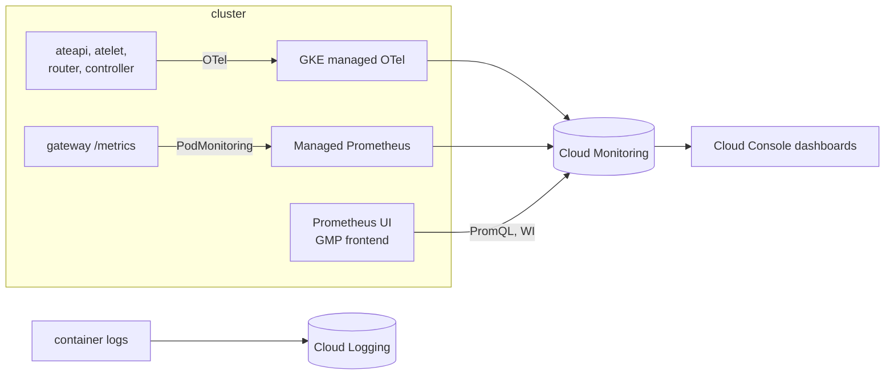

# Module 6 — Observe the fleet (12 min)

**Goal:** answer "what is my fleet doing?" three ways: live PromQL, Cloud Console dashboards, and
per-actor logs. You'll use both Substrate's own telemetry and your app's metrics.



Two sources, one store:
- **Substrate** exports OpenTelemetry through GKE's managed collector. Its names are dotted,
  for example `ate.workerpool.workers`, so PromQL quotes them: `{"ate.workerpool.workers"}`.
- **Your gateway** exposes Prometheus metrics on `/metrics`. A `PodMonitoring` tells Managed Prometheus to scrape it.

Both end up in Cloud Monitoring, so you can query them with PromQL from one place.

## Steps

1. **Scrape the gateway and start a Prometheus UI.**
   ```bash
   cat observability/podmonitoring.yaml
   make observe
   make prometheus-ui          # → http://localhost:9090
   ```
2. **Generate traffic.** In a second terminal, run bursty chats across the swarm for 3 minutes:
   ```bash
   make load
   ```
3. **Ask questions in the Prometheus UI** (http://localhost:9090 → Graph). Copy each query from
   [observability/queries.md](../../observability/queries.md):
   - How many workers are busy vs idle? `sum by ("ate.worker.state") ({"ate.workerpool.workers", "ate.workerpool.name"="agents"})`
   - How often did the router have to resume an actor? The `"ate.router.resume"` query.
   - How long does a resume take? The lifecycle P95 query.
   - Chat turns by outcome, and awake vs tracked actors, from your gateway.

   Points appear **1–3 minutes** after the traffic that produced them. If a panel is empty, wait a minute.
4. **Dashboards in Cloud Console.** Open
   `https://console.cloud.google.com/monitoring/dashboards?project=$PROJECT_ID`:
   - **Agent Substrate Workshop** (yours): the fleet, lifecycle, router, snapshots, and gateway on one page.
   - Substrate's **gRPC**, **E2E latency**, and **Snapshot** dashboards: the maintainers' own views.

   While `make load` runs, watch awake actors track worker capacity, "resumed" requests rise, and idle suspends follow each burst.
5. **Follow one actor in the logs.** In Logs Explorer, use this query:
   ```
   resource.type="k8s_container"
   labels."ate.actor.name"="swarm-03"
   ```
   You'll see every state change for that actor across workers, and your agent's own `agent listening` lines.
   The CLI equivalent is `kubectl ate logs actor swarm-03 -a workshop`.

## What just happened
- Substrate's telemetry tells you about the **platform**: workers, lifecycle operations, routing, snapshots.
  Your gateway's metrics tell you about the **product**: turns, model latency, tokens, idle policy. You need both.
- Every dashboard tile is a PromQL query you can read in `observability/dashboard.json` and reuse in alerts.
- `make dashboards` is idempotent: edit the JSON and run it again.
- **Actors can't export their own metrics yet** — they share hostname and IP inside the sandbox — so every
  app-level signal you just saw came from the always-on gateway, not the actors themselves. Per-actor detail
  lives in logs instead, which is why step 5 exists.

## Checkpoint
```bash
make verify MODULE=6
```
**Stuck?** Run `make catch-up MODULE=7`.

Next: [Module 7 — Wrap-up](../07-wrap-up/README.md)
