# Observe the fleet (12 min)

The goal of this section is to answer "what is my fleet doing?" in three ways: live PromQL queries, Google Cloud console dashboards, and
per-actor logs. You use both Substrate's built-in telemetry and your application's metrics.



Two metric sources flow into a single store:
- **Substrate** exports OpenTelemetry metrics through GKE's managed collector. Because its metric names contain dots
  (for example, `ate.workerpool.workers`), PromQL queries quote them inside braces: `{"ate.workerpool.workers"}`.
- **Your gateway** exposes Prometheus metrics on `/metrics`. A `PodMonitoring` resource instructs Google Cloud Managed Service for Prometheus to scrape that endpoint.

Both sources write to Cloud Monitoring, so you can query them together using PromQL.

## Steps

1. **Scrape the gateway and start the Prometheus UI.**
   ```bash
   cat observability/podmonitoring.yaml
   make observe
   make prometheus-ui          # opens http://localhost:9090 (in Cloud Shell: Web Preview > Change port > 9090)
   ```
2. **Generate traffic.** In a second terminal (`cd` into your workshop checkout first if a new tab starts in `$HOME`), send bursty chat traffic across the swarm for 3 minutes:
   ```bash
   source scripts/env.sh     # in the new terminal, from the repo root: puts bin/ (kubectl ate) on PATH
   make load
   ```
3. **Run queries in the Prometheus UI** (`http://localhost:9090` → **Graph**, or Web Preview `:9090` in Cloud Shell). Copy each query from
   [observability/queries.md](../../observability/queries.md) (if your `CLUSTER_NAME` in `workshop.env` isn't
   `ate-cluster`, replace `cluster="ate-cluster"` to match):
   - **How many workers are busy vs. idle?** `max by ("ate.worker.state") ({"ate.workerpool.workers", "ate.workerpool.name"="agents", cluster="ate-cluster"})`
     (Use `max` rather than `sum` because each `ateapi` replica reports the entire pool.) A busy worker appears as `partial` rather than
     `at_capacity` because the state counts actor slots (`1` of the default `1000`), not CPU utilization.
   - **How often did the router resume a suspended actor?** Run the `"ate.router.resume"` query.
   - **How long does a resume take?** Run the lifecycle P95 latency query.
   - **What are the chat turn outcomes and active actor counts?** Run the gateway metric queries.

   Data points appear **1–3 minutes** after the traffic that produces them. If a chart is empty, wait a minute and run the query again.
4. **View dashboards in the Google Cloud console.** Open
   `https://console.cloud.google.com/monitoring/dashboards?project=$PROJECT_ID`:
   - **Agent Substrate Workshop** (your dashboard): shows fleet status, actor lifecycle, router requests, snapshots, and gateway metrics on a single page.
   - Substrate's **gRPC**, **E2E latency**, and **Snapshot** dashboards: provide the platform maintainers' operational views.

   While `make load` runs, watch active actors track worker capacity, resumed requests rise, and idle suspends follow each traffic burst.
5. **Follow a single actor across workers.** Because an actor isn't tied to a single Pod, its logs aren't tied to a single Pod either. In this step, you
   wake `buddy`, let it suspend again, and delete the worker Pod it ran on so that the next resume lands
   on a different Pod. First, stop `make load` if it is still running. In one terminal, stream `buddy`'s logs:
   ```bash
   kubectl ate logs actor buddy -a workshop -f
   ```
   In a second terminal, resume `buddy` and record its worker Pod name:
   ```bash
   source scripts/env.sh     # if this is a fresh terminal, from the repo root: puts bin/ (kubectl ate) on PATH
   kubectl ate resume actor buddy -a workshop
   FIRST=$(kubectl ate get actor buddy -a workshop -o json | jq -r .status.workerAssignment.workerPod)
   echo "$FIRST"
   ```
   The gateway suspends idle actors after about 3 seconds. Wait about 10 seconds, then verify that no actors are running on
   that worker. `buddy` should show `ACTOR_STATE_SUSPENDED`, and that Pod's worker entry should show `0/1000` actors:
   ```bash
   kubectl ate get actors -a workshop
   kubectl ate get workers -n workshop
   ```
   Deleting a worker Pod terminates any actor still running on it, so always verify that the worker is empty first. Next, delete the
   worker Pod and resume `buddy` with tracing enabled:
   ```bash
   kubectl -n workshop delete pod "$FIRST"
   kubectl ate --trace resume actor buddy -a workshop     # prints: Tracing enabled. Trace ID: <id>
   ```
   The Deployment replaces the deleted Pod, and `buddy` wakes up on a different worker Pod.
   The log stream prints `Actor is currently running on pod …` twice with two different Pod names and continues streaming.
   The `Actor restoring` and `Actor restored` log entries include a `trace_id` field that matches the
   trace ID printed by the CLI.

   `kubectl ate logs` streams logs only from the Pod that currently hosts the actor. To view the complete history across Pods, open Logs Explorer in the Google Cloud console (replace `ate-cluster` if your `CLUSTER_NAME` differs):
   ```
   resource.type="k8s_container"
   resource.labels.cluster_name="ate-cluster"
   (labels."ate.actor.name"="buddy" OR jsonPayload."ate.actor.name"="buddy")
   ```
   This query returns a single timeline across three components and two workers: `ateworker`'s `Actor restoring`, `atelet`'s
   `Restore timing breakdown`, `ateapi`'s `Actor state changed` (`resuming`, `running`, `suspended`), and
   your agent's own log lines. Include both clauses in the `OR` filter: `ateapi` and `atelet` write actor identity into `jsonPayload` rather than
   `labels`, so filtering only on `labels` misses the state transitions.

   Next, replace the filter with `jsonPayload.trace_id="<id>"`, using the trace ID from the `--trace` resume command. This query isolates that
   single request across `ateapi`, `atelet`, and `ateworker`. Paste the same ID into **Cloud Trace** → **Trace Explorer** to
   inspect the request as a waterfall of spans.

## What just happened
- Substrate's telemetry describes the **platform**: workers, lifecycle operations, routing, and snapshots.
  Your gateway's metrics describe your **application**: chat turns, model latency, token usage, and idle policy. Operating a fleet requires both.
- Every dashboard widget uses a PromQL query defined in `observability/dashboard.json`, which you can reuse in alerting policies.
- `make dashboards` is idempotent: edit the JSON file and run the command again to update the dashboards.
- **Managed Prometheus doesn't scrape actors directly.** Actors share a generic hostname and IP address inside the sandbox, and pushing OTLP metrics directly from an actor
  requires an `http` `EgressPolicy` rule for the OpenTelemetry collector (`docs/observability.md`). Instead, all application-level
  metrics in this section come from the always-on gateway, while per-actor details live in Cloud Logging (step 5).
- Metrics omit actor identity to avoid creating a separate time series per actor. Logs and traces include actor identity, and a
  `trace_id` links them together: the CLI prints the ID, every Substrate log entry for that request includes it, and Cloud
  Trace visualizes the end-to-end spans.

## Checkpoint
```bash
make verify MODULE=6
```
**Stuck?** Run `make catch-up MODULE=7`.

Next: [Wrap-up](../07-wrap-up/README.md)
