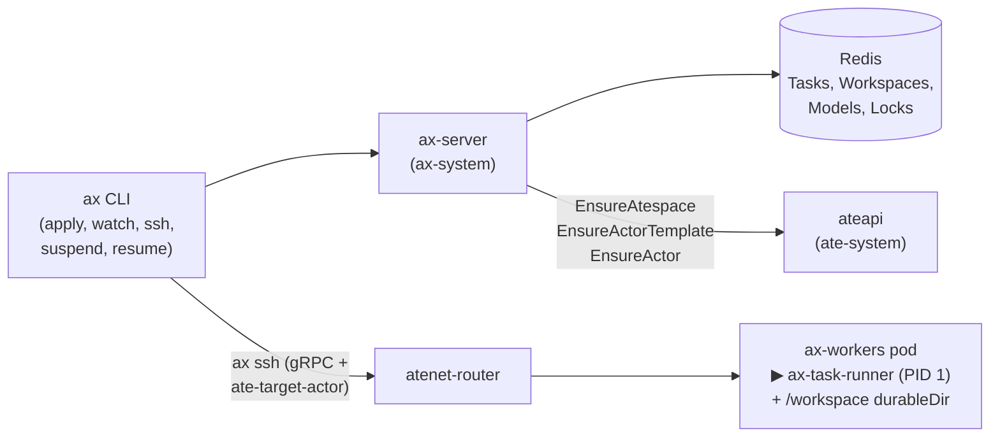

# Optional lab B — Declarative tasks and workspaces with `google/ax` (30–45 min)

> **Cluster impact:** Namespace-scoped. Adds the `ax-system` namespace, `ax-workshop` atespace, and an `ax-workers` WorkerPool next to the workshop; nothing in `workshop` changes.

[AX (`google/ax`, Agent eXecutor)](https://github.com/google/ax) is a declarative orchestrator (`ax.io/v1alpha1`) built on top of Agent Substrate. Where [lab A (`agent-substrate/env`)](../A-env/README.md) gave you an imperative sandboxed shell, AX gives you `kubectl`-style manifests for the three things every agent deployment repeats:

- **`Workspace`**: pre-wires Git repositories, seed files (like `AGENTS.md`), MCP servers, and skills so the sandbox starts with its environment already in place.
- **`Task`**: binds one or more `Workspace`s, a container image, a command, and environment variables, and reconciles them into a Substrate `ActorTemplate` and `Actor`.
- **`Model`**: stores LLM provider configuration and Kubernetes Secret references in one place instead of in every task's environment.

Under the hood, AX compiles those manifests into the exact Substrate primitives you built by hand in Modules 2–5 — and embeds `agent-substrate/env`'s guest gRPC server inside its task runner (`ax-task-runner`) to power `ax ssh`.



## Which AX commit, and why

Our `SUBSTRATE_REF` is `v0.5.0` (pinned in `app/go.mod` as `github.com/agent-substrate/substrate v0.5.0`).

Upstream `google/ax` pins an older Substrate commit (`v0.0.0-20260918201817-944abe3278b8` in `go.mod`). This lab pins AX at:

```
AX_REF=ac2332829f22360ff97b0ba34d94dd0dd782f17e   # google/ax main, 2026-10-12
```

Step 1 runs [`optional/B-ax/patch-ax-v040.py`](patch-ax-v040.py) to bring it up to `v0.5.0` before building:

1. **Substrate `v0.5.0` proto changes**: `ContainerReadyz` → `WakeupProbe` + `HttpGetAction` (pointed at `/healthz` so the actor transitions to `RUNNING` and activates its `EgressPolicy` as soon as the runner's HTTP server starts, while `TaskReconciler` polls `/readyz?check=workspace`), `SnapshotsConfig` (with `OnPause`/`OnResume`) → `SnapshotConfig` (`PreferredFidelity: SNAPSHOT_FIDELITY_VOLUMES`), `SandboxConfig.SandboxClass` enum → string `"gvisor"`, required `Resources.Limits` (`cpu: "1"`, `memory: "512Mi"`), `WorkerPodIp` → `WorkerPodIps`, and a retry in `EnsureActor` while the template's golden snapshot finishes (`FailedPrecondition`).
2. **`ko`-built runner path**: AX's `.ko.yaml` already configures `cmd/ax-task-runner` to use `alpine/git:latest` (Alpine + `git`, `sh`, `wget`), which lets `ko build` produce a `@sha256:` digest-pinned runner image without Docker. The patch switches `DefaultGuestCommand` in `internal/substrate/client.go` from `/usr/local/bin/ax-task-runner` to `/ko-app/ax-task-runner` where `ko` places the binary.
3. **`WorkerSelector`, `VOLUMES`-fidelity marker path, and namespace-scoped RBAC**: adds `workerSelector: {workload: ax-worker}` so AX tasks run on their own `ax-workers` pool instead of the workshop's `agents` pool, moves AX's maiden-run marker directory (`DefaultAXDir` in `internal/workspace/setup.go`) from `/ax` to `/workspace/.ax` so it lives inside the `/workspace` `durableDir` and survives a `SNAPSHOT_FIDELITY_VOLUMES` suspend/resume ([Module 3 Part B](../../modules/03-suspend-resume/README.md#part-b-disk-only-suspend-template-agent-v2)), labels `Namespace/ax-system` with `ate.dev/api-access: "true"`, and removes the cluster-wide Secret `ClusterRole` and `ClusterRoleBinding` from `deploy/ax-server.yaml` so the deployment stays strictly namespace-scoped to `ax-system`.

## 1. Build and deploy AX (you build every image)

```bash
source scripts/env.sh   # workshop.env into this shell (bash or zsh): KO_DOCKER_REPO, BUCKET_NAME, REPO_ROOT, …
export PATH="$REPO_ROOT/bin:$PATH"
AX_REF=ac2332829f22360ff97b0ba34d94dd0dd782f17e
git clone https://github.com/google/ax .workshop/ax 2>/dev/null; git -C .workshop/ax checkout -f "$AX_REF"
python3 optional/B-ax/patch-ax-v040.py .workshop/ax
(cd .workshop/ax && go build ./... && go test ./internal/controller/ ./internal/workspace/)

export KO_DOCKER_REPO
export RUNNER_IMAGE=$(cd .workshop/ax && ko build --base-import-paths ./cmd/ax-task-runner)
(cd .workshop/ax && go build -o "$REPO_ROOT/bin/ax" ./cmd/ax)

# Deploy the ax-workers WorkerPool, Redis, and ax-server in ax-system
# (patch-ax-v040.py stripped the ClusterRole/ClusterRoleBinding from deploy/ax-server.yaml;
# delete any leftover grant if you applied an unpatched manifest earlier):
kubectl delete clusterrolebinding,clusterrole ax-server --ignore-not-found
scripts/render.sh optional/B-ax/workerpool.yaml.tmpl | kubectl apply -f -
kubectl apply -f .workshop/ax/deploy/redis.yaml
kubectl -n ax-system rollout status deploy/ax-redis --timeout=180s
sed "s|gs://dberkov-gke-dev3/ate-env/|gs://$BUCKET_NAME/ax/|g" .workshop/ax/deploy/ax-server.yaml \
  | (cd .workshop/ax && ko apply -f -)
kubectl -n ax-system rollout status deploy/ax-server --timeout=180s
kubectl -n ax-system get pods -l workload=ax-worker     # 2 worker pods Running
kubectl ate get workers -n ax-system                    # 2 Ready workers registered with ateapi
```

Look at `.workshop/ax/deploy/ax-server.yaml`: `ax-server` mounts the same two projected volumes you saw in the workshop — a `serviceAccountToken` audienced to `api.ate-system.svc` and the `servicedns.podcert.ate.dev/identity` `ClusterTrustBundle` — so it can call `ateapi` over mTLS/TLS and route readiness checks through `atenet-router.ate-system.svc.cluster.local:80`.

## 2. Declare a Workspace and a Task

Read [`optional/B-ax/task.yaml.tmpl`](task.yaml.tmpl): it declares a `Workspace` (`demo-workspace`) that seeds `AGENTS.md` and `hello.sh`, and a `Task` (`demo-task`) that mounts it at `/workspace`, runs `/bin/sh hello.sh`, and sets `debug: true` so `ax ssh` works.

```bash
scripts/render.sh optional/B-ax/task.yaml.tmpl | ax apply -f -
ax get workspaces -a ax-workshop
ax get tasks -a ax-workshop                # PHASE is Suspended: AX creates tasks asleep by default
```

Why did `ax apply` create `demo-task` in `Suspended` phase? Behind that one command, `ax-server` created the `ax-workshop` atespace, generated a dedicated `ActorTemplate` for `demo-task` (whose golden snapshot runs in the background on `ax-workers` and writes to `gs://$BUCKET_NAME/ax/`), and created the `demo-task` actor in `SUSPENDED` state.

Note too that you didn't start a port-forward before running `ax`: the CLI inspects your active Kubernetes context (`ax ctx`), opens a background port-forward to `ax-server` (`ax tunnel list`), and reuses it across commands.

## 3. Peel back the curtain with `kubectl ate`

Before resuming the task, inspect the Substrate records `ax-server` created for it:

```bash
kubectl ate get atespaces                                     # ax-workshop is listed next to workshop
kubectl ate get actor-templates -a ax-workshop                # demo-task-tmpl-<8-hex-chars> (GOLDEN TAG set after ~15s)
kubectl ate get actors -a ax-workshop                         # demo-task in ACTOR_STATE_SUSPENDED
TMPL=$(kubectl ate get actor-templates -a ax-workshop -o json | jq -r '.actorTemplates[0].metadata.name')
kubectl ate get actor-template "$TMPL" -a ax-workshop -o yaml
```

Compare that generated `ActorTemplate` with the ones you wrote by hand in Modules 2–4:

- **Name (`demo-task-tmpl-<hash>`)**: `TaskReconciler` (`internal/controller/reconciler.go`) hashes the image and environment variables into the template name. Because both AX `Task`s and Substrate `ActorTemplate`s are immutable ([Module 3](../../modules/03-suspend-resume/README.md#templates-are-immutable)), changing a task's spec requires either a new task name or deleting and recreating the task (`ax delete task …` then `ax apply -f …`, which discards the previous actor state and generates a fresh template digest).
- **Entrypoint (`/ko-app/ax-task-runner`)**: AX never sets your `spec.command` as the container entrypoint. Instead, it injects the task and workspace YAML into `AX_TASK_YAML` and `AX_WORKSPACES_YAML` env vars and boots `ax-task-runner` as PID 1 on port 80 (`wakeupProbe: /healthz`, with `/readyz` reporting `200 OK` once `SetupWorkspace` finishes).
- **Storage (`preferredFidelity: SNAPSHOT_FIDELITY_VOLUMES`, `durableDir: /workspace`)**: AX uses the disk-only snapshot fidelity from Module 3 Part B. Only `/workspace` is saved to GCS on suspend; on resume, `ax-task-runner` cold-boots, sees `/workspace/.ax/initialized-workspace`, skips workspace setup, and starts your command against the restored files.

## 4. Resume, inspect over `ax ssh`, and suspend

Wake the task and inspect its conditions:

```bash
ax resume task demo-task -a ax-workshop
ax get tasks -a ax-workshop                # PHASE: Running, with WORKER-IP assigned
ax describe task demo-task -a ax-workshop  # Conditions: WorkspaceReady=True, Ready=True
```

When `spec.debug: true` is set on a task, `ax-task-runner` multiplexes [`agent-substrate/env`](../A-env/README.md)'s guest gRPC services (`Process` and `FileSystem`) onto port 80 using `h2c` (`internal/metadata/server.go`). `ax ssh` connects to those services through `atenet-router` by setting the `ate-target-actor: ax-workshop/demo-task` gRPC metadata header:

```bash
ax ssh demo-task -a ax-workshop -- ls -la /workspace /workspace/.ax
ax ssh demo-task -a ax-workshop -- cat /workspace/AGENTS.md /workspace/run.log
```

`ax-task-runner` also runs an in-sandbox HTTP metadata server on `$AX_METADATA_URL` (`http://127.0.0.1:80`) so an agent can introspect its own `Task` and `Workspace` specs without an SDK:

```bash
ax ssh demo-task -a ax-workshop -- sh -c 'wget -qO- "$AX_METADATA_URL/metadata/v1alpha1/ax/task"'
ax ssh demo-task -a ax-workshop -- sh -c 'wget -qO- "$AX_METADATA_URL/metadata/v1alpha1/ax/workspaces"'
```

Now write a file to `/workspace`, suspend the task, verify that its worker is freed, and resume it:

```bash
ax ssh demo-task -a ax-workshop -- sh -c 'echo "saved before sleep" > /workspace/note.txt'
ax suspend task demo-task -a ax-workshop
kubectl ate get actors -a ax-workshop      # demo-task SUSPENDED
kubectl ate get workers -n ax-system       # both ax-workers pods show 0/1000 actors

ax resume task demo-task -a ax-workshop
ax ssh demo-task -a ax-workshop -- cat /workspace/note.txt /workspace/run.log
```

Notice two things in the output:
1. `/workspace/note.txt` is intact (`saved before sleep`).
2. `/workspace/run.log` now has **two** `booted task` lines — because AX uses `SNAPSHOT_FIDELITY_VOLUMES`, resuming cold-boots `ax-task-runner` and re-runs `spec.command` against the restored `/workspace` directory, while `/workspace/.ax/initialized-workspace` prevented `SetupWorkspace` from overwriting `AGENTS.md`.

## 5. Clone a Git repository and lock down egress

A `Workspace` can also clone Git repositories (`spec.git`) before the task reports `WorkspaceReady`. Because an actor has **deny-by-default egress** ([Module 4](../../modules/04-make-it-an-agent/README.md)) and AX does not yet attach an `EgressPolicy` automatically, a task that clones from GitHub needs an `EgressPolicy` before its first resume.

Because `ax apply` creates tasks in `Suspended` phase, you can apply the task, attach [`optional/B-ax/egress-github.yaml`](egress-github.yaml) to its actor while it is still asleep, and then resume it:

```bash
ax suspend task demo-task -a ax-workshop
scripts/render.sh optional/B-ax/git-task.yaml.tmpl | ax apply -f -
source scripts/ate-api.sh
egressctl -a ax-workshop apply -f optional/B-ax/egress-github.yaml --actor=repo-task
ax resume task repo-task -a ax-workshop
ax describe task repo-task -a ax-workshop
ax ssh repo-task -a ax-workshop -- ls -la /workspace/env
```

Check why `git` needed no extra CA flags here (unlike `wget --no-check-certificate` in [lab A step 5](../A-env/README.md#5-lock-down-egress-env-sets-no-policy)): `egress-github.yaml` uses a `tlsPassthrough` rule on port 443 rather than an `https` MITM rule, so `atenet-egress` inspects only the TLS SNI hostname (`github.com`) and forwards the encrypted connection untouched. Verify that `github.com` is allowed and everything else is denied:

```bash
ax ssh repo-task -a ax-workshop -- sh -c '
  wget -q -T 5 -O /dev/null https://github.com/agent-substrate/env && echo "github.com: reachable" || echo "github.com: FAILED"
  wget -q -T 5 -O /dev/null https://example.com 2>/dev/null && echo "example.com: reachable (should not happen)" || echo "example.com: denied"
'
```

## 6. Find it on the dashboard

Use the same signals from [Module 6](../../modules/06-observe/README.md), filtered to the `ax-workers` pool and `ax-workshop` atespace (replace `ate-cluster` if your `CLUSTER_NAME` in `workshop.env` differs):

```bash
make prometheus-ui   # http://localhost:9090
```

| Question | PromQL |
|---|---|
| Worker state on AX's pool | `max by ("ate.worker.state") ({"ate.workerpool.workers", "ate.workerpool.name"="ax-workers", cluster="ate-cluster"})` |
| Desired vs ready workers on `ax-workers` | `{"ate.workerpool.desired_workers", "ate.workerpool.name"="ax-workers", cluster="ate-cluster"}` vs `{"ate.workerpool.ready_workers", "ate.workerpool.name"="ax-workers", cluster="ate-cluster"}` |
| Suspend/resume latency across templates | `histogram_quantile(0.95, sum by (le, "ate.actor.operation.name") (rate({"ate.actor.lifecycle.operation.duration_bucket", cluster="ate-cluster"}[5m])))` |

And in Cloud Console → Logging → Logs Explorer:

```
resource.type="k8s_container"
resource.labels.cluster_name="ate-cluster"
resource.labels.namespace_name="ate-system"
"Actor state changed"
jsonPayload."ate.atespace"="ax-workshop"
```

## Read the code

In `.workshop/ax`:

- `internal/controller/reconciler.go`: how `TaskReconciler.Reconcile` turns a `Task` + `Workspace`s into an `Atespace`, a digest-named `ActorTemplate` (`<task>-tmpl-<hash>`), and an `Actor`, then polls `/readyz?check=workspace` to set the `WorkspaceReady` and `Ready` conditions.
- `internal/substrate/client.go`: `BuildActorTemplate` — compare the protobuf `ActorTemplate` it constructs with the YAML templates you wrote in Modules 2–4.
- `internal/metadata/server.go`: how `ax-task-runner` serves `/healthz`, `/readyz`, `/metadata/v1alpha1/ax/{task,workspaces}`, and (when `spec.debug: true`) `github.com/agent-substrate/env/guest` on port 80 over `h2c`.
- `internal/workspace/setup.go`: `SetupWorkspace` — how files, shallow/full Git clones, skills directories, and the maiden-run marker file (`MarkerName`) are initialized inside `/workspace`.

## Clean up

```bash
ax delete task demo-task -a ax-workshop
ax delete task repo-task -a ax-workshop
ax delete workspace demo-workspace -a ax-workshop
ax delete workspace repo-workspace -a ax-workshop
ax tunnel stop
kubectl ate delete atespace ax-workshop
kubectl delete namespace ax-system --ignore-not-found
```

## Next

Back to [Module 7 — Wrap-up](../../modules/07-wrap-up/README.md) for the rest of the optional labs.
