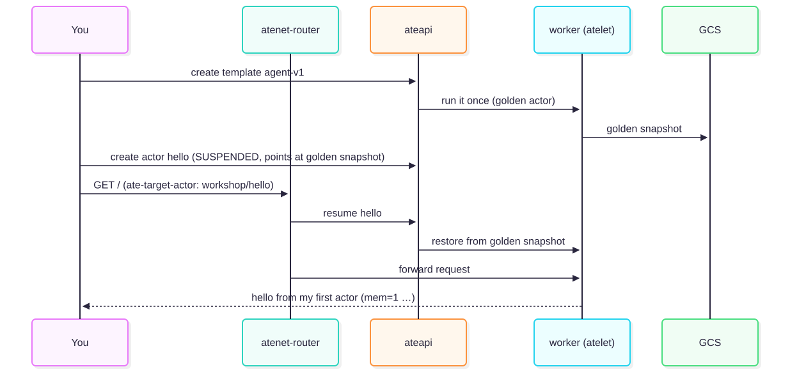

# Untrusted Code on Secure Runtimes: Agent Substrate on Kubernetes

## Introduction

In this workshop, you build and operate your own fleet of AI agents on [Agent Substrate](https://github.com/agent-substrate/substrate),
starting from a pre-warmed GKE cluster and Agent Substrate control plane. An agent spends most of its life waiting,
so Substrate runs agents as *actors*: sandboxed processes that it can suspend to Cloud Storage and resume on any worker,
with their memory intact.

When this lab started, Terraform created a GKE cluster (`ate-cluster`) with two `n1-standard-4` nodes, provisioned Cloud
Storage, Artifact Registry, Workload Identity bindings, and Cloud Monitoring dashboards, and installed Agent Substrate (`v1.0.0`)
in `ate-system` with a 500 GiB persistent disk for Postgres. In Cloud Shell, you unpack the pre-built CLI tools and
`.workshop/` install metadata, explore the installed `ate.dev` CRDs and control plane, and build and operate your agent
fleet across the hands-on sections where you:

- Connect Cloud Shell to the pre-warmed GKE cluster and explore the Agent Substrate control plane and `ate.dev` CRDs.
- Build a Go agent, run it as a Substrate **actor**, and suspend and resume it across workers with `MEMORY` and `VOLUMES` snapshot fidelity.
- Connect the agent to a model (Gemini on the Gemini platform) through an always-on gateway, and lock down its egress.
- Run 20 agents on 2 workers with request parking and idle suspend, and monitor the fleet in Prometheus and Google Cloud console dashboards.

### Prerequisites
- Familiarity with Kubernetes. You don't need prior Substrate knowledge.

## Setup

When the lab started, Terraform pre-warmed your cluster and Agent Substrate installation so you can inspect the control
plane in "Architecture tour" and build your first actor in "Hello actor":

- A zonal GKE cluster named `ate-cluster` in <ql-variable key="project_0.default_zone" placeHolder="ZONE"></ql-variable> (GKE 1.37 on the Rapid channel, two `n1-standard-4` nodes, Workload Identity, managed OpenTelemetry, Managed Service for Prometheus, and a 48-hour maintenance exclusion).
- The Cloud Storage snapshot bucket (`<ql-variable key="project_0.project_id" placeHolder="PROJECT_ID"></ql-variable>-ate`), Artifact Registry Docker repository (`workshop`), Workload Identity bindings, and all four Cloud Monitoring dashboards.
- Agent Substrate `v1.0.0` in `ate-system`, patched with a 60-second router parked-request budget, a 120-second shutdown grace period, and an HTTP bridge on port 80, with the matching worker image pre-pulled onto the cluster nodes.
- Pre-built Linux tools (`kubectl-ate`, `ko`, `egressctl`) and `.workshop/` install metadata (`.workshop/worker-image` and `.workshop/install-complete`) packaged in Cloud Storage.

In this section, you clone the workshop repository in Cloud Shell, configure `workshop.env`, unpack the pre-warmed tools
and install metadata, and verify that your environment is ready to explore the cluster in "Architecture tour" and run
your first actor in "Hello actor".

### Steps

1. **Activate Cloud Shell.** Open the Google Cloud console and click **Activate Cloud Shell** in the top-right
   toolbar to launch Cloud Shell — a self-contained VM in your browser — and run all the commands in this lab from there.
2. **Clone the workshop repository.** Clone the repository and move into its root directory:
   ```bash
   git clone https://github.com/GoogleCloudPlatform/agent-substrate-workshop
   cd agent-substrate-workshop
   ```
3. **Configure the environment and cluster credentials.** Populate `workshop.env` with your project ID, region, and
   cluster zone, fetch `kubectl` credentials for `ate-cluster`, and configure Docker authentication for Artifact Registry:
   <ql-code-block language="bash" templated noWrap>
   cp workshop.env.example workshop.env
   sed -i \
     -e 's|^PROJECT_ID=.*|PROJECT_ID={{{project_0.project_id | "PROJECT_ID"}}}|' \
     -e 's|^REGION=.*|REGION={{{project_0.default_region | "REGION"}}}|' \
     -e 's|^CLUSTER_LOCATION=.*|CLUSTER_LOCATION={{{project_0.default_zone | "ZONE"}}}|' \
     workshop.env
   gcloud container clusters get-credentials ate-cluster \
     --zone {{{project_0.default_zone | "ZONE"}}} \
     --project {{{project_0.project_id | "PROJECT_ID"}}}
   gcloud auth configure-docker {{{project_0.default_region | "REGION"}}}-docker.pkg.dev --quiet
   </ql-code-block>
4. **Unpack the pre-warmed tools and state.** Download the pre-warmed `bin/` binaries (`kubectl-ate`, `ko`, `egressctl`)
   and `.workshop/` install metadata from Cloud Storage, add `$PWD/bin` to your shell `PATH`, and verify the `kubectl ate`
   plugin:
   <ql-code-block language="bash" templated noWrap>
   gcloud storage cp gs://{{{project_0.project_id | "PROJECT_ID"}}}-ate/.prewarm/workshop-prewarm.tar.gz /tmp/workshop-prewarm.tar.gz
   tar -xzf /tmp/workshop-prewarm.tar.gz
   rm -f /tmp/workshop-prewarm.tar.gz
   export PATH="$PWD/bin:$PATH"
   echo 'export PATH="'"$PWD"'/bin:$PATH"' >> ~/.bashrc
   kubectl ate --help
   </ql-code-block>
   If Cloud Shell reconnects or you open a new tab later, `cd` into `agent-substrate-workshop` and run `source scripts/env.sh` to load `workshop.env` and ensure `bin/` is on your `PATH`.
5. **Run preflight checks.** Verify your local tools, cluster configuration, Workload Identity, and managed OpenTelemetry:
   ```bash
   make preflight
   ```
   The first `go` invocation inside `app/` might download the Go 1.27 toolchain automatically if Cloud Shell's default Go version is older.

### What just happened
- `workshop.env` points the workshop scripts at your pre-warmed cluster, bucket, and Artifact Registry repository.
- Unpacking `workshop-prewarm.tar.gz` installs `bin/kubectl-ate`, `bin/ko`, and `bin/egressctl`, along with `.workshop/worker-image` and `.workshop/install-complete`, while leaving `app/cmd/agent/main.go` untouched for "Hello actor".

### Checkpoint
```bash
make verify MODULE=0
```

**Stuck?** Run `make catch-up MODULE=1` to run all of these steps in the foreground, and see
[troubleshooting](https://github.com/GoogleCloudPlatform/agent-substrate-workshop/blob/main/instructor/troubleshooting.md).

## Architecture tour

The goal of this section is to learn what each piece of Agent Substrate does and inspect the pre-warmed system in `ate-system`.

### Why not a Pod per agent?

An agent spends most of its life **waiting**: for a user, for a model, or for a tool. A Pod per agent
reserves CPU and memory during all of that idle time, and deleting the Pod loses the agent's memory.
Substrate runs agents as **actors**. An actor is a sandboxed process that Substrate can **suspend** (checkpointing it to Cloud Storage and
freeing its slot) and **resume** on *any* worker, often in about a second, with its memory intact. A few worker Pods serve
many actors.

> **Comparison with [kubernetes-sigs/agent-sandbox](https://github.com/kubernetes-sigs/agent-sandbox):**
> `agent-sandbox` is a separate project with no Substrate integration. It assigns each sandbox its own Pod.
>
> | agent-sandbox | Agent Substrate | Difference |
> |---|---|---|
> | Sandbox (a Pod) | Actor (a process in a worker) | Many actors share a few workers |
> | SandboxTemplate | ActorTemplate | Substrate takes a **golden snapshot** of the template |
> | SandboxWarmPool | WorkerPool | Workers are generic; any worker runs any actor of a matching template |
> | SandboxClaim | create / resume actor | Resume restores memory, not just disk |
> | Suspend = scale to 0: the Pod is deleted, and the PVC is kept and reattached on resume | Suspend = checkpoint memory and disk to Cloud Storage | Many actors share a few generic workers, and a suspended actor resumes on *any* of them |
>
> Note the naming overlap: Substrate also has a `SandboxConfig` CRD, which configures gVisor and microVM runtimes.
>
> **Where does [AX (`google/ax`)](https://github.com/google/ax) fit?**
> Substrate is the **runtime and sandbox** layer: it isolates, snapshots, routes to, and suspends or resumes
> actor processes across shared workers, without caring what runs inside them. **AX (Agent eXecutor)** is a higher-level,
> `kubectl`-style **control plane** (`ax.io/v1alpha1`) built on top of Substrate. You declare a `Workspace` (Git repositories,
> files, MCP servers, skills), a `Task` (image, command, resources), and a `Model`, and AX compiles them into the
> Substrate `ActorTemplate` and `Actor` records that you build by hand from "Hello actor" through "Density and idle".

### The pieces



| Component | Job |
|---|---|
| **ateapi** | The control API (gRPC). `kubectl ate` and your own code call it to create, suspend, resume, and delete actors. Creating an `ActorTemplate` also instructs `ateapi` to run that template's golden-snapshot actor once before the template becomes ready for use. |
| **Postgres** | Stores Substrate's records: atespaces, templates, actors, workers, and tags. **These are not Kubernetes objects.** |
| **atecontroller** | Reconciles `WorkerPool` CRDs into worker Pods (one Kubernetes `Deployment` per pool) and registers each Pod with `ateapi` as a Worker. |
| **atelet** | Runs on each worker. Starts actors in a gVisor sandbox, and snapshots and restores them to and from Cloud Storage. |
| **atenet-router** | The front door. Routes HTTP requests using the `ate-target-actor` header. If the target actor is suspended, the router **parks the request, resumes the actor, and then forwards the request**. |
| **atenet-egress** | Proxies every outbound connection from an actor. **Denies traffic by default**; `EgressPolicy` opens specific destinations. |
| **k8s-credential-provider** | Resolves `ate-secret://k8s.io/…` references from Kubernetes Secrets for `atenet-egress` when an `https` `EgressPolicy` rule injects headers. Denies access by default until you grant specific namespaces. |
| **podcertcontroller** | Issues certificates so actors and components have cryptographic identities. Clients trust `ateapi` through a `ClusterTrustBundle`. |
| **ate-idp-server** | Serves the public OIDC discovery document and JWKS that relying parties use to verify actor JWTs. |

**CRDs vs. records**

| Kubernetes CRDs (`kubectl get`) | Substrate records (`kubectl ate get`) |
|---|---|
| WorkerPool, SandboxConfig, CSIDriverConfig | Atespace, ActorTemplate, Actor, Worker, Tag |

`EgressPolicy` is also a Substrate record, with one policy per actor (`kubectl ate get egress-policy NAME -a workshop`).
In the "Make it an agent" section, you apply policies using the workshop's `egressctl` tool (unpacked in Setup), which can apply a single policy
file to every actor at once.

An **atespace** is Substrate's tenancy boundary for records, similar to a Kubernetes namespace but for actors.
It is separate from a Kubernetes namespace. Your `WorkerPool` lives in the Kubernetes namespace `workshop`, and your actors live in the atespace `workshop`.

### Look around

```bash
kubectl -n ate-system get deploy,ds,sts,svc
kubectl get crd | grep ate.dev
kubectl get sandboxconfigs                       # gvisor-default — the runtime profile actors use
kubectl get clustertrustbundles -l podcert.ate.dev/canarying=live
kubectl -n ate-system get deploy atenet-egress   # the egress proxy (used in "Make it an agent")
kubectl ate get atespaces
kubectl ate get workers -n workshop              # none yet — "Hello actor" creates a WorkerPool
cat .workshop/worker-image                       # the worker build that matches your control plane
```

Terraform already patched `atenet-router` with the 60-second parked-request budget, 120-second shutdown grace period, and HTTP bridge on port 80 during lab startup.

Every `kubectl ate` command prints `Warning: no --token-file given; acting as the shared identity system:serviceaccount:ate-system:ate-client rather than as yourself. Pass --token-file to act as yourself.`
That's expected in this workshop: without `--token-file`, `kubectl ate` acts as the shared `ate-client` ServiceAccount, which the
installer makes a global owner so that the demos work.

### What just happened
- You inspected the control plane (`ateapi`, `atecontroller`, Postgres), the data plane (`atelet` in each worker, the router, and the egress proxy),
  and the identity plumbing (`podcertcontroller`, `ClusterTrustBundle`).
- The worker image must come from the **same build** as the control plane. The installation script
  records this image in `.workshop/worker-image` so that your `WorkerPool` stays in sync.

### Checkpoint
```bash
make verify MODULE=1
```
**Stuck?** Run `make catch-up MODULE=2`.

## Hello actor

The goal of this section is to build your agent image, give Substrate workers to run it, register a template, create
an actor, and send requests to it through the router.



### Steps

1. **Customize the greeting.** Open `app/cmd/agent/main.go`, find `WORKSHOP(module-2)`, and change the greeting.
   Then build and push the image. `ko` prints a digest-pinned image reference and saves it to `.workshop/agent-image`.
   ```bash
   make build-agent
   ```
   `ko` might log warnings such as `git doesn't contain any tags` and `git is in a dirty state … M app/cmd/agent/main.go`. Those warnings are
   expected because you just edited the file, and the build still succeeds.
2. **Create a WorkerPool.** A `WorkerPool` is a Kubernetes CRD. The controller reconciles it into worker Pods that run `atelet`.
   ```bash
   scripts/render.sh modules/02-hello-actor/manifests/workerpool.yaml.tmpl   # inspect the rendered manifest
   scripts/render.sh modules/02-hello-actor/manifests/workerpool.yaml.tmpl | kubectl apply -f -
   kubectl -n workshop get pods -w          # press Ctrl+C when 2 Pods are Running
   kubectl ate get workers -n workshop
   ```
3. **Create an atespace.** An atespace is the tenancy boundary for Substrate records.
   ```bash
   kubectl ate create atespace workshop
   ```
4. **Create an ActorTemplate.** Inspect `modules/02-hello-actor/manifests/template.yaml.tmpl`: it defines the container image, a readiness
   probe, the snapshot fidelity (`preferredFidelity`), resource limits (`cpuMillicores`, `memoryBytes`), and one durable directory.
   ```bash
   scripts/render.sh modules/02-hello-actor/manifests/template.yaml.tmpl | kubectl ate create actor-template -f -
   until kubectl ate get actor-template agent-v1 -a workshop -o json 2>/dev/null | jq -e '.status.goldenSnapshotStatus | (.goldenTag.name // .errorMessage)' >/dev/null; do sleep 3; done
   kubectl ate get actor-template agent-v1 -a workshop
   kubectl ate get actor-template agent-v1 -a workshop -o yaml    # inspect status.goldenSnapshotStatus.goldenTag.name
   ```
   The `until` loop returns once the golden snapshot exists, and the next command shows it in the `GOLDEN TAG` column.
   If it hasn't returned in about 5 minutes, press Ctrl+C and check the [troubleshooting guide](https://github.com/GoogleCloudPlatform/agent-substrate-workshop/blob/main/instructor/troubleshooting.md).
   Substrate starts your container once on a free worker, waits for its `wakeupProbe` (`/readyz`) to pass, and snapshots it.
   That **golden snapshot** serves as the starting point for every actor created from this template. Creating an actor
   restores this snapshot instead of cold-booting a process.
5. **Create an actor.**
   ```bash
   kubectl ate create actor hello --template=agent-v1 -a workshop
   kubectl ate get actors -a workshop
   ```
   The `STATE` column shows `ACTOR_STATE_SUSPENDED`: the record exists, but it isn't running on a worker yet.
6. **Send requests to the actor.** The router selects the target actor from the `ate-target-actor` header.
   ```bash
   make forward-router                      # port-forwards atenet-router to localhost:8080
   curl -H 'ate-target-actor: workshop/hello' localhost:8080/
   curl -H 'ate-target-actor: workshop/hello' localhost:8080/
   curl -s -H 'ate-target-actor: workshop/hello' localhost:8080/state | jq
   kubectl ate get actors -a workshop       # RUNNING, with a worker assigned
   kubectl ate get workers -n workshop
   ```
   The router **parks** the first request while it resumes `hello`. `mem` counts requests in memory.
   `disk=-1` because the agent doesn't use its durable directory yet (you configure that in the "Suspend and resume" section).

### What just happened
- **`WorkerPool`** provides capacity: generic, pre-started worker Pods. **`ActorTemplate`** defines what to run.
  An **`Actor`** is an individual instance with its own identity and state. Actors don't map 1:1 to Pods:
  any worker in the selected pool can run any actor of that template.
- The `workload: workshop-agent` label serves two distinct purposes: on the `WorkerPool`, the
  template's `workerSelector` matches it to select a pool; on the Pod template (`spec.template.labels`),
  Kubernetes applies it to the worker Pods so that `kubectl get pods -l workload=workshop-agent`
  can find them.
- `create actor` is lightweight. It writes a database record that points to the golden snapshot. The actor first runs
  when a request arrives.
- `kubectl ate` is a `kubectl` plugin that calls **`ateapi`**. Actors live in Postgres rather than etcd, so
  `kubectl get actors` doesn't exist.

### Checkpoint
```bash
make verify MODULE=2
```
**Stuck?** Run `make catch-up MODULE=3`. If `agent-v1` or its actors exist in a broken state, run `make catch-up MODULE=3 RESET=1` to delete and recreate them from the solution.

## Suspend and resume

The goal of this section is to see what survives a suspend, where the snapshot goes, and how the router brings an actor back,
possibly on a different worker.


### Part A: Full-memory suspend (template `agent-v1`)

1. Generate some state, then note the worker Pod and the boot ID:
   ```bash
   for i in 1 2 3; do curl -s -H 'ate-target-actor: workshop/hello' localhost:8080/; done
   curl -s -H 'ate-target-actor: workshop/hello' localhost:8080/state | jq '{memCount, bootID}'
   kubectl ate get actors -a workshop       # check the WORKER POD column
   ```
   (Inside the sandbox, the agent's `hostname` is always `actor`, so use the
   `WORKER POD` column to see which worker hosts it.) If the port-forward stopped, restart it with `make forward-router`.
2. Suspend the actor and watch the worker free up:
   ```bash
   kubectl ate suspend actor hello -a workshop
   kubectl ate get actors -a workshop       # SUSPENDED, no worker
   kubectl ate get workers -n workshop      # both workers free
   ```
3. Send another request to the actor:
   ```bash
   curl -s -H 'ate-target-actor: workshop/hello' localhost:8080/
   curl -s -H 'ate-target-actor: workshop/hello' localhost:8080/state | jq '{memCount, bootID}'
   ```
   `mem` **continues** from where it left off, and the `bootID` remains the **same**. The process never restarted:
   Substrate checkpointed its memory to Cloud Storage and restored it, possibly on the other worker.
   You see the router's resume metrics in the dashboards in the "Observe the fleet" section.

### Part B: Disk-only suspend (template `agent-v2`)

A full-memory snapshot is powerful, but it can be large. Many agents only need their files. `agent-v2` suspends
with **VOLUMES** fidelity (`SNAPSHOT_FIDELITY_VOLUMES`): Substrate saves only the durable directory, and resume cold-boots the process.

4. Point the agent at its durable directory. In `app/cmd/agent/main.go`, find `WORKSHOP(module-3)` and set
   `DataDir: "/data"`. Then build the updated image:
   ```bash
   make build-agent
   ```
5. Suspend `hello` again. Creating a new template requires a **free worker** to run its golden-snapshot actor, and your pool has two workers.
   Create the new template and an actor:
   ```bash
   kubectl ate suspend actor hello -a workshop 2>/dev/null; kubectl ate get actors -a workshop
   diff modules/02-hello-actor/manifests/template.yaml.tmpl modules/03-suspend-resume/manifests/template.yaml.tmpl
   scripts/render.sh modules/03-suspend-resume/manifests/template.yaml.tmpl | kubectl ate create actor-template -f -
   until kubectl ate get actor-template agent-v2 -a workshop -o json 2>/dev/null | jq -e '.status.goldenSnapshotStatus | (.goldenTag.name // .errorMessage)' >/dev/null; do sleep 3; done
   kubectl ate get actor-template agent-v2 -a workshop
   kubectl ate create actor memo --template=agent-v2 -a workshop
   ```
6. Follow the actor's logs in a second terminal (`cd` into your workshop checkout first if a new tab starts in `$HOME`). The log stream follows the actor across workers and restarts:
   ```bash
   source scripts/env.sh     # in the new terminal, from the repo root: puts bin/ (kubectl ate) on PATH
   kubectl ate logs actor memo -a workshop -f
   ```
   Most of the output comes from gVisor's runtime logging (`I…` and `W…` lines from `cli.go`,
   `config.go`, and similar files, wrapped in JSON). Watch for the agent's `agent listening …` line. Append
   `| grep -v '"message":"[IW][01]'` (or `| grep 'agent listening'`) to filter for the agent's output.
7. Generate state, suspend the actor, and send another request:
   ```bash
   for i in 1 2 3; do curl -s -H 'ate-target-actor: workshop/memo' localhost:8080/; done
   kubectl ate suspend actor memo -a workshop
   curl -s -H 'ate-target-actor: workshop/memo' localhost:8080/
   ```
   Now `mem=1` because the suspend discarded memory. `disk` kept counting because the file lives in `/data`. The
   boot ID is new, and the logs show a fresh `agent listening` line.

### Templates are immutable
You didn't edit `agent-v1`; instead, you created `agent-v2`. A template's golden snapshot bakes in its container image,
command, environment variables, **and the memory of the process at snapshot time**. Changing any of those settings requires a new
template version. Existing actors keep their assigned template, so `hello` continues to run `agent-v1`.

### What just happened

| Feature | `preferredFidelity: MEMORY` (`hello`) | `preferredFidelity: VOLUMES` (`memo`) |
|---|---|---|
| Saved on suspend | Memory and `durableDir` | `durableDir` only |
| Resume behavior | Restores process (same `bootID`) | Cold-boots process (new `bootID`) |
| Snapshot size | ~ memory footprint | ~ files written |
| Best suited for | Agents with warm in-memory context | Agents that store state on disk |

- Suspending an actor frees the worker so that the next actor can use it. That's how a few workers serve many actors, as you explore in the "Density and idle" section.
- The router makes resume transparent to `curl` by parking the request until the actor is running.
- The scheduler might assign a resumed actor back to the **same** worker it suspended from. With only two
  workers, that behavior is expected, so `make verify MODULE=3` logs a warning instead of failing if the worker Pod doesn't change.

### Checkpoint
```bash
make verify MODULE=3
```
**Stuck?** Run `make catch-up MODULE=4`. If `agent-v2` or its actors exist in a broken state, run `make catch-up MODULE=4 RESET=1` to delete and recreate them from the solution.

## Make it an agent

The goal of this section is to give the actor a model backend without giving it credentials. An always-on **gateway** holds the
model access, and a deny-by-default **egress policy** lets the actor reach the gateway and nothing else.


### Why use a gateway?
- **Template environment variables are literal and baked into every snapshot.** If you put an API key in a template, Substrate writes it to Cloud Storage and includes it in every clone.
- Actors don't receive a Kubernetes ServiceAccount token. The gateway does, so it uses **Workload Identity** to call Gemini.
- The gateway is always on and lightweight. Actors are the resource-intensive, suspendable part. This split between
  **presence** (always on) and **cognition** (suspendable) is the core pattern behind production agent systems on Substrate.

### Steps

1. **Deploy the gateway.** The gateway serves `/v1/model` (calling Gemini, or returning a mock response if `MOCK_LLM=true` or
   the Gemini call fails) and `/chat/{actor}`, which forwards requests to the router with the `ate-target-actor` header set.
   ```bash
   make gateway
   make forward-gateway            # port-forwards the gateway to http://localhost:8081
   curl -s localhost:8081/v1/model -d '{"messages":[{"role":"user","content":"Say hi in five words"}]}' | jq
   ```
   `backend` shows which model answered (`gemini`). If a Gemini call fails (for example, with a `403` error while the Workload Identity
   binding propagates), the gateway answers that request from a mock fallback instead: `backend` is `mock-fallback`
   and `upstreamError` reports what the platform returned. As a result, the `502` response from the agent in step 3 comes from
   egress blocking, not the model. `make verify MODULE=4` fails if the reply comes from `mock-fallback`, so check `upstreamError`,
   or switch to the mock on purpose (see "If the model isn't available").
2. **Configure the agent to call the model, then free a worker.** First, open `app/cmd/agent/main.go`, find the
   `WORKSHOP(module-4)` comment, and change the line below it from `ModelURL: "",` to:
   ```go
   ModelURL: os.Getenv("MODEL_URL"),
   ```
   Save the file. Then suspend `memo` so that the new template's golden-snapshot actor has a free worker, and build the image.
   If `make build-agent` warns that the image is the same as your last build, the edit isn't saved yet.
   ```bash
   kubectl ate suspend actor memo -a workshop
   make build-agent
   cat modules/04-make-it-an-agent/manifests/template.yaml.tmpl     # note the MODEL_URL environment variable
   scripts/render.sh modules/04-make-it-an-agent/manifests/template.yaml.tmpl | kubectl ate create actor-template -f -
   until kubectl ate get actor-template agent-v3 -a workshop -o json 2>/dev/null | jq -e '.status.goldenSnapshotStatus | (.goldenTag.name // .errorMessage)' >/dev/null; do sleep 3; done
   kubectl ate get actor-template agent-v3 -a workshop
   kubectl ate create actor buddy --template=agent-v3 -a workshop
   ```
3. **Send a chat request and watch it fail.**
   ```bash
   curl -s localhost:8081/chat/buddy -d '{"message":"What is Agent Substrate?"}'; echo
   ```
   The request returns a `502` error: `model call failed: …`. The agent tried to reach the gateway, but **egress is deny-by-default**
   and `buddy` has no policy. The error ends in `no such host` rather than "denied": the sandbox's DNS answers NXDOMAIN for
   any hostname that the actor's policy doesn't allow, so the agent can't look up the gateway's address.
4. **Allow traffic to the gateway only.**
   ```bash
   cat modules/04-make-it-an-agent/manifests/egress-gateway.yaml
   make egress POLICY=modules/04-make-it-an-agent/manifests/egress-gateway.yaml ACTOR=buddy
   scripts/egress.sh get --actor=buddy
   curl -s localhost:8081/chat/buddy -d '{"message":"What is Agent Substrate?"}' | jq
   ```
   `atenet-egress` caches each actor's policy for a few seconds, so the immediate
   next call might still hit the cached state; retry once if needed. You don't need to suspend or
   resume `buddy` for the new policy to take effect because egress policies operate independently of the actor's lifecycle.
   `EgressPolicy` is a Substrate record that you can inspect with `kubectl ate get egress-policy buddy -a workshop -o yaml`.
   Both commands show `metadata.name: default` rather than `buddy`: an actor has at most one policy, which Substrate stores under the
   fixed name `default` and looks up by the actor it belongs to.
   `make egress` runs `bin/egressctl` (a 100-line Go client in `app/cmd/egressctl`) instead of
   `kubectl ate create egress-policy`, because `create` fails when a policy already exists and `update`
   requires the record's current metadata.
   For comparison, `egress-open.yaml` allows all outbound traffic; avoid using it in production.
5. **Verify that conversation state survives a suspend.**
   ```bash
   curl -s localhost:8081/chat/buddy -d '{"message":"My name is Sam. Remember it."}' | jq .reply
   curl -s localhost:8081/chat/buddy -d '{"message":"Give me one fun fact."}' | jq .reply
   kubectl ate suspend actor buddy -a workshop
   curl -s localhost:8081/chat/buddy -d '{"message":"What is my name?"}' | jq
   curl -s localhost:8081/actors/buddy/state | jq
   ```
   The conversation history lives in `/data/history.json` and in memory, and both survive the suspend and resume cycle. The `turn` count continues from where it left off.
   Even if the model's first reply claims that it can't remember across
   conversations, the agent sends the full conversation history with every turn, as the response to "What is my name?" confirms.

### If the model isn't available
Run `MOCK_LLM=true make gateway`, or update the running Deployment with `kubectl -n workshop set env deploy/gateway MOCK_LLM=true`.
Everything else in the workshop behaves the same. Once the gateway is running, `make gateway` and `make catch-up`
preserve its live `MOCK_LLM` value (`workshop.env` sets only the initial deployment); run `MOCK_LLM=false make gateway` to switch back.

### What just happened
- The actor holds **no secrets**. Workload Identity binds the gateway's Kubernetes ServiceAccount to `roles/aiplatform.user`.
- **Egress is per-actor and deny-by-default.** An actor without a policy can't open outbound connections at all.
  A hostname rule scoped to the gateway provides least-privilege access for this setup. Note that a hostname rule grants access to the entire host (`gateway.workshop.svc.cluster.local`), not
  just `/v1/model`: because the same Service also serves `/chat/{actor}`, `/actors/…`, and `/metrics`, an actor that can
  reach the model endpoint can also reach those paths. A production deployment serves `/v1/model` on a dedicated Service and allows only that hostname.
- The egress proxy checks the `Host` header of every request against the actor's current `EgressPolicy`, refreshing policies
  from `ateapi` every few seconds. A policy update applies to a *running* actor's next outbound call without requiring a
  suspend, resume, or restart.
- The gateway's `/chat/{actor}` endpoint acts as a lightweight **front door**: it sets the `ate-target-actor` header, and the router
  resumes the actor if needed. In the "Density and idle" section, the gateway also learns *when* to suspend idle actors.

### Checkpoint
```bash
make verify MODULE=4
```
**Stuck?** Run `make catch-up MODULE=5`. If `agent-v3` or its actors exist in a broken state, run `make catch-up MODULE=5 RESET=1` to delete and recreate them from the solution.

## Density and idle

The goal of this section is to run 20 agents on 2 workers, observe what happens when multiple actors need a worker at the same time, and add
the one piece that Substrate leaves to your application: **deciding when an actor is idle**.

### Steps

1. **Free the workers.** Suspend `buddy`, which is still `RUNNING` and holding a worker slot.
   ```bash
   kubectl ate suspend actor buddy -a workshop
   kubectl ate get actors -a workshop
   ```
2. **Create a swarm of actors.** Creating actors is fast and lightweight because each one is a database record pointing to `agent-v3`'s golden snapshot.
   ```bash
   for i in $(seq -w 1 20); do kubectl ate create actor swarm-$i --template=agent-v3 -a workshop; done
   make egress POLICY=modules/04-make-it-an-agent/manifests/egress-gateway.yaml ALL=1
   kubectl ate get actors -a workshop
   ```
   `ALL=1` applies the policy to every actor that currently exists. If you create additional actors later, you must apply a policy to them as well.
   Using `ALL=1` also applies the policy to `hello` and `memo`, which never call a model. While harmless in this workshop, it violates least
   privilege; in production, apply policies per template or per actor, as you did in the "Make it an agent" section for `buddy`.
3. **Fill both workers.** If the gateway port-forward stopped, restart it (`make forward-gateway`).
   ```bash
   curl -s localhost:8081/chat/swarm-01 -d '{"message":"hi"}' | jq -c '{turn, backend}'
   curl -s localhost:8081/chat/swarm-02 -d '{"message":"hi"}' | jq -c '{turn, backend}'
   kubectl ate get workers -n workshop
   ```
   Both workers are now busy: each one shows `1/1000` in the `ACTORS` column and `1000/1000` in the `CPU(MILLICORES)` column.
4. **Send a request to a third actor.** *(Optional: in an instructor-led session, your instructor might demonstrate or describe this step.)*
   ```bash
   time curl -s localhost:8081/chat/swarm-03 -d '{"message":"hi"}'; echo
   ```
   The router **parks** the request while it waits for a free worker. After the 60-second parked-request budget expires, the router returns
   a `503` error. Even though `swarm-01` and `swarm-02` finished responding, they remain in the `RUNNING` state:
   **Substrate never suspends an actor automatically.** It can't know whether your agent is idle, thinking, or
   waiting on a background tool call.
5. **Configure the gateway to suspend idle actors.** Because the gateway proxies every chat turn, it knows when each actor
   last handled a request. When you set `IDLE_AFTER`, the gateway suspends `RUNNING` actors that have had no in-flight requests for that duration.
   ```bash
   kubectl -n workshop set env deploy/gateway IDLE_AFTER=3s
   kubectl -n workshop rollout status deploy/gateway   # wait for the rollout to complete
   make forward-gateway                                # restart the port-forward to the new gateway Pod
   while true; do clear; kubectl ate get actors -a workshop; sleep 1; done   # swarm-01 and swarm-02 suspend within ~5s; press Ctrl+C to exit
   ```
   See `app/internal/idle/idle.go` for the implementation: the front door feeds an activity tracker, and a background loop (about 200 lines
   in total) checks every second (`IDLE_CHECK_EVERY`) and calls `SuspendActor` over gRPC using the gateway's
   own identity.
6. **Oversubscribe the worker pool.** Send requests to four actors simultaneously across the two workers:
   ```bash
   for a in swarm-03 swarm-04 swarm-05 swarm-06; do
     (curl -s -o /dev/null -w "$a %{http_code} %{time_total}s\n" localhost:8081/chat/$a -d '{"message":"hi"}') &
   done; wait
   ```
   All four requests return `200`. Two actors answer immediately. The router parks the other two requests until the idle-suspender frees their workers,
   so they finish in about 5–8 seconds (3 seconds of idle time, up to 1 second until the next check, a suspend and a restore, plus the
   1–2 second model call).
7. **Observe work that bypasses the gateway** (optional). Every actor exposes a `/work?steps=N` endpoint that consumes CPU for about
   0.3 seconds per step during the request. Ask `swarm-03` for about 18 seconds of work, but send the request directly to the router instead of
   going through the gateway:
   ```bash
   make forward-router    # restart if the port-forward from "Hello actor" stopped
   curl -s -w '\nHTTP %{http_code} in %{time_total}s\n' -H 'ate-target-actor: workshop/swarm-03' 'localhost:8080/work?steps=60'
   ```
   The request fails with a `502` error after 3–5 seconds. Because the request bypassed the gateway, the gateway's tracker considered `swarm-03`
   idle and suspended it mid-request. Substrate froze the entire sandbox, including the running loop. That work isn't
   lost: the next time anything wakes `swarm-03`, the loop resumes from the exact step where it froze and finishes, even though the original
   caller disconnected. If you send the same request through the gateway
   (`curl -s 'localhost:8081/actors/swarm-03/work?steps=60'`), it returns `200` because the in-flight request pauses
   the idle timer. The call takes about 30 seconds instead of 18 seconds because waking `swarm-03` also resumes the earlier frozen job,
   and both jobs share one CPU. To see both finish, wake `swarm-03` and read its logs in a single command (logs stream only from
   a running actor, and it suspends again 3 seconds later):
   ```bash
   curl -s -o /dev/null localhost:8081/actors/swarm-03/state; kubectl ate logs actor swarm-03 -a workshop | grep 'work done'
   ```
   If an actor runs work that outlives an HTTP request (such as a background job or queue consumer), the actor must report its activity to the component that manages
   idle suspension. The gateway's tracker provides a `Touch` method for this purpose.

> **Note: Clones share initial state.** Substrate restores every swarm actor from the same golden snapshot, so
> any value computed *before* the snapshot is identical across all of them:
> ```bash
> for a in swarm-03 swarm-04; do curl -s localhost:8081/actors/$a/state | jq -r .bootID; done
> ```
> Both actors report the same `bootID`. If your agent generates IDs, seeds a random number generator, or fetches credentials at startup, perform those actions on
> the first request (or after restore) rather than at process boot.
>
> Handle wall-clock time carefully as well. The sandbox clock jumps forward when an actor resumes. A duration measured across a suspend
> includes the time spent suspended, and a timing loop that runs immediately after a restore can produce unexpected results while the clock catches up.
> Count completed work rather than wall-clock time if a suspend can occur mid-operation.

### What just happened
- **Density** comes from suspending idle actors. Twenty actors fit on two workers because at most two actors are awake at the same time. Each
  worker has a `cpu: 1` limit that its actors share, and each actor requests `cpu: 1` (`cpuMillicores: 1000`). Substrate workers can
  host multiple actors concurrently, so increasing the worker CPU limit (or reducing each actor's CPU request) packs more active actors onto each worker.
- **Request parking** absorbs traffic bursts: incoming requests wait, up to the router's timeout budget, for the target actor to acquire a worker.
- **Idle detection belongs to your application**, because only your application knows what "idle" means. A gateway or front door that observes all traffic
  is a natural place to implement it. Production systems also autoscale the `WorkerPool` itself.
- **Suspend early.** On the workshop's reference cluster (two `c3-standard-4` nodes), a snapshot is about 1 MB (P95 is about 4 MB). Suspending takes about 0.4 seconds,
  and restoring takes about 0.25 seconds. The five Cloud Storage writes per snapshot cost about $0.000025, whereas a `c3-standard-4` worker
  costs about $0.00006 per second. An actor that stays idle for more than a couple of seconds is cheaper to suspend, which is why
  this workshop sets `IDLE_AFTER` to `3s`. The main trade-off is how often you want the next request to wait for a
  restore.
- **Idle means "no tracked work is running."** Suspending an actor freezes everything in the sandbox, including background work that
  bypassed the gateway (step 7).

### Checkpoint
```bash
make verify MODULE=5
```
**Stuck?** Run `make catch-up MODULE=6`.

## Observe the fleet

The goal of this section is to answer "what is my fleet doing?" in three ways: live PromQL queries, Google Cloud console dashboards, and
per-actor logs. You use both Substrate's built-in telemetry and your application's metrics.



Two metric sources flow into a single store:
- **Substrate** exports OpenTelemetry metrics through GKE's managed collector. Because its metric names contain dots
  (for example, `ate.workerpool.workers`), PromQL queries quote them inside braces: `{"ate.workerpool.workers"}`.
- **Your gateway** exposes Prometheus metrics on `/metrics`. A `PodMonitoring` resource instructs Google Cloud Managed Service for Prometheus to scrape that endpoint.

Both sources write to Cloud Monitoring, so you can query them together using PromQL.

### Steps

1. **Scrape the gateway and start the Prometheus UI.**
   ```bash
   cat observability/podmonitoring.yaml
   make observe
   make prometheus-ui          # opens http://localhost:9090 (in Cloud Shell: Web Preview > Change port > 9090)
   ```
2. **Generate traffic.** In a second terminal (`cd` into your workshop checkout first if a new tab starts in `$HOME`), send bursty chat traffic across the swarm for 3 minutes:
   ```bash
   source scripts/env.sh     # in the new terminal, from the repo root: puts bin/ (kubectl ate) on PATH
   make load
   ```
3. **Run queries in the Prometheus UI** (`http://localhost:9090` → **Graph**, or Web Preview `:9090` in Cloud Shell). More queries
   are in [observability/queries.md](https://github.com/GoogleCloudPlatform/agent-substrate-workshop/blob/main/observability/queries.md). Copy each query below (if your `CLUSTER_NAME` in `workshop.env` isn't
   `ate-cluster`, replace `cluster="ate-cluster"` to match):
   - **How many workers are busy vs. idle?** `max by ("ate.worker.state") ({"ate.workerpool.workers", "ate.workerpool.name"="agents", cluster="ate-cluster"})`
     (Use `max` rather than `sum` because each `ateapi` replica reports the entire pool.) A busy worker appears as `partial` rather than
     `at_capacity` because the state counts actor slots (`1` of the default `1000`), not CPU utilization.
   - **How often did the router resume a suspended actor?** `sum by ("ate.router.resume") (rate({"atenet.router.route.duration_count", top_level_controller_name="atenet-router", cluster="ate-cluster"}[2m]))`
   - **How long does a resume take?** `histogram_quantile(0.95, sum by (le, "ate.actor.operation.name") (rate({"ate.actor.lifecycle.operation.duration_bucket", cluster="ate-cluster"}[5m])))`
   - **What are the chat turn outcomes and active actor counts?** `sum by (outcome) (rate(workshop_chat_turns_total{cluster="ate-cluster"}[2m]))`
     and `max(workshop_actors_awake{cluster="ate-cluster"})`

   Data points appear **1–3 minutes** after the traffic that produces them. If a chart is empty, wait a minute and run the query again.
4. **View dashboards in the Google Cloud console.** Open
   `https://console.cloud.google.com/monitoring/dashboards?project=$PROJECT_ID`:
   - **Agent Substrate Workshop** (your dashboard): shows fleet status, actor lifecycle, router requests, snapshots, and gateway metrics on a single page.
   - Substrate's **gRPC**, **E2E latency**, and **Snapshot** dashboards: provide the platform maintainers' operational views.

   While `make load` runs, watch active actors track worker capacity, resumed requests rise, and idle suspends follow each traffic burst.
5. **Follow a single actor across workers.** Because an actor isn't tied to a single Pod, its logs aren't tied to a single Pod either. In steps 5 and 6, you
   wake `buddy`, let it suspend again, and delete the worker Pod it ran on so that the next resume lands
   on a different Pod. First, stop `make load` if it is still running. In one terminal, stream `buddy`'s logs:
   ```bash
   kubectl ate logs actor buddy -a workshop -f
   ```
   In a second terminal, resume `buddy` and record its worker Pod name:
   ```bash
   source scripts/env.sh     # if this is a fresh terminal, from the repo root: puts bin/ (kubectl ate) on PATH
   kubectl ate resume actor buddy -a workshop
   FIRST=$(kubectl ate get actor buddy -a workshop -o json | jq -r .status.workerAssignment.workerPod)
   echo "$FIRST"
   ```
   The gateway suspends idle actors after about 3 seconds. Wait about 10 seconds, then verify that no actors are running on
   that worker. `buddy` should show `ACTOR_STATE_SUSPENDED`, and that Pod's worker entry should show `0/1000` actors:
   ```bash
   kubectl ate get actors -a workshop
   kubectl ate get workers -n workshop
   ```
6. **Move `buddy` to a new worker and trace the resume.** Deleting a worker Pod terminates any actor still running on it, so
   continue only if step 5 showed `0/1000` actors on that worker. In the second terminal, delete the worker Pod and resume
   `buddy` with tracing enabled:
   ```bash
   kubectl -n workshop delete pod "$FIRST"
   kubectl ate --trace resume actor buddy -a workshop     # prints: Tracing enabled. Trace ID: <id>
   ```
   The Deployment replaces the deleted Pod, and `buddy` wakes up on a different worker Pod.
   The log stream prints `Actor is currently running on pod …` twice with two different Pod names and continues streaming.
   The `Actor restoring` and `Actor restored` log entries include a `trace_id` field that matches the
   trace ID printed by the CLI.

7. **View the actor's history in Logs Explorer.** `kubectl ate logs` streams logs only from the Pod that currently hosts the actor. To view the complete history across Pods, open Logs Explorer in the Google Cloud console and run this query (replace `ate-cluster` if your `CLUSTER_NAME` differs):
   ```
   resource.type="k8s_container"
   resource.labels.cluster_name="ate-cluster"
   (labels."ate.actor.name"="buddy" OR jsonPayload."ate.actor.name"="buddy")
   ```
   This query returns a single timeline across three components and two workers: `ateworker`'s `Actor restoring`, `atelet`'s
   `Restore timing breakdown`, `ateapi`'s `Actor state changed` (`resuming`, `running`, `suspended`), and
   your agent's own log lines. Include both clauses in the `OR` filter: `ateapi` and `atelet` write actor identity into `jsonPayload` rather than
   `labels`, so filtering only on `labels` misses the state transitions.

8. **Follow one request by its trace ID.** In Logs Explorer, replace the filter with `jsonPayload.trace_id="YOUR_TRACE_ID"`, using the trace ID from the `--trace` resume command in step 6. This query isolates that
   single request across `ateapi`, `atelet`, and `ateworker`. Paste the same ID into **Cloud Trace** → **Trace Explorer** to
   inspect the request as a waterfall of spans.

### What just happened
- Substrate's telemetry describes the **platform**: workers, lifecycle operations, routing, and snapshots.
  Your gateway's metrics describe your **application**: chat turns, model latency, token usage, and idle policy. Operating a fleet requires both.
- Every dashboard widget uses a PromQL query defined in `observability/dashboard.json`, which you can reuse in alerting policies.
- `make dashboards` is idempotent: edit the JSON file and run the command again to update the dashboards.
- **Managed Prometheus doesn't scrape actors directly.** Actors share a generic hostname and IP address inside the sandbox, and pushing OTLP metrics directly from an actor
  requires an `http` `EgressPolicy` rule for the OpenTelemetry collector (`docs/observability.md`). Instead, all application-level
  metrics in this section come from the always-on gateway, while per-actor details live in Cloud Logging (step 7).
- Metrics omit actor identity to avoid creating a separate time series per actor. Logs and traces include actor identity, and a
  `trace_id` links them together: the CLI prints the ID, every Substrate log entry for that request includes it, and Cloud
  Trace visualizes the end-to-end spans.

### Checkpoint
```bash
make verify MODULE=6
```
**Stuck?** Run `make catch-up MODULE=7`.

## Wrap-up

The goal of this section is to review how the primitives you used map to real-world agent systems and cover the platform's current limits.

### What you built

| What you built | Substrate primitive | Where production systems use it |
|---|---|---|
| `WorkerPool` `agents` | Generic, pre-started capacity | Every deployment |
| Templates `agent-v1` → `agent-v3` | Immutable template and golden snapshot | **google/ax (`Task`)**: hashes image and env into `<task>-tmpl-<hash>` |
| `hello`, `memo` | Suspend/resume, `MEMORY` vs. `VOLUMES` fidelity | **google/ax (`Workspace`)**: `/workspace` `durableDir` with `VOLUMES` fidelity |
| Gateway `/v1/model` | Presence vs. cognition split | **always-on-agent**: presence service and suspendable cognition actor |
| Gateway-only `EgressPolicy` | Deny-by-default egress | **agent-substrate/env**: sandboxed shells for LLM tools |
| `swarm-01…20` and idle-suspend | Density and request parking | **agent-swarm**: 50 agents on 2–5 autoscaled workers, 4 per worker |
| Dashboards and logs | OpenTelemetry and Managed Service for Prometheus | Operating any of the systems above |
| `buddy` remembers your name | Durable per-actor state | **hermes**: an agent with durable identity |

**Going one layer up: [`agent-substrate/env`](https://github.com/agent-substrate/env) and [`google/ax`](https://github.com/google/ax).**
From "Hello actor" through "Density and idle", you configured templates, `/data` persistence, readiness probes, routing headers, and model access
by hand to see how each Substrate primitive works. Higher-level tools package those patterns for you:
`agent-substrate/env` wraps a sandboxed shell and file API in an
actor with a built-in MCP server, and **AX** embeds `env`'s guest
gRPC services (`ax ssh`) inside a declarative `Task`, `Workspace`, and `Model` control plane (`ax apply -f`).

For comparison, **agent-sandbox** (`kubernetes-sigs/agent-sandbox`) addresses a similar use case — running a
Pod per agent session — with no Substrate integration. Its `SandboxTemplate` corresponds to
`ActorTemplate` and `SandboxWarmPool` corresponds to `WorkerPool`, and both projects can suspend and resume. The difference is that many actors share a few generic workers,
and a suspended actor resumes from its memory and disk snapshot on any of them. See the "Architecture tour" section for the full comparison table.

### Limits to know before you build
- **Authorization inside an atespace is role-based (`AccessPolicy`).** Any principal granted `editor` or `admin` on an atespace can act on all actors in that atespace (there are no per-actor ACLs).
- **Without `--token-file`, `kubectl ate` acts as the shared `ate-client` identity**, which the installer makes a global owner.
  Substrate's authorization guide says not to keep that setup outside development. On a shared install, pass `--token-file` so
  that each person acts as themselves.
- **`CRASHED` actors require intervention** (from a human or your controller): `resume` rejects crashed actors, so run `kubectl ate revert actor X -a Y`
  to roll the actor back to `SUSPENDED` at its last snapshot before resuming, or delete it with `kubectl ate delete actor X -a Y`.
- **Idle detection is your application's responsibility** (see "Density and idle"), and so is `WorkerPool` sizing.
- Substrate currently supports IPv4 only, no GPUs, and one `durableDir` per actor under gVisor.
- **Managed Prometheus doesn't scrape actors directly.** Because actors share a generic hostname and IP address inside the sandbox, Prometheus
  scraping runs on the always-on tier (see "Observe the fleet"), or actors push OTLP metrics to the collector through an `http`
  `EgressPolicy` rule (`docs/observability.md`). Per-actor details live in logs.
- Template environment variables are literal and stored in snapshots. Keep secrets in a gateway or use egress credential injection.
- Substrate evolves quickly. Pin `SUBSTRATE_REF` and rebuild worker images alongside the control plane.
